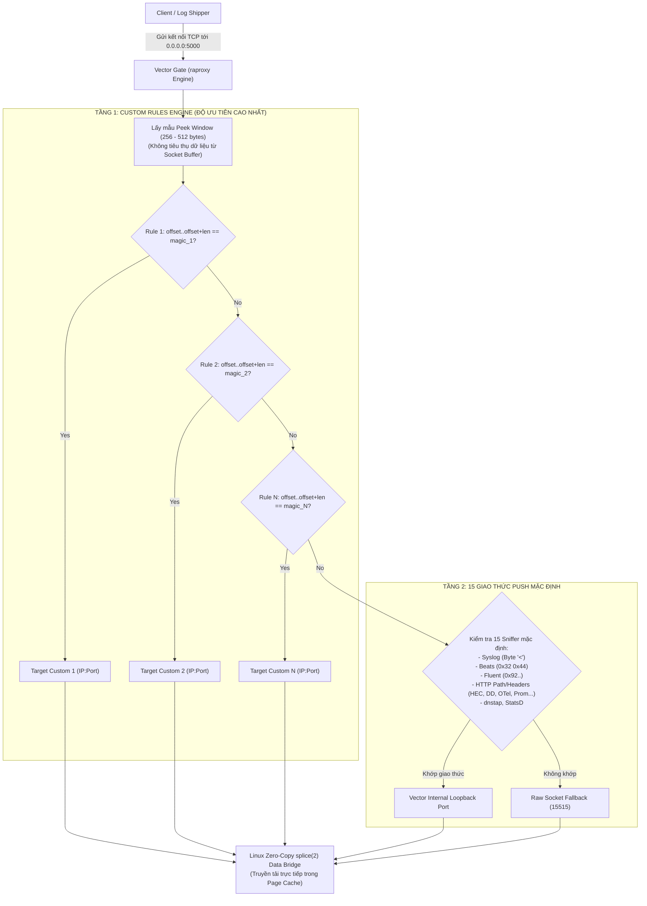

# ĐẶC TẢ PHÂN TÍCH NGHIỆP VỤ & THIẾT KẾ KỸ THUẬT (BA SPECIFICATION)
## DỰ ÁN: CƠ CHẾ PHÂN LOẠI TÙY BIẾN CHO VECTOR SMART GATE (CUSTOM CLASSIFICATION ENGINE)
### Tự Động Định Tuyến Đa Giao Thức Theo Chữ Ký Nhị Phân Base64 & Offset Tùy Chọn

---

| **Thuộc tính** | **Giá trị chi tiết** |
|---|---|
| **Tên dự án** | Vector Smart Gate - Custom Classification Engine (Base64 Magic Byte Matching) |
| **Mã dự án** | `VECTOR-GATE-CUSTOM-RULES` |
| **Phiên bản tài liệu** | `v1.1 - Production Specification` |
| **Ngày lập** | 24/10/2026 |
| **Mục tiêu cốt lõi** | Cung cấp cho người dùng khả năng tự định nghĩa các quy tắc phân loại luồng dữ liệu (Custom Classification Rules) thông qua chữ ký nhị phân dạng **Base64** và **Offset tùy chọn** trên cùng một cổng duy nhất `0.0.0.0:5000`, định tuyến ngay lập tức tới cổng dịch vụ mong muốn mà không cần biên dịch lại mã nguồn. |

---

## 1. TỔNG QUAN NGHIỆP VỤ & BỐI CẢNH (BUSINESS BACKGROUND)

### 1.1. Vấn Đề Thực Tế (Problem Statement)
* Hiện tại, `vector-gate` (`raproxy`) đã hỗ trợ nhận diện và phân giải tự động 15 nguồn PUSH tiêu chuẩn (Syslog, Beats, Fluent, Splunk HEC, Datadog Agent, AWS Firehose, Heroku, Prometheus, OpenTelemetry, Vector Native, StatsD, dnstap, HTTP Server, Socket Raw).
* Tuy nhiên, trong thực tế triển khai Enterprise và Telco/IoT/Banking:
  1. **Các giao thức độc quyền (Proprietary Protocols)**: Thiết bị IoT, thiết bị y tế, camera an ninh, thiết bị SCADA/PLC hoặc hệ thống Core Banking (ISO-8583, FIX engine) gửi các gói tin có header nhị phân đặc thù.
  2. **Nhu cầu phân nhánh dịch vụ động (Dynamic Multi-tenancy)**: Khách hàng muốn điều hướng các luồng log có chữ ký đặc biệt (ví dụ `0xDEADBEEF` hoặc `"MYLOG"`) vào các cụm xử lý riêng biệt (ví dụ port `17001`, `17002`), hoàn toàn tách rời khỏi các pipeline mặc định.
  3. **Yêu cầu không sửa mã nguồn**: Người vận hành không muốn và không có điều kiện sửa mã nguồn Rust hay build lại Docker image mỗi khi xuất hiện một định dạng log mới.

### 1.2. Giải Pháp: Custom Classification Rules via Base64 Magic Bytes
* Cho phép người dùng khai báo trực tiếp danh sách các quy tắc phân loại trong file cấu hình `vector.yaml`:
  - `name`: Tên quy tắc (phục vụ log & telemetry).
  - `magic_base64`: Chuỗi nhị phân cần nhận diện, được mã hóa dưới dạng Base64.
  - `offset`: Vị trí byte bắt đầu so khớp (mặc định = 0).
  - `target`: Địa chỉ IP:Port của dịch vụ nhận luồng dữ liệu.
* Khi có kết nối TCP đến, Gate kiểm tra ưu tiên các `custom_rules` trước:
  - Nếu khớp $\rightarrow$ Định tuyến thẳng sang `target`.
  - Nếu không khớp $\rightarrow$ Rơi xuống các sniffer mặc định hoặc fallback Raw Socket.

---

## 2. PHÂN TÍCH CHUYÊN SÂU: ĐỘ DÀI $n$ BYTE TỐI ƯU CỦA CHỮ KÝ

Khi người dùng nhập chữ ký nhị phân $n$ bytes đầu tiên, lựa chọn độ dài $n$ ảnh hưởng trực tiếp tới độ chính xác và nguy cơ va chạm (Collision / False Positive):

```
Độ an toàn:     1-2 Bytes (Rủi ro cao)  <  4 Bytes (Tiêu chuẩn vàng)  <  8-16 Bytes (Tuyệt đối an toàn)
Base64 length:        2 - 4 ký tự                    6 ký tự                      12 - 24 ký tự
```

### 2.1. Ma Trận Đánh Giá Độ Dài $n$ Bytes

| Độ dài $n$ | Độ dài Base64 | Xác suất va chạm ngẫu nhiên | Đánh giá kiến trúc | Ứng dụng thực tế |
| :---: | :---: | :---: | :--- | :--- |
| **1 Byte** | 2 ký tự | $1 / 256 \approx 0.39\%$ | ❌ **Rất nguy hiểm**: Dễ bị trùng với các ký tự ASCII phổ biến như `<`, `{`, `[`, `G`, `P`. | Không khuyến nghị |
| **2 Bytes** | 4 ký tự | $1 / 65,536 \approx 0.0015\%$ | ⚠️ **Cảnh báo**: Vẫn có thể trùng với header ngắn của Beats (`0x32 0x44`) hoặc TLS (`0x16 0x03`). | Chỉ dùng khi giao thức rất đặc thù |
| **4 Bytes** | **6 ký tự** | $1 / 4,294,967,296 \approx 2.3 \times 10^{-10}$ | ⭐ **TỐI ƯU NHẤT (SWEET SPOT)**: Tương đương 32-bit Magic Number của các file định dạng chuẩn thế giới. | Header ELF, PNG, Java Magic, IoT Magic |
| **8 Bytes** | **12 ký tự** | $1 / 1.84 \times 10^{19}$ | ⭐ **Tuyệt đối an toàn**: Xác suất trùng ngẫu nhiên bằng 0. | Chữ ký Telco, Banking, Packet Trace Pcap |
| **16 – 32 Bytes** | 24 – 44 ký tự | Thực tế $= 0$ | Thích hợp cho chuỗi ASCII dài, HTTP Custom Path/Headers, Token nhận dạng. | HTTP Preface, API Token prefix |

> **Quyết định thiết kế**: **Hỗ trợ độ dài động từ 2 bytes đến 64 bytes**. Khuyến nghị người dùng chọn $n \ge 4$ bytes để đảm bảo tính độc nhất.

---

## 3. THIẾT KẾ KIẾN TRÚC & CƠ CHẾ HOẠT ĐỘNG (SYSTEM ARCHITECTURE)

### 3.1. Sơ Đồ Quy Trình Định Tuyến Hai Tầng (Two-Tier Sniffing Pipeline)



### 3.2. Cấu Trúc Khai Báo Trong `vector.yaml`

```yaml
gate:
  enabled: true
  type: "any"
  address: "0.0.0.0:5000"
  
  # KHAI BÁO CÁC QUY TẮC CUSTOM TỰ ĐỊNH NGHĨA
  custom_rules:
    # Quy tắc 1: 4 bytes Magic Hex 0xDEADBEEF -> Base64: "3q2+7w=="
    - name: "custom_iot_sensor"
      magic_base64: "3q2+7w=="
      offset: 0
      target: "127.0.0.1:17001"

    # Quy tắc 2: Chuỗi ASCII "MYLOG" -> Base64: "TVlMT0c="
    - name: "custom_app_signature"
      magic_base64: "TVlMT0c="
      offset: 0
      target: "127.0.0.1:17002"

    # Quy tắc 3: Magic Byte nằm sau 4 byte Length Header (Offset = 4)
    - name: "custom_framed_protocol"
      magic_base64: "SVNPODU4Mw=="     # "ISO8583"
      offset: 4
      target: "127.0.0.1:17003"
```

---

## 4. CHỈ TIÊU KỸ THUẬT & HIỆU NĂNG (TECHNICAL KPIS)

| Thuộc tính | Chỉ tiêu cam kết | Cơ sở kỹ thuật |
|---|---|---|
| **Độ trễ kiểm tra rule (Check Latency)** | **$\le 5 \text{ nanoseconds}$ / rule** | So sánh slice trong bộ nhớ RAM qua lệnh CPU SIMD `memcmp`. |
| **Tác động đến thông lượng tổng** | **$< 0.5\%$ suy giảm** | Chỉ thực hiện 1 lần duy nhất trong pha `peek` của kết nối TCP. Sau đó `splice(2)` chạy thẳng. |
| **Độ dài Magic Byte hỗ trợ** | **$2 \le n \le 64$ bytes** | Đảm bảo tính linh hoạt tối đa cho mọi loại payload. |
| **Hỗ trợ Offset** | **$0 \le \text{offset} \le 256$ bytes** | Bỏ qua các header độ dài/version động. |
| **Bảo toàn dữ liệu** | **$100\%$ không mất mát** | Dữ liệu `peek` không bị xóa khỏi buffer, truyền nguyên vẹn sang target. |

---

## 5. KỊCH BẢN KIỂM THỬ NGHIỆM THU (QA/QC ACCEPTANCE CRITERIA)

1. **Test Case CR-01 (4-byte Binary Magic)**: Gửi gói tin bắt đầu bằng `0xDE 0xAD 0xBE 0xEF`, Gate phải định tuyến tới đúng cổng dịch vụ 1.
2. **Test Case CR-02 (ASCII String Magic)**: Gửi gói tin bắt đầu bằng `MYLOG`, Gate phải định tuyến tới đúng cổng dịch vụ 2.
3. **Test Case CR-03 (Offset-based Magic)**: Gửi gói tin có 4 byte padding ngẫu nhiên + `ISO8583`, Gate phải định tuyến tới đúng cổng dịch vụ 3.
4. **Test Case CR-04 (Fallback Integrity)**: Gửi log Syslog, Beats, HTTP thông thường, Gate vẫn phải nhận diện chính xác 15 protocol mặc định như cũ, không bị ảnh hưởng.
5. **Test Case CR-05 (Stress & Memory Footprint)**: Bơm 20,000 logs chứa custom magic, kiểm tra Zero-Copy Splice vẫn đạt $\ge 4,000,000 \text{ EPS}$ và RAM container $\le 25 \text{ MB}$.

