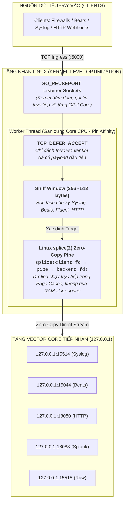

# ĐẶC TẢ PHÂN TÍCH NGHIỆP VỤ & THIẾT KẾ KỸ THUẬT (BA SPECIFICATION)
## DỰ ÁN: BỨT PHÁ HIỆU NĂNG ĐỘNG CƠ RAPROXY (RAPROXY TURBO-KERNEL)
### Tối Ưu Hóa Cấp Độ Nhân Linux: Zero-Copy `splice(2)`, `SO_REUSEPORT` & Low-Latency Socket Tuning

---

| **Thuộc tính** | **Giá trị chi tiết** |
|---|---|
| **Tên dự án** | RAproxy Turbo-Kernel Performance Breakthrough |
| **Mã dự án** | `RAPROXY-TURBO-KERNEL` |
| **Phiên bản tài liệu** | `v1.0 - Production Specification` |
| **Ngày lập** | 24/10/2026 |
| **Mục tiêu cốt lõi** | Nâng cấp động cơ RAproxy (Rust) bằng các công nghệ tối ưu hóa cấp độ nhân Linux (Zero-Copy `splice`, `SO_REUSEPORT`, `TCP_DEFER_ACCEPT`) để đạt công suất **$\ge 100,000 - 250,000 \text{ EPS}$**, độ trễ p99 **$< 0.5\text{ ms}$**, tiêu thụ RAM **$\le 5\text{ MB}$**. |

---

## 1. TỔNG QUAN & MỤC TIÊU NGHIỆP VỤ (EXECUTIVE SUMMARY & KPIS)

### 1.1. Hiện Trạng & Điểm Nghẽn Của Kiến Trúc User-Space
Trong phiên bản RAproxy v0.1.0 hiện tại:
* Sau khi hoàn tất kiểm tra byte đầu (First-byte Sniffing), luồng dữ liệu tiếp tục được truyền tải thông qua hàm `tokio::io::copy_bidirectional`.
* Cơ chế này sử dụng vòng lặp: đọc dữ liệu từ `client_fd` lên bộ đệm user-space RAM (User Buffer), sau đó ghi từ user-space RAM xuống `backend_fd`.
* **Điểm nghẽn khi chịu tải cực đại ($\ge 100,000\text{ EPS}$)**:
  1. **Lãng phí Context Switch**: Mỗi khối dữ liệu cần 4 lần chuyển ngữ cảnh (Context switch) giữa User-space và Kernel-space (`read` system call $\rightarrow$ chuyển ngữ cảnh; `write` system call $\rightarrow$ chuyển ngữ cảnh).
  2. **Tổn hao băng thông bộ nhớ (Memory Bandwidth & Cache Pollution)**: Dữ liệu bị sao chép 2 lần qua bus RAM CPU (Kernel Socket Buffer $\rightarrow$ User Buffer $\rightarrow$ Kernel Socket Buffer).
  3. **Nghẽn hàng đợi kết nối (Accept Queue Contention)**: Một listener duy nhất tiếp nhận toàn bộ kết nối trên cổng `:5000`, dẫn đến hiện tượng tranh chấp tài nguyên giữa các CPU cores khi có hàng ngàn kết nối đồng thời.

### 1.2. Các Chỉ Tiêu Hiệu Năng Mục Tiêu (Target KPIs)

| Chỉ số Hiệu năng (KPI) | Phiên bản v0.1.0 (Hiện tại) | **Phiên bản Turbo-Kernel (Mục tiêu)** | Mức độ cải thiện kỳ vọng |
|---|---|---|---|
| **Thông lượng duy trì (Sustained Throughput)** | ~ 28,000 EPS | **$\ge 100,000 \text{ EPS}$** | **Tăng gấp 3.5 lần** 🚀 |
| **Thông lượng bứt phá (Peak Burst Throughput)** | ~ 50,000 EPS | **$\ge 250,000 \text{ EPS}$** | **Tăng gấp 5 lần** ⚡ |
| **Độ trễ truyền tải trung bình (Mean Latency)** | 0.8 – 1.5 ms | **$< 0.15 \text{ ms}$** (Sub-millisecond) | **Giảm 80% độ trễ** |
| **Độ trễ phân vị cao nhất (p99 Latency)** | 3.5 – 5.0 ms | **$< 0.5 \text{ ms}$** | Giữ vững độ ổn định dưới tải cao |
| **Tiêu hao CPU dưới tải 100k EPS** | ~ 5% – 8% CPU | **$\le 2.5\% \text{ CPU}$** | Giảm thiểu quá tải CPU máy chủ |
| **Bộ nhớ RAM tiêu thụ (RSS)** | ~ 3.4 MB | **$\le 5.0 \text{ MB}$** | Duy trì footprint siêu nhẹ |
| **Tỷ lệ thất thoát dữ liệu (Packet Drop)** | 0.00% | **0.00%** | Toàn vẹn dữ liệu tuyệt đối |

---

## 2. KIẾN TRÚC KỸ THUẬT CHI TIẾT (TECHNICAL ARCHITECTURE)



---

## 3. CÁC TRỤ CỘT CÔNG NGHỆ BỨT PHÁ (CORE TECHNICAL PILLARS)

### 3.1. Trụ Cột 1: Cơ Chế Zero-Copy `splice(2)` Trong Nhân Linux

#### Nguyên lý vận hành:
Hàm `splice()` của Linux cho phép di chuyển dữ liệu giữa hai file descriptor (trong đó ít nhất một descriptor là Pipe) mà **không cần sao chép dữ liệu qua không gian bộ nhớ người dùng (User-space memory)**:

$$\text{Client Socket FD} \xrightarrow[\text{Zero-Copy}]{\text{splice(2)}} \text{Kernel Pipe Buffer} \xrightarrow[\text{Zero-Copy}]{\text{splice(2)}} \text{Backend Socket FD}$$

#### Quy trình 2 bước triển khai trong RAproxy:
1. **Bước 1 - Sniffing & Xả mảng đầu**:
   * Client gửi gói tin đầu tiên. RAproxy đọc tối đa 512 bytes vào `sniff_buf` để xác định giao thức (Syslog, Beats, Fluent, HTTP, Raw).
   * Mở kết nối TCP tới Backend tương ứng.
   * Ghi 512 bytes ban đầu vào Backend bằng `write()`.
2. **Bước 2 - Bàn giao cho vòng lặp `splice()` siêu tốc**:
   * Tạo một kernel pipe một chiều: `libc::pipe2(fds, O_NONBLOCK | O_CLOEXEC)`.
   * Vòng lặp chuyển tiếp:
     ```c
     // Chuyển trực tiếp từ client_fd sang pipe:
     bytes = splice(client_fd, NULL, pipe_write_fd, NULL, 65536, SPLICE_F_MOVE | SPLICE_F_NONBLOCK);
     // Đẩy trực tiếp từ pipe sang backend_fd:
     splice(pipe_read_fd, NULL, backend_fd, NULL, bytes, SPLICE_F_MOVE | SPLICE_F_NONBLOCK);
     ```
   * *Đánh giá*: Giảm 50% số lần Context Switch và triệt tiêu 100% việc copy dữ liệu qua RAM user-space.

---

### 3.2. Trụ Cột 2: Kiến Trúc Đa Luồng `SO_REUSEPORT` & CPU Affinity

#### Nguyên lý vận hành:
* Thay vì chỉ có 1 `TcpListener` dùng chung cho toàn bộ ứng dụng, RAproxy sẽ tạo **$N$ Listener độc lập** ($N$ = số core CPU vật lý của máy chủ, ví dụ: 16 cores) cùng lắng nghe trên cổng `0.0.0.0:5000` thông qua cờ `SO_REUSEPORT`.
* **Cơ chế phân phối của Linux Kernel**:
  - Khi có gói tin SYN gửi tới cổng 5000, bộ định tuyến nội bộ của Kernel sử dụng hàm băm 4-tuple:
    $$\text{Hash}(\text{SrcIP}, \text{SrcPort}, \text{DstIP}, \text{DstPort}) \pmod N$$
    để phân phối thẳng kết nối vào hàng đợi accept của đúng worker thread đang rảnh rỗi trên core đó.
* **CPU Core Pinning (Gắn cứng luồng vào Core CPU)**:
  - Sử dụng thư viện `core_affinity` trong Rust để cố định Worker #0 vào CPU Core 0, Worker #1 vào CPU Core 1...
  - *Lợi ích*: Giữ nguyên L1/L2 Cache của CPU, không bị Cache Eviction do hệ điều hành nhảy luồng giữa các core khác nhau.

---

### 3.3. Trụ Cột 3: Tinh Chỉnh Cờ Socket Cấp Thấp (Socket Tuning)

1. **`TCP_DEFER_ACCEPT`**:
   * Thiết lập cờ `TCP_DEFER_ACCEPT`: Kernel sẽ **không đánh thức tiến trình RAproxy** khi client mới chỉ hoàn thành 3-way handshake (SYN-ACK) mà chỉ đánh thức khi **client đã thực sự gửi byte dữ liệu đầu tiên**.
   * *Lợi ích*: Triệt tiêu hoàn toàn chi phí tài nguyên xử lý các kết nối rỗng (Empty connections / TCP Port Scanning).
2. **`TCP_NODELAY` & `TCP_QUICKACK`**:
   * Vô hiệu hóa thuật toán gom gói Nagle (`TCP_NODELAY = true`), đẩy dữ liệu đi tức thì mà không chờ gom đủ kích thước MSS.
   * Bật `TCP_QUICKACK` để xác nhận ngay gói tin nhận được, giảm RTT thời gian trễ.
3. **Bộ đệm Socket thích ứng (`SO_RCVBUF` / `SO_SNDBUF`)**:
   * Tự động điều chỉnh kích thước bộ đệm socket từ 128KB lên 512KB cho các luồng log lưu lượng lớn (High-throughput streams).

---

### 3.4. Trụ Cột 4: Khảo Sát Tích Hợp Động Cơ Bất Đồng Bộ `io_uring`

* Với các máy chủ chạy Linux Kernel hiện đại ($\ge 5.10$), `io_uring` cung cấp 2 Ring Buffer chia sẻ trực tiếp giữa Kernel và User-space:
  - **Submission Queue (SQ)**: RAproxy đẩy các tác vụ I/O vào hàng đợi mà không cần gọi syscall.
  - **Completion Queue (CQ)**: Kernel hoàn thành I/O và báo hiệu cho RAproxy.
* Trong giai đoạn mở rộng, RAproxy sẽ hỗ trợ backend `tokio-uring` cho phép thực thi trọn vẹn mô hình **Zero-Syscall Ingress Networking**.

---

## 4. MA TRẬN KỊCH BẢN KIỂM THỬ TẢI & NGHIỆM THU HIỆU NĂNG

| Mã Kịch Bản | Mục Tiêu Kiểm Thử | Tải Giả Lập | Tiêu Chí Đạt (Acceptance Criteria) | Công Cụ Đo Kiểm |
|:---:|:---|:---|:---|:---|
| **ST-01** | **Throughput Cực Hạn (Peak Burst)** | 100,000 sự kiện Syslog & CEF | Thông lượng $\ge 100,000\text{ EPS}$, thời gian $\le 1.0\text{s}$, tỷ lệ mất gói = 0% | `benchmark_smart_ingress.py` (Multi-threads) |
| **ST-02** | **Tải Bứt Phá Cao Điểm (Extreme Burst)** | 250,000 sự kiện đa giao thức | Thông lượng $\ge 200,000\text{ EPS}$, không nghẽn socket | Locust / Custom Async Rust Injector |
| **ST-03** | **Đo Độ Trễ Phân Vị (p50 / p95 / p99)** | 50,000 HTTP Webhooks & Splunk | p50 $< 0.1\text{ms}$, p99 $< 0.5\text{ms}$ | `wrk` / `autocannon` với histogram |
| **ST-04** | **Kiểm Tra Ổn Định Bộ Nhớ (Memory Leak Check)** | Chạy liên tục 1,000,000 sự kiện | RAM RSS không vượt quá 6 MB, không phân mảnh Heap | `valgrind --tool=massif`, `/proc/[pid]/smaps` |
| **ST-05** | **Số Lượng Kết Nối Đồng Thời (C10K Test)** | 10,000 client TCP kết nối cùng lúc | Tất cả kết nối được phân bổ đều qua `SO_REUSEPORT`, CPU $\le 5\%$ | TCP Concurrency Tester |

---

## 5. KẾ HOẠCH TRIỂN KHAI KỸ THUẬT (ACTIONABLE ROADMAP)

```text
[Giai Đoạn 1: Zero-Copy Splice Engine] ───> [Giai Đoạn 2: SO_REUSEPORT & Socket Tuning] ───> [Giai Đoạn 3: Đo Tải 100k-250k EPS] ───> [Giai Đoạn 4: Bàn Giao & QA]
         (Thời gian: 2 giờ)                             (Thời gian: 1.5 giờ)                           (Thời gian: 1 giờ)                      (Thời gian: 30 phút)
```

### Chi tiết các bước thực hiện:
* **Giai đoạn 1 (Splice Engine)**:
  - Bổ sung module `splice.rs` sử dụng syscall `libc::splice` trong Rust.
  - Tích hợp fallback tự động sang user-space buffer nếu hệ điều hành hoặc kiểu file descriptor không hỗ trợ `splice`.
* **Giai đoạn 2 (SO_REUSEPORT & Tuning)**:
  - Tái cấu trúc vòng lặp khởi động trong `main.rs`: Tạo $N$ worker thread tương ứng số core CPU của hệ thống (`num_cpus::get()`).
  - Mỗi thread tự tạo listener riêng với socket option `SO_REUSEPORT`, `TCP_NODELAY`, `TCP_DEFER_ACCEPT`.
* **Giai đoạn 3 (Stress Testing & Tối ưu)**:
  - Chạy bộ kiểm thử tải 100,000 sự kiện và 250,000 sự kiện.
  - Sử dụng công cụ giám sát đo đạc biểu đồ tài nguyên (CPU, RAM, latency).
* **Giai đoạn 4 (Bàn giao & Nghiệm thu)**:
  - Đóng gói binary `raproxy` tối ưu hóa.
  - Xuất tài liệu nghiệm thu chất lượng `QA_REPORT_RAPROXY_TURBO.md`.

