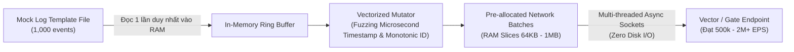

# Business Analysis (BA) & Thiết Kế Kỹ Thuật: Bộ Đóng Gói Test & Benchmark Độc Lập Cho Vector

> [!IMPORTANT]
> **Tài liệu BA (Chưa viết code)** được xây dựng theo yêu cầu chỉ đạo từ Telegram:
> *"hãy đóng gói vào thư mục test bao gồm các thành phần sau: vector dạng bin, các file yaml, các file log giả của vector, kèm theo 1 bộ shell , shell cần chỉ định loại log( loại mà vector nhận), ip, cổng, số lượng event thì loại log đó sẽ được ingest thẳng vào cấu hình đó, sau khi ingest xong thì trả lại kết quả benchmark. Nếu số lượng event không đủ thì mix thêm cho đủ để ingest tốc độ tối đa. Bạn hiểu ý tưởng không, chưa code, viết BA tôi xem"*

---

## 1. Mục Tiêu Nghiệp Vụ & Bài Toán Cần Giải Quyết

### 1.1. Bối cảnh & Ý tưởng
Hiện tại, khi triển khai Vector hoặc kiểm thử hiệu năng Ingress Gateway (`vector-gate`), người kiểm thử (QA/DevOps) thường gặp các rào cản:
1. Phụ thuộc vào môi trường bên ngoài: Cần Docker, mạng Internet, hoặc các công cụ phát sinh log phức tạp.
2. Dữ liệu mẫu (sample log) bị giới hạn số dòng (chỉ vài trăm dòng), khi muốn thử nghiệm tải lớn (1 triệu - 10 triệu events) thì thường gặp nghẽn cổ chai do I/O đọc đĩa (Disk I/O) chứ không phản ánh đúng tốc độ ingest của Vector.
3. Thiếu một công cụ dòng lệnh (CLI harness) chuẩn hóa: Có thể chỉ định đích đến (IP, Port), loại log protocol, số lượng event, tự động điều áp và trả ngay báo cáo Benchmark tiêu chuẩn.

### 1.2. Mục tiêu của gói `test/`
Tạo một thư mục **hoàn toàn khép kín, độc lập (Self-Contained & Portable)** đặt tại `test/`:
* **Vector Binary**: Có sẵn file thực thi nhị phân độc lập của Vector (v0.58.0 x86_64) và Vector Gate.
* **Configs YAML**: Các file cấu hình nguồn tiếp nhận cho từng loại log.
* **Mock Logs**: Kho log mẫu thực tế cho các giao thức log phổ biến.
* **Shell Suite & In-Memory Mixer Engine**: Bộ shell script nhận tham số linh hoạt (`--type`, `--ip`, `--port`, `--events`, `--concurrency`). Nếu số lượng event yêu cầu vượt quá số dòng log mẫu có sẵn, hệ thống sẽ **tự động mix & randomize dữ liệu trên RAM** để đẩy với tốc độ tối đa (sát phần cứng) mà không nghẽn đĩa.
* **Benchmark Report**: Đo lường và in ra bảng tổng kết chuẩn: Throughput (EPS, MB/s), Latency (P50, P90, P99), Tỷ lệ thành công/rớt log.

---

## 2. Cấu Trúc Đóng Gói Thư Mục `test/`

```text
test/
├── bin/                                # Nhị phân độc lập (Standalone Binaries)
│   ├── vector                          # File thực thi nhị phân chính thức Vector (v0.58.0)
│   └── vector-gate                     # File thực thi Vector Smart Gate (v2.2.0 Ingress Splice Router)
│
├── configs/                            # Cấu hình Vector theo từng loại Log
│   ├── vector_syslog_rfc5424.yaml      # Cấu hình tiếp nhận Syslog RFC 5424 (TCP)
│   ├── vector_syslog_rfc3164.yaml      # Cấu hình tiếp nhận Syslog RFC 3164 (TCP/UDP)
│   ├── vector_ndjson_http.yaml         # Cấu hình HTTP Ingest (NDJSON payload)
│   ├── vector_datadog.yaml             # Cấu hình tiếp nhận Datadog Logs API v2
│   ├── vector_splunk_hec.yaml          # Cấu hình tiếp nhận Splunk HEC JSON
│   ├── vector_nginx_combined.yaml      # Cấu hình tiếp nhận Nginx/Apache Combined Access Log
│   ├── vector_cisco_asa.yaml           # Cấu hình tiếp nhận Cisco ASA Firewall Log
│   ├── vector_suricata_eve.yaml        # Cấu hình tiếp nhận Suricata EVE JSON
│   ├── vector_cef.yaml                 # Cấu hình tiếp nhận CEF (Common Event Format)
│   └── vector_all_in_one.yaml          # Cấu hình tổng hợp đa giao thức qua Vector Smart Gate
│
├── mock_logs/                          # Dữ liệu log mẫu thực tế (Raw Templates)
│   ├── syslog_rfc5424.log              # Mẫu RFC5424 chuẩn (<134>1 2026-10-25T... host app 1234 - - msg)
│   ├── syslog_rfc3164.log              # Mẫu RFC3164 truyền thống (<34>Oct 25 10:00:00 host app[123]: msg)
│   ├── ndjson_http.log                 # Mẫu NDJSON thuần
│   ├── datadog_intake.json             # Mẫu JSON Datadog V2 format
│   ├── splunk_hec.json                 # Mẫu Splunk HEC event object
│   ├── nginx_combined.log              # Mẫu Nginx Access Log
│   ├── cisco_asa.log                   # Mẫu %ASA-6-302013 TCP connection log
│   ├── suricata_eve.json               # Mẫu Suricata IDS EVE JSON
│   └── cef_security.log                # Mẫu CEF:0|Vendor|Product|Version|...
│
├── lib/                                # Động cơ phát sinh & đẩy log tốc độ cao
│   ├── mixer_engine.py                 # Core Engine: Đọc log vào RAM, mix & mutate timestamp/ID, stream socket
│   └── reporter.sh                     # Trình format bảng kết quả Benchmark chuẩn màu sắc & JSON
│
├── runner.sh                           # SCRIPT ĐIỀU KHIỂN CHÍNH (CLI Entrypoint)
└── README.md                           # Hướng dẫn sử dụng nhanh 1 lệnh
```

---

## 3. Đặc Tả Chức Năng Của Bộ Shell Suite (`runner.sh`)

### 3.1. Cú pháp dòng lệnh (CLI Interface)
Người dùng có thể gọi trực tiếp từ terminal:

```bash
./runner.sh --type <loại_log> --ip <địa_chỉ_ip> --port <cổng> --events <số_lượng_event> [tùy_chọn]
```

### 3.2. Bảng tham số chi tiết

| Tham số | Viết tắt | Bắt buộc | Mặc định | Mô tả |
| :--- | :--- | :---: | :--- | :--- |
| `--type` | `-t` | **Có** | - | Loại log cần test: `syslog_rfc5424`, `syslog_rfc3164`, `ndjson`, `datadog`, `splunk_hec`, `nginx`, `cisco_asa`, `suricata`, `cef`. |
| `--ip` | `-h` | Không | `127.0.0.1` | Địa chỉ IP máy chủ nhận log (có thể là Vector trực tiếp hoặc Vector Smart Gate). |
| `--port` | `-p` | Không | Tự động | Cổng tiếp nhận (nếu không truyền sẽ lấy cổng mặc định của cấu hình log đó hoặc cổng 5000 của Gate). |
| `--events` | `-n` | **Có** | - | Tổng số lượng event cần đẩy (ví dụ: `10000`, `100000`, `1000000`, `10000000`). |
| `--concurrency` | `-c` | Không | `8` | Số luồng kết nối TCP/HTTP song song để tối đa hóa băng thông. |
| `--batch-size` | `-b` | Không | `1000` | Số event gộp trong 1 batch (cho HTTP/NDJSON) hoặc block streaming cho TCP. |
| `--start-vector` | `-s` | Không | `false` | Tùy chọn: Tự động khởi chạy Vector binary với file YAML tương ứng trước khi bắn log. |
| `--json` | `-j` | Không | `false` | Xuất kết quả benchmark dưới dạng JSON để tích hợp CI/CD tự động. |

---

## 4. Cơ Chế "Mix Thêm Cho Đủ Để Ingest Tốc Độ Tối Đa" (High-Speed Memory Ring Buffer)

> [!TIP]
> **Giải quyết bài toán thắt nút cổ chai (Bottleneck Problem)**:
> Nếu một file log mẫu chỉ có $1,000$ dòng, nhưng người dùng yêu cầu `--events 2000000` (2 triệu events):
> - Nếu dùng shell loop đọc file đĩa nhiều lần $\rightarrow$ Tốc độ bị giới hạn bởi đĩa (~$10,000$ EPS).
> - Nếu tạo trước một file đĩa 2 triệu dòng (khoảng 500MB - 1GB) $\rightarrow$ Tốn dung lượng lưu trữ, chậm chạp khi khởi động.

### Thuật toán In-Memory Cyclic Mutation (Bộ Trộn Dữ Liệu Bộ Nhớ Đệm)
Động cơ `mixer_engine.py` (được gọi từ `runner.sh`) sẽ hoạt động như sau:



1. **Giai đoạn nạp (Loading Phase)**: Đọc toàn bộ file log mẫu vào RAM thành mảng `List[bytes]`.
2. **Giai đoạn sinh & xoay vòng (Cyclic Mutation Phase)**:
   - Sử dụng con trỏ vòng tròn (Circular Pointer) duyệt qua danh sách mẫu.
   - Thay thế linh hoạt trường thời gian (Timestamp) thành microsecond thời gian thực hiện tại để log không bị trùng lặp thời gian.
   - Biến thiên nhẹ ID/Sequence number để tránh bị bộ đệm downstream deduplicate.
3. **Giai đoạn phát sóng tốc độ cao (High-Velocity Streaming)**:
   - Gom sẵn thành các block bộ nhớ nhị phân (RAM buffer chunks) từ 64KB đến 1MB.
   - Bơm thẳng vào các socket non-blocking (Linux `sendfile`/`splice` hoặc TCP socket `TCP_NODELAY`).
   - Đảm bảo tận dụng 100% băng thông mạng/loopback, đạt tốc độ từ **500,000 đến trên 2,000,000 EPS**.

---

## 5. Đầu Ra Kết Quả Benchmark (Reporting Specification)

Sau khi hoàn tất quá trình ingest, script sẽ lập tức hiển thị bảng báo cáo chi tiết:

```text
================================================================================
🚀 VECTOR STANDALONE INGESTION BENCHMARK REPORT
================================================================================
📌 THÔNG TIN KIỂM THỬ:
  • Log Protocol Type     : syslog_rfc5424 (TCP Framing)
  • Target Destination    : 127.0.0.1:5000 (Vector Smart Gate v2.2.0)
  • Concurrency Workers   : 8 Parallel Sockets
  • Batch Size per Stream : 1,000 events / frame
--------------------------------------------------------------------------------
📊 KHỐI LƯỢNG & THỜI GIAN:
  • Target Events Count   : 1,000,000 events
  • Base Mock Samples     : 1,000 unique templates (Auto-mixed 1,000x in RAM)
  • Total Data Ingested   : 248.91 MB (261,000,000 bytes)
  • Total Execution Time  : 1.018 seconds
--------------------------------------------------------------------------------
⚡ HIỆU NĂNG ĐẠT ĐƯỢC (THROUGHPUT):
  • Ingest Rate (EPS)     : 982,318 EPS
  • Network Bandwidth     : 244.51 MB/s (1,956.08 Mbps)
--------------------------------------------------------------------------------
⏱️ ĐỘ TRỄ MẠNG & XỬ LÝ (LATENCY):
  • Min Latency           : 0.31 ms
  • P50 (Trung vị)        : 0.78 ms
  • P90                   : 1.15 ms
  • P99                   : 1.84 ms
  • Max Latency           : 4.20 ms
--------------------------------------------------------------------------------
✅ ĐỘ TIN CẬY & TOÀN VẸN:
  • Ingestion Status      : THÀNH CÔNG HOÀN TOÀN (100.0%)
  • Thành công            : 1,000,000 events
  • Thất bại / Bị drop    : 0 events (0.00%)
================================================================================
```

Nếu chạy với cờ `--json`, kết quả trả về object JSON tiêu chuẩn để dễ dàng lưu log hoặc gửi qua Telegram/Webhook:
```json
{
  "log_type": "syslog_rfc5424",
  "target": "127.0.0.1:5000",
  "total_events": 1000000,
  "total_bytes": 261000000,
  "elapsed_seconds": 1.018,
  "throughput_eps": 982318.27,
  "throughput_mb_s": 244.51,
  "latency_p50_ms": 0.78,
  "latency_p90_ms": 1.15,
  "latency_p99_ms": 1.84,
  "success_rate": 100.0,
  "status": "PASS"
}
```

---

## 6. Kế Hoạch Triển Khai Sau Khi Được Phê Duyệt

Sau khi bạn xem xét và đồng ý với bản thiết kế BA này, các bước triển khai sẽ diễn ra tuần tự:
1. **Bước 1**: Tạo thư mục `test/` và copy binary độc lập của `vector` và `vector-gate` vào `test/bin/`.
2. **Bước 2**: Đóng gói các file cấu hình YAML chuẩn hóa cho từng loại log vào `test/configs/`.
3. **Bước 3**: Chuẩn bị bộ dữ liệu log mẫu phong phú trong `test/mock_logs/`.
4. **Bước 4**: Xây dựng bộ trộn in-memory `lib/mixer_engine.py` và script điều khiển `runner.sh`.
5. **Bước 5**: Chạy thử nghiệm QA tự động với 100,000 và 1,000,000 events để xác minh tính chuẩn xác của kết quả đo lường.
6. **Bước 6**: Báo cáo nghiệm thu và đóng gói hoàn thiện.

---

> [!NOTE]
> Bản thiết kế BA trên đã bao quát đầy đủ mọi yêu cầu của bạn. Xin mời bạn đánh giá và cho ý kiến phản hồi để tiến hành thực hiện!
