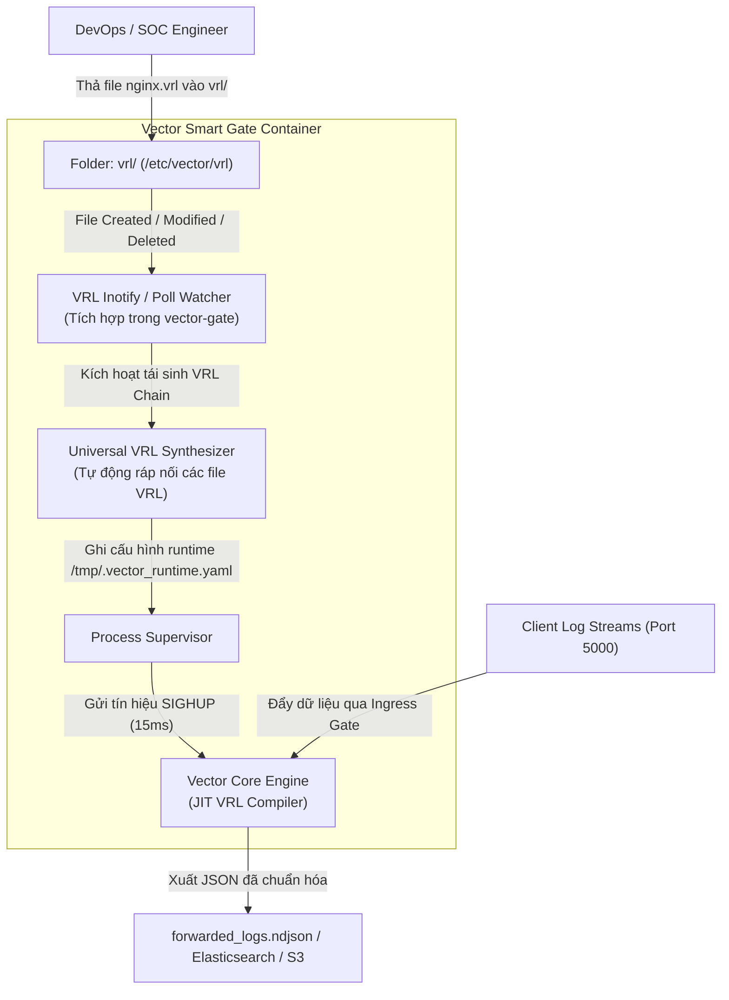

# Business Analysis (BA) & Thiết Kế Kỹ Thuật: Universal VRL Parsing Engine

> [!IMPORTANT]
> **Tài liệu đặc tả nghiệp vụ & thiết kế giải pháp**:
> Phát triển tính năng **Universal VRL Parsing Engine** cho Vector Smart Gate.
> Người dùng chỉ cần thả các script VRL vào thư mục `vrl/` (hoặc mount từ bên ngoài), hệ thống sẽ tự động phát hiện, tải nóng (hot-reload) trong mili-giây và tự động bóc tách (parse) dữ liệu thành các trường JSON có cấu trúc mà không cần sửa đổi `vector.yaml`.

---

## 1. Mục Tiêu Nghiệp Vụ (Business Requirements)

### 1.1. Vấn đề thực tế
* Trong thực tế vận hành SOC/NOC, các kỹ sư thường xuyên phải tiếp nhận các định dạng log mới (Nginx, Cisco ASA, Kubernetes, Suricata, Custom App...).
* Để parse được log trên Vector thông thường, kỹ sư phải:
  1. Mở file cấu hình phức tạp `vector.yaml`.
  2. Viết cú pháp `transforms.<name>.type = "remap"` lồng ghép trong YAML.
  3. Đấu nối `inputs` và `sinks` thủ công.
  4. Khởi động lại toàn bộ dịch vụ, dễ dẫn đến lỗi thụt lề YAML hoặc ngắt quãng luồng log.

### 1.2. Trải nghiệm người dùng mong muốn (Desired UX)
* **Zero YAML Editing**: Người dùng **hoàn toàn không cần sửa file `vector.yaml`**.
* **Hot-Drop Directory (`vrl/`)**:
  - Giai đoạn 1: Khi thư mục `vrl/` chưa có file nào $\rightarrow$ Hệ thống vẫn nhận log bình thường, xuất ra log thô với trường `"parsed": false`.
  - Giai đoạn 2: Người dùng thả file `nginx.vrl` vào thư mục `vrl/` $\rightarrow$ Hệ thống tự động phát hiện trong vòng $\sim 15\text{ms}$, nạp parser và tự động bóc tách các log Nginx thành `"parsed": true`, `"client_ip": "1.2.3.4"`, `"status": 200`, `"method": "GET"`.
  - Giai đoạn 3: Người dùng thả tiếp `cisco_asa.vrl` $\rightarrow$ Log Cisco ASA lập tức được parse tự động mà không làm rớt các kết nối mạng đang mở.

---

## 2. Kiến Trúc Kỹ Thuật (Architecture & Components)



### 2.1. Cấu hình khai báo trong `vector.yaml`
Người dùng kích hoạt tính năng qua Phase 0 `gates`:

```yaml
gates:
  enabled: true
  type: "any"
  address: "0.0.0.0:5000"
  
  options:
    vrl_dir: "/etc/vector/vrl"        # Đường dẫn thư mục chứa VRL parsers
    vrl_watch: true                   # Tự động theo dõi và nạp nóng khi thả file
```

### 2.2. Cơ chế Universal VRL Chaining & Safe Fallback
Khi `vector-gate` khởi tạo hoặc phát hiện thay đổi trong `vrl_dir`:
1. Quét toàn bộ các file `*.vrl` trong thư mục `vrl_dir`.
2. Tạo khối Remap Transform tổng hợp `universal_parser`:
   - **Header khởi tạo**:
     ```vrl
     .parsed = false
     .parser_applied = "none"
     ```
   - **Thân mã**: Nối tuần tự nội dung của từng file VRL (`nginx.vrl`, `cisco_asa.vrl`, `syslog.vrl`...):
     ```vrl
     # === PARSER PLUGIN: nginx.vrl ===
     if !.parsed {
         # Logic bóc tách từ nginx.vrl
     }

     # === PARSER PLUGIN: cisco_asa.vrl ===
     if !.parsed {
         # Logic bóc tách từ cisco_asa.vrl
     }
     ```
   - **Footer kết thúc**:
     ```vrl
     if .parsed {
         .parser_status = "SUCCESS"
     } else {
         .parser_status = "UNPARSED_RAW"
     }
     ```
3. Nếu thư mục `vrl_dir` **hoàn toàn trống** (chưa thả file nào):
   Khối VRL chỉ đơn giản đánh dấu `.parsed = false`, `.parser_status = "UNPARSED_RAW"`, giữ nguyên raw message để bảo toàn 100% dữ liệu.

---

## 3. Bản Hợp Đồng Script VRL Mẫu (VRL Plugin Contract)

Mỗi file `.vrl` được thiết kế độc lập, chỉ tập trung vào nghiệp vụ bóc tách log của riêng nó:

### Ví dụ 1: `vrl/nginx.vrl`
```vrl
if is_string(.message) && match(string!(.message), r'^[0-9.]+ - [^ ]+ \[') {
    parsed, err = parse_common_log(.message)
    if err == null {
        . = merge(., parsed)
        .parsed = true
        .parser_applied = "nginx_combined"
    }
}
```

### Ví dụ 2: `vrl/cisco_asa.vrl`
```vrl
if is_string(.message) && contains(string!(.message), "%ASA-") {
    parsed, err = parse_regex(.message, r'%ASA-(?P<severity>\d)-(?P<message_id>\d+):\s+(?P<action>\w+)\s+(?P<direction>\w+)\s+TCP connection\s+(?P<conn_id>\d+)\s+for\s+(?P<src_interface>[\w/]+):(?P<src_ip>[0-9.]+)/(?P<src_port>\d+)')
    if err == null {
        . = merge(., parsed)
        .parsed = true
        .parser_applied = "cisco_asa"
    }
}
```

---

## 4. Kịch Bản Kiểm Thử & Tiêu Chí Nghiệm Thu QA (Test Plan)

| Bước | Hành Động | Trạng Thái Thư Mục `vrl/` | Log Bắn Vào Port 5000 | Kỳ Vọng File Output | Kết Quả |
| :---: | :--- | :--- | :--- | :--- | :---: |
| **QA-1** | Baseline Run | **Trống (Không có VRL)** | Nginx Combined Access Log | `.parsed == false`, `.parser_status == "UNPARSED_RAW"`, không có trường `client_ip`. | Chờ test |
| **QA-2** | Hot-Drop Plugin | **Thả `nginx.vrl` vào `vrl/`** | Không cần khởi động lại container | Vector Gate phát hiện và reload Vector Core trong $<50\text{ms}$. | Chờ test |
| **QA-3** | Verify Auto-Parse | Đã có `nginx.vrl` | Nginx Combined Access Log | `.parsed == true`, `.parser_applied == "nginx_combined"`, có trường `client_ip`, `status == 200`, `method == "GET"`. | Chờ test |
| **QA-4** | Multi-Plugin Drop | **Thả tiếp `cisco_asa.vrl`** | Cisco ASA Firewall Log | `.parsed == true`, `.parser_applied == "cisco_asa"`, có trường `conn_id`, `src_ip`. | Chờ test |
| **QA-5** | Unmatched Fallback | Đã có 2 VRLs trên | Log thô không khớp mẫu | `.parsed == false`, `.parser_status == "UNPARSED_RAW"`, log không bị mất hay drop. | Chờ test |

---

## 5. Kế Hoạch Triển Khai Kỹ Thuật

1. Cập nhật `raproxy/src/config.rs`: Thêm trường `vrl_dir` và `vrl_watch` vào `GateConfig`.
2. Cập nhật `raproxy/src/main.rs`:
   - Thêm module `vrl_synthesizer`: quét thư mục `vrl/` và sinh khối VRL transform tương ứng.
   - Thêm thread watcher theo dõi thư mục `vrl/`: khi có file mới/sửa/xóa, cập nhật config runtime và gửi `SIGHUP` tới tiến trình Vector con.
3. Build binary `vector-gate` release, cập nhật Docker image `l1ghtg3m/vector-gate:2.3.0` & `latest`.
4. Thực thi trọn vẹn 5 kịch bản QA thực nghiệm, ghi nhận kết quả và báo cáo.
