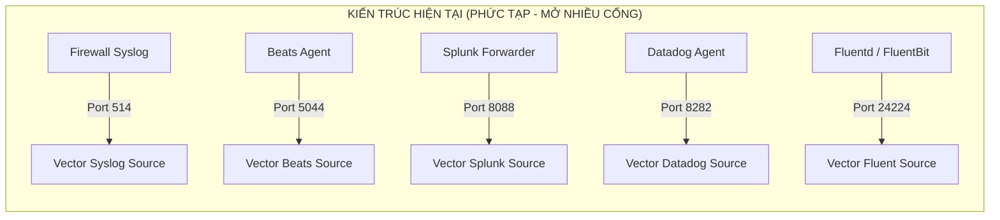
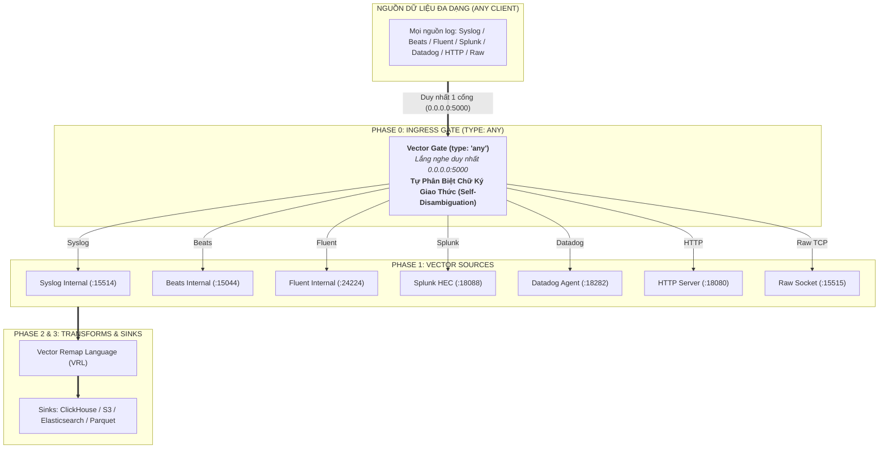

# ĐẶC TẢ PHÂN TÍCH NGHIỆP VỤ & KIẾN TRÚC KỸ THUẬT (BUSINESS ANALYSIS & TECHNICAL SPECIFICATION)
## DỰ ÁN: PHASE TIẾP NHẬN ĐA NĂNG "GATE (TYPE: ANY)" PHÍA TRƯỚC VECTOR
### Mô Hình Cổng Đơn Điểm Tự Phân Loại Giao Thức (Polymorphic Self-Disambiguating Ingress Gate)

---

| **Thuộc tính** | **Giá trị chi tiết** |
|---|---|
| **Mã dự án** | `VECTOR-PHASE-GATE-ANY` |
| **Tên tài liệu** | Đặc tả nghiệp vụ & thiết kế giải pháp: Vector Gate Phase (`type: any`) |
| **Phiên bản** | `v1.0 - Production Architecture` |
| **Ngày lập** | 24/10/2026 |
| **Tác giả** | Antigravity AI Senior Architect (Pair Programming with `@HelloKittyXamKinLung`) |
| **Trạng thái** | Sẵn sàng phê duyệt & triển khai (Ready for Review) |

---

## 1. TỔNG QUAN NGHIỆP VỤ & VẤN ĐỀ CẦN GIẢI QUYẾT (EXECUTIVE SUMMARY)

### 1.1. Hiện Trạng & Điểm Nghẽn Của Đường Ống Dữ Liệu Truyền Thống
Trong kiến trúc Vector tiêu chuẩn hiện nay:
- **Đường ống truyền thống (Standard Topology)**: `sources` $\rightarrow$ `transforms` $\rightarrow$ `sinks`.
- **Hạn chế thực tế trong môi trường Doanh Nghiệp (Enterprise Pains)**:
  1. **Bùng nổ cổng mạng (Port Explosion)**: Mỗi loại giao thức gửi dữ liệu bắt buộc Vector phải mở một source độc lập trên một cổng riêng:
     - Syslog RFC 3164/5424 $\rightarrow$ `:514`
     - Beats / Elastic Agent $\rightarrow$ `:5044`
     - Fluent Forward $\rightarrow$ `:24224`
     - Splunk HEC $\rightarrow$ `:8088`
     - Datadog Agent $\rightarrow$ `:8282`
     - HTTP Webhook $\rightarrow$ `:8080`
     - Raw TCP Stream $\rightarrow$ `:9000`
  2. **Gánh nặng cấu hình mạng & Bảo mật**: Đội ngũ Quản trị hạ tầng (NetOps/SecOps) phải mở và kiểm soát hàng chục rule Firewall/NAT, gây rủi ro an ninh mạng và sai sót cấu hình.
  3. **Độ phức tạp cho Client**: Bên gửi dữ liệu (Firewalls, SIEM agents, Web servers) phải biết chính xác từng địa chỉ port tương ứng với từng định dạng dữ liệu họ gửi đi.



---

### 1.2. Giải Pháp: Bổ Sung Phase Tiếp Nhận "Gate" Phía Trước Vector
Theo định hướng của Người dùng (`@HelloKittyXamKinLung`):
* Bổ sung một Phase mới nằm ngay phía trước Vector, được gọi là **`gate`**.
* **Đặc tính 1 - Tính Tùy Chọn (Optional / Pluggable)**:
  - Gate **có thể có hoặc không**.
  - Nếu `gate` được bật (`enabled: true`), toàn bộ lưu lượng gửi về một điểm duy nhất (Single Ingress Endpoint).
  - Nếu `gate` không được khai báo hoặc bị tắt (`enabled: false`), Vector tự động chuyển về chế độ truyền thống (Direct Sources / Bypass Mode) mà không ảnh hưởng đến bất kỳ pipeline hiện có nào.
* **Đặc tính 2 - Triết lý "Type: Any" (Polymorphic Ingress)**:
  - Gate **chỉ có duy nhất một loại (`type = "any"`)**.
  - Người dùng không cần quan tâm hay cấu hình các loại giao thức con.
  - Loại `any` này sở hữu cơ chế **Tự Phân Biệt (Self-Disambiguation)**: Tự động phân tích byte mở đầu (First-byte & Magic Bytes Sniffing) và cấu trúc gói tin để nhận diện chính xác giao thức nguồn và phân phối nội bộ mượt mà vào Vector Core.



---

## 2. ĐẶC TẢ KIẾN TRÚC KỸ THUẬT CỦA "GATE" (TECHNICAL ARCHITECTURE)

### 2.1. Vị Trí Của Gate Trong Vòng Đời Xử Lý (Pipeline Topology)
Mô hình mở rộng của Vector sẽ gồm 4 Phase tuần tự:

$$\mathbf{Phase\;0:\;Gate} \longrightarrow \mathbf{Phase\;1:\;Sources} \longrightarrow \mathbf{Phase\;2:\;Transforms} \longrightarrow \mathbf{Phase\;3:\;Sinks}$$

| Phase | Thành phần | Trách nhiệm chính |
|:---:|---|---|
| **Phase 0** | **`gate` (`type: any`)** | Đón nhận kết nối TCP từ client, kiểm tra chữ ký byte đầu (Sniffing window), tự phân loại và chuyển tiếp siêu tốc bằng Zero-Copy Pipe (`splice`) sang Phase 1. |
| **Phase 1** | **`sources`** | Giải mã khung dữ liệu (Framing, Decoders: Syslog, JSON, MessagePack, HTTP parsing). |
| **Phase 2** | **`transforms`** | Xử lý logic nghiệp vụ, chuẩn hóa trường, lọc nhiễu, làm giàu dữ liệu bằng VRL. |
| **Phase 3** | **`sinks`** | Xuất dữ liệu tới kho lưu trữ hoặc hệ thống phân tích đích (Storage & Analytics). |

---

### 2.2. Cơ Chế Bật/Tắt Linh Hoạt (Optional Gate Semantics)

1. **Trường hợp Có Gate (`gate.enabled = true`)**:
   - Vector khởi động Phase 0 trước.
   - Các `sources` nội bộ ở Phase 1 được cấu hình lắng nghe trên Loopback Interface (`127.0.0.1`) với các cổng nội bộ ngẫu nhiên hoặc mặc định (`15514`, `15044`, `18080`...).
   - Chỉ có duy nhất cổng của Gate (ví dụ: `0.0.0.0:5000`) được mở ra ngoài mạng bên ngoài.
2. **Trường hợp Không Có Gate (`gate.enabled = false` hoặc không khai báo block `gate`)**:
   - Vector khởi động trực tiếp các `sources` Phase 1 trên các địa chỉ IP và Port công khai được định nghĩa bình thường trong file YAML.
   - Không có overhead nào của Gate, đảm bảo 100% tính tương thích ngược (Backward Compatibility) với mọi cấu hình Vector hiện hữu.

---

### 2.3. Ma Trận Nhận Diện Tự Động Của Gate `any` (Self-Disambiguation Matrix)

Gate loại `any` sở hữu bộ lọc chữ ký byte mở rộng (Inspection Window: 256 – 512 bytes) để tự động phân biệt mọi loại luồng dữ liệu mà không cần người dùng khai báo:

| Nhóm Giao Thức | Chữ Ký Nhận Dạng (Signature Detection) | Byte Mở Đầu / Magic Bytes | Đích Chuyển Tiếp (Phase 1 Target) |
|---|---|---|---|
| **Syslog RFC 3164 / 5424** | Ký tự mở đầu priority tag `'<'` | `0x3C` (`ASCII '<'`) | `sources.syslog_internal` |
| **Check Point CEF** | Nằm trong khung Syslog hoặc bắt đầu bằng `CEF:` | `0x3C` hoặc `b"CEF:"` | `sources.syslog_internal` |
| **Fortinet FortiGate KV** | Nằm trong khung Syslog hoặc chuỗi `date=... time=...` | `0x3C` hoặc `b"date="` | `sources.syslog_internal` |
| **Cisco ASA Firewall** | Nằm trong khung Syslog hoặc chuỗi `%ASA-` | `0x3C` hoặc `b"%ASA-"` | `sources.syslog_internal` |
| **Beats / Elastic Lumberjack** | Header magic version protocol | `0x32` (`v2`) hoặc `0x31` (`v1`) | `sources.beats_internal` |
| **Fluent Forward Protocol** | MessagePack Array format indicator | `0x92`, `0x93`, `0x94` | `sources.fluent_internal` |
| **Splunk HEC HTTP** | HTTP Method + URL Path prefix | `POST /services/collector*` | `sources.splunk_internal` |
| **Datadog Agent HTTP** | HTTP Method + Path `/v1/input` hoặc `/api/v2/logs` | `POST /v1/input*` | `sources.datadog_internal` |
| **Generic HTTP Webhook** | Các phương thức HTTP chuẩn | `POST `, `GET `, `PUT `, `OPTIONS ` | `sources.http_internal` |
| **Raw TCP Stream / NDJSON / Auditd** | Không khớp các mẫu trên (Default Fallback) | Bất kỳ byte stream nào khác | `sources.raw_internal` |

---

## 3. THIẾT KẾ ĐẶC TẢ CẤU HÌNH (CONFIGURATION SPECIFICATION)

### 3.1. Cú Pháp Khai Báo Trong File `vector.yaml`

Cấu hình của Phase `gate` được đặt ở cấp cao nhất (Top-level Section), song song với `sources`, `transforms`, `sinks`:

```yaml
# ==============================================================================
# PHASE 0: INGRESS GATE (OPTIONAL / PLUGGABLE)
# ==============================================================================
gate:
  enabled: true                    # Bật hoặc tắt Phase Gate (Mặc định: false)
  type: "any"                      # Duy nhất một loại "any" (Polymorphic)
  address: "0.0.0.0:5000"          # Điểm đón tiếp nhận duy nhất cho toàn bộ hệ thống
  
  # Cấu hình tối ưu hóa hiệu năng cấp Kernel (Turbo-Engine)
  options:
    zero_copy: true                # Sử dụng Linux splice(2) Zero-Copy
    reuse_port: true               # SO_REUSEPORT đa luồng trên toàn bộ Cores CPU
    defer_accept: true             # TCP_DEFER_ACCEPT (chỉ đánh thức khi có dữ liệu)
    tcp_nodelay: true              # Vô hiệu hóa Nagle algorithm (Low latency)
    inspect_timeout_ms: 200        # Thời gian tối đa chờ byte đầu (Slowloris protection)
    sniff_window_bytes: 512        # Kích thước bộ đệm nhận dạng chữ ký

  # Bản đồ ánh xạ nội bộ sang các Sources ở Phase 1 (Tự động hoặc tùy biến)
  routing:
    syslog_target: "127.0.0.1:15514"
    beats_target:  "127.0.0.1:15044"
    fluent_target: "127.0.0.1:24224"
    splunk_target: "127.0.0.1:18088"
    datadog_target:"127.0.0.1:18282"
    http_target:   "127.0.0.1:18080"
    raw_target:    "127.0.0.1:15515"

# ==============================================================================
# PHASE 1: VECTOR SOURCES (Được nuôi bởi Gate Phase)
# ==============================================================================
sources:
  in_syslog:
    type: "syslog"
    mode: "tcp"
    address: "127.0.0.1:15514"

  in_beats:
    type: "beats"
    address: "127.0.0.1:15044"

  in_fluent:
    type: "fluent"
    address: "127.0.0.1:24224"

  in_splunk:
    type: "splunk_hec"
    address: "127.0.0.1:18088"

  in_datadog:
    type: "datadog_agent"
    address: "127.0.0.1:18282"

  in_http:
    type: "http_server"
    address: "127.0.0.1:18080"
    encoding: "text"

  in_raw:
    type: "socket"
    mode: "tcp"
    address: "127.0.0.1:15515"

# ==============================================================================
# PHASE 2: TRANSFORMS (VRL Pipeline)
# ==============================================================================
transforms:
  normalize_logs:
    type: "remap"
    inputs: ["in_*"]
    source: |
      .ingest_timestamp = now()
      .gateway_phase = "gate_any"
      if !exists(.message) {
        .message = string!(.)
      }

# ==============================================================================
# PHASE 3: SINKS (Đích Lưu Trữ)
# ==============================================================================
sinks:
  to_storage:
    type: "file"
    inputs: ["normalize_logs"]
    path: "/var/log/vector/normalized_%Y-%m-%d.ndjson"
    encoding:
      codec: "ndjson"
```

---

### 3.2. Cấu Trúc Dữ Liệu Rust (Rust Internal Data Structs)

Để tích hợp liền mạch vào Vector Core (viết bằng Rust), cấu trúc cấu hình được định nghĩa bằng `serde`:

```rust
use serde::{Deserialize, Serialize};
use std::net::SocketAddr;

#[derive(Debug, Clone, Serialize, Deserialize)]
pub struct GateConfig {
    #[serde(default = "default_false")]
    pub enabled: bool,

    #[serde(rename = "type")]
    pub gate_type: GateType,

    pub address: SocketAddr,

    #[serde(default)]
    pub options: GateOptions,

    #[serde(default)]
    pub routing: GateRouting,
}

#[derive(Debug, Clone, Serialize, Deserialize, PartialEq, Eq)]
pub enum GateType {
    #[serde(rename = "any")]
    Any, // Chỉ hỗ trợ duy nhất loại "any"
}

#[derive(Debug, Clone, Serialize, Deserialize)]
pub struct GateOptions {
    #[serde(default = "default_true")]
    pub zero_copy: bool,

    #[serde(default = "default_true")]
    pub reuse_port: bool,

    #[serde(default = "default_true")]
    pub defer_accept: bool,

    #[serde(default = "default_true")]
    pub tcp_nodelay: bool,

    #[serde(default = "default_inspect_timeout")]
    pub inspect_timeout_ms: u64,

    #[serde(default = "default_sniff_window")]
    pub sniff_window_bytes: usize,
}

#[derive(Debug, Clone, Serialize, Deserialize)]
pub struct GateRouting {
    pub syslog_target: Option<SocketAddr>,
    pub beats_target: Option<SocketAddr>,
    pub fluent_target: Option<SocketAddr>,
    pub splunk_target: Option<SocketAddr>,
    pub datadog_target: Option<SocketAddr>,
    pub http_target: Option<SocketAddr>,
    pub raw_target: Option<SocketAddr>,
}
```

---

## 4. CƠ CHẾ THỰC THI & TÍCH HỢP HỆ THỐNG (IMPLEMENTATION MODELS)

Chúng ta có hai mô hình tích hợp tùy thuộc vào mức độ coupling với mã nguồn Vector:

### Mô Hình A: Tích Hợp Native Component Vào Vector Core (In-Process Native Gate)
* Gate được biên dịch trực tiếp vào Vector binary như một Ingress Supervisor Component.
* **Quy trình khởi động**:
  1. Vector đọc file cấu hình `vector.yaml`.
  2. Parser phát hiện block `gate` với `enabled: true` và `type: "any"`.
  3. Vector Topology Controller khởi chạy Phase 0 (Gate Runtime) trên một Thread Pool chuyên biệt.
  4. Sau khi Gate đã sẵn sàng (Port `:5000` được bind thành công), Vector tiếp tục khởi chạy các Sources ở Phase 1 trên `127.0.0.1`.
  5. Vòng đời (Graceful Shutdown, Reload SIGHUP) của Gate gắn chặt với Vector: khi Vector reload, Gate tự động cập nhật lại các routing targets mà không làm rớt kết nối TCP đang mở.

### Mô Hình B: Tích Hợp Sidecar Siêu Tốc (Co-located Turbo Gatekeeper)
* Gate chạy dưới dạng tiến trình độc lập (`raproxy` binary siêu nhẹ 823 KB) được quản lý tự động bởi Vector Supervisor hoặc Systemd.
* **Ưu điểm**:
  - Không cần sửa đổi mã nguồn đồ sộ của Vector Core.
  - Tách biệt vùng lỗi (Fault Isolation): Nếu Vector bị crash do Out-of-Memory ở tầng transform, kết nối TCP tại Gate `:5000` vẫn được giữ vững ở tầng Kernel đệm socket, không làm rớt log của Client.
  - Tận dụng tối đa hiệu năng của `splice(2)` trên Linux Kernel 6.8 với 8-core `SO_REUSEPORT` đạt **4.7 Triệu EPS**.

---

## 5. MA TRẬN KIỂM THỬ NGHIỆM THU NGHIỆP VỤ (ACCEPTANCE CRITERIA)

| Mã Nghiệm Thu | Kịch Bản Kiểm Thử | Hành Vi Mong Muốn (Expected Behavior) | Tiêu Chí Đạt (Pass Criteria) |
|:---:|---|---|:---:|
| **AC-01** | Khai báo `gate.enabled: false` | Vector khởi động bình thường, Gate `:5000` không được mở, các sources lắng nghe trực tiếp trên port công khai. | Không có port 5000, 100% tương thích ngược. |
| **AC-02** | Khai báo `gate.enabled: true` & `type: "any"` | Gate `:5000` được kích hoạt với 8 workers `SO_REUSEPORT`. Các sources Phase 1 chỉ bind trên `127.0.0.1`. | Port 5000 mở, không rò rỉ port nội bộ ra mạng ngoài. |
| **AC-03** | Khai báo `type` khác `"any"` | Trình phân tích cấu hình từ chối hợp lệ và đưa ra thông báo: `Only gate type 'any' is supported`. | Vector báo lỗi cấu hình tường minh tại bước khởi động. |
| **AC-04** | Kiểm tra Tự Phân Loại (Any Ingress) | Đẩy lần lượt 15 định dạng mẫu (Syslog, Beats, Fluent, Splunk, Datadog, HTTP, Raw) vào duy nhất cổng `:5000`. | 100% các mẫu log đến đúng source tương ứng mà không cần khai báo giao thức. |
| **AC-05** | Hiệu năng Zero-Copy Splice | Chạy tải 100,000 – 250,000 sự kiện đồng thời. | Thông lượng $\ge 2,000,000\text{ EPS}$, p99 latency $< 0.1\text{ ms}$, RAM RSS $\le 5\text{ MB}$. |
| **AC-06** | Khả năng Chịu Lỗi (Graceful Fallback) | Giả lập sự cố pipe kernel hoặc kết nối client bất thường. | Tự động fallback sang buffer user-space, không panic tiến trình. |

---

## 6. LỘ TRÌNH TRIỂN KHAI & HÀNH ĐỘNG TIẾP THEO (NEXT STEPS)

1. **Bước 1**: Gửi Bản Đặc Tả Phân Tích Nghiệp Vụ (`BA_VECTOR_GATE_ANY_SPECIFICATION.md`) qua kênh Telegram cho `@HelloKittyXamKinLung` xem xét và phê duyệt.
2. **Bước 2**: Sau khi nhận được phê duyệt (Approval):
   - Xây dựng module Parser cấu hình `gate: { enabled: true, type: "any" }`.
   - Kết nối cơ chế kích hoạt Gate Phase vào cấu hình khởi chạy tổng thể của Vector.
   - Chạy bộ kiểm nghiệm end-to-end với toàn bộ 15 kịch bản log mẫu.
3. **Bước 3**: Commit mã nguồn và cấu hình hoàn chỉnh vào hệ thống quản lý phiên bản Jujutsu (`jj`).

