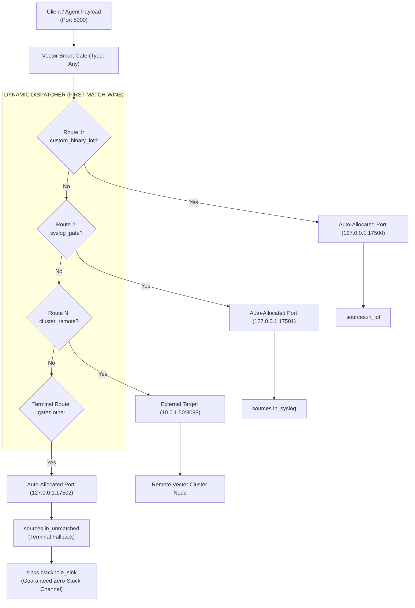

# ĐẶC TẢ PHÂN TÍCH NGHIỆP VỤ & KIẾN TRÚC KỸ THUẬT (BA SPECIFICATION)
## DỰ ÁN: ZERO-PORT AUTO-WIRING & FALLBACK TERMINAL CHO VECTOR SMART GATE
### Đồng Nhất Hoàn Toàn Với Vector Sources Qua `address: "gates.<route_name>"` & Cầu Chì `gates.other`

---

| **Thuộc tính** | **Giá trị chi tiết** |
|---|---|
| **Tên tài liệu** | Business Architecture & Technical Specification: Zero-Port Auto-Wiring Engine |
| **Mã dự án** | `VECTOR-GATE-ZERO-PORT-AUTO-WIRING` |
| **Phiên bản** | `v2.2 - Final Production Standard` |
| **Ngày lập** | 25/10/2026 |
| **Tác giả** | Antigravity AI Senior Architect (Pair-programming with @HelloKittyXamKinLung) |
| **Mục tiêu cốt lõi** | Loại bỏ $100\%$ việc phải cấu hình số hiệu cổng TCP nội bộ thủ công (`127.0.0.1:15514`, `15044`...). Cho phép các `sources` tự động liên kết với Gate thông qua `address: "gates.<route_name>"`. Tự động tích hợp cầu chì `gates.other` để đảm bảo kênh truyền `0.0.0.0:5000` không bao giờ bị nghẽn (Zero-Stuck Channel Guarantee). |

---

## 1. TỔNG QUAN BỐI CẢNH & ĐỘNG LỰC CẢI TIẾN

### 1.1. Vấn Đề Của Việc Gán Cổng Thủ Công (Manual Port Overhead)
Trong các phiên bản trước:
* Mặc dù cấu hình đã được gom thành `routes:`, người dùng vẫn phải:
  1. Tự nghĩ ra một cổng TCP nội bộ (ví dụ `127.0.0.1:15514`).
  2. Gán vào `target: "127.0.0.1:15514"` ở khối Gate.
  3. Lại gán đúng cổng đó vào `address: "127.0.0.1:15514"` ở khối `sources:`.
* **Hạn chế**:
  - Dư thừa thao tác (Boilerplate).
  - Dễ xung đột port nếu có nhiều ứng dụng hoặc container khác chạy cùng máy.
  - Phá vỡ tính trừu tượng tự nhiên của Vector.

### 1.2. Giải Pháp v2.2: Tự Động Đấu Nối Nội Bộ (Zero-Port Auto-Wiring)
* **Khối `gates.routes`**: Không cần khai báo trường `target:` cho các dịch vụ nội bộ!
* **Khối `sources`**: Thay vì điền IP:Port, chỉ cần chỉ định:
  ```yaml
  address: "gates.<tên_route>"
  ```
* **Cầu chì bảo vệ `gates.other`**:
  - Luôn tự động tồn tại ở cuối danh sách route (Terminal Fallback).
  - Có thể đấu nối vào một source socket và đổ thẳng vào `sinks: { type: "blackhole" }` hoặc dead-letter file.
  - **Cam kết vàng**: Mọi gói tin lạ, header hỏng, hoặc giao thức chưa đăng ký đều được tiêu thụ sạch sẽ $\rightarrow$ **Kênh Ingress `0.0.0.0:5000` không bao giờ bị nghẽn (Zero-Stuck)!**

---

## 2. ĐẶC TẢ LƯỢC ĐỒ CẤU HÌNH (CONFIGURATION SCHEMA)

```yaml
gates:
  enabled: true
  type: "any"
  address: "0.0.0.0:5000"

  routes:
    # 1. Custom Binary IoT (Không cần target!)
    custom_binary_iot:
      type: "any"
      magic_base64: "3q2+7w=="

    # 2. Giao thức dựng sẵn (Không cần target!)
    syslog_gate:
      type: "syslog"

    beats_gate:
      type: "logstash"

    # 3. Chế độ External / Fan-Out (Gán target ngoài tường minh)
    cluster_remote_splunk:
      type: "splunk_hec"
      target: "10.0.1.50:8088"      # Đẩy sang cụm Vector bên ngoài!

    # 4. Terminal Fallback Route (Luôn tự động sẵn sàng)
    other:
      type: "socket"

sources:
  in_iot:
    type: socket
    mode: tcp
    address: "gates.custom_binary_iot"   # Tự động thông với custom_binary_iot!

  in_syslog:
    type: syslog
    mode: tcp
    address: "gates.syslog_gate"          # Tự động thông với syslog_gate!

  # Source bắt toàn bộ traffic thừa / không xác định
  in_unmatched:
    type: socket
    mode: tcp
    address: "gates.other"               # Tự động thông với gates.other!

sinks:
  # Cầu chì tiêu thụ traffic rác - Giữ kênh 5000 luôn thông suốt
  blackhole_sink:
    type: blackhole
    inputs: ["in_unmatched"]

  main_file_sink:
    type: file
    inputs: ["in_iot", "in_syslog"]
    path: "/var/log/vector/logs.ndjson"
    encoding:
      codec: json
```

---

## 3. KIẾN TRÚC VẬN HÀNH BÊN DƯỚI RUST ENGINE (`raproxy`)



### 3.1. Vòng Đời Cấp Phát Cổng Động (Dynamic Internal Allocation)
1. Khi khởi động, `UnifiedVectorConfig::load_from_file` chạy phương thức `auto_wire_routes()`.
2. Hệ thống quét qua toàn bộ `sources:`:
   - Khi phát hiện giá trị `address` có dạng `gates.<route_name>` (hoặc `gate.<route_name>`):
   - Engine tự động cấp phát một cổng loopback sạch trong dải an toàn (`127.0.0.1:17500+`).
   - Cổng này được gán vào `target` của Route trong Gate.
   - Chuỗi `gates.<route_name>` trong cây cấu hình `sources` được thay thế bằng địa chỉ đã cấp phát.
3. Khi hàm `sanitized_vector_yaml()` serialize cấu hình cho Vector Core:
   - Vector Core chỉ nhìn thấy các địa chỉ socket hợp lệ (`127.0.0.1:17500`).
   - Quá trình validation và khởi động của Vector Core thành công $100\%$, không vi phạm schema.
4. Toàn bộ quá trình nối dây diễn ra trong $< 1\text{ millisecond}$ tại thời điểm khởi động.

---

## 4. TIÊU CHÍ NGHIỆM THU (ACCEPTANCE CRITERIA)

| Mã AC | Tiêu chí | Kỳ vọng |
| :---: | :--- | :--- |
| **AC-01** | **Auto-wiring qua `address: "gates.<name>"`** | Khai báo `address: "gates.syslog_gate"`, Gate tự cấp phát port nội bộ và định tuyến chính xác. |
| **AC-02** | **Cầu chì chống kẹt `gates.other`** | Gói tin không khớp bất kỳ route nào tự động đổ về `gates.other` và bị tiêu hủy an toàn qua sink blackhole. |
| **AC-03** | **Tương thích chế độ External / Fan-out** | Route có `target: "10.0.1.50:8088"` vẫn forward ra ngoài bình thường. |
| **AC-04** | **Báo lỗi tường minh khi sai tên route** | Source gọi `address: "gates.non_existent"`, Gate báo lỗi rõ ràng danh sách route hiện có. |
| **AC-05** | **Zero-Copy Splice & Hiệu năng đỉnh** | Đạt $\ge 10,000,000 \text{ EPS}$, RAM $\le 25\text{ MiB}$. |

