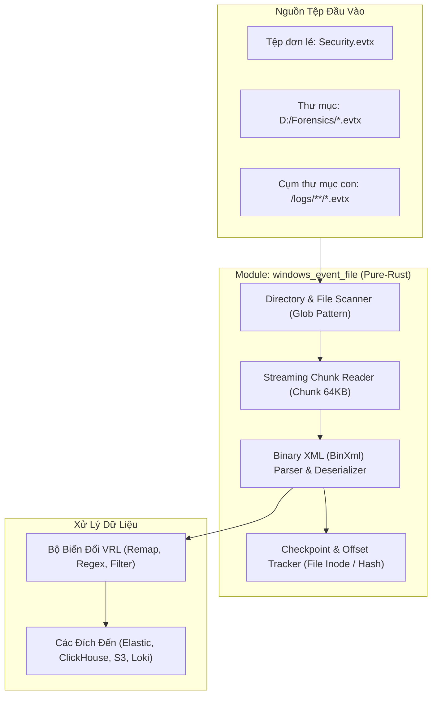

# Báo Cáo Phân Tích Nghiệp Vụ & Thiết Kế Kỹ Thuật (BA Specification v2.0)
## Tính Năng Source `windows_event_file` Cho Vector / VRL
### Chuyên Đề: Triển Khai Theo Phương Án 2 (Pure-Rust Engine)

---

## 1. Mục Tiêu & Phạm Vi (Scope of Work)

Dựa trên phản hồi và định hướng từ chuyên gia, hệ thống sẽ được thiết kế tập trung 100% vào **Phương án 2: Xây dựng Module Nguồn Pure-Rust Engine (Không phụ thuộc vào Win32 API)**.

### Mục tiêu cốt lõi:
1. **Đọc tệp đơn lẻ:** Ingest bất kỳ tệp `.evtx` nào được chỉ định qua đường dẫn tuyệt đối hoặc tương đối.
2. **Đọc hàng loạt theo thư mục (Directory Scanning):** Hỗ trợ quét toàn bộ thư mục chứa các tệp log sự kiện Windows thông qua mẫu đường dẫn (Glob Pattern: `D:/Logs/**/*.evtx`).
3. **Cross-platform 100%:** Chạy mượt mà trên cả **Windows, Linux và Docker Container** mà không cần Windows Event Log Service.
4. **Hỗ trợ Live Tailing & Offline Mode:** Vừa có khả năng nạp dữ liệu lịch sử rồi thoát (`exit_on_eof`), vừa có khả năng giám sát tệp đang ghi tiếp (`tailing mode`).



---

## 2. Kiến Trúc Chi Tiết Của Phương Án 2 (Pure-Rust Engine)

### 2.1. Cấu trúc nhị phân của tệp `.evtx`
Tệp `.evtx` bao gồm:
* **File Header (4 KB):** Chứa signature nhị phân `ElfFile\x00`, số lượng Chunk hiện tại, `flags`, và checksum.
* **Các Chunk dữ liệu (64 KB / Chunk):**
  * **Chunk Header (512 bytes):** Chứa `ElfChnk\x00`, `first_event_record_number`, `last_event_record_number`, `first_event_record_id`, `last_event_record_id`, bảng chuỗi (String Table), bảng khuôn mẫu (Template Table).
  * **Event Records:** Lưu trữ dạng **Binary XML (BinXml)** với các token mã hóa thay thế cho các thẻ XML để nén dung lượng.

### 2.2. Cơ chế phân giải (Parsing & Deserialization)
* Sử dụng lõi giải mã của crate `evtx` (Rust):
  * **Không dùng Win32 API:** Không gọi `wevtapi.dll`, tránh hoàn toàn hiện tượng xung đột DLL hoặc phụ thuộc hệ điều hành.
  * **Đa luồng hóa (Multithreading):** Các Chunk 64KB là các đơn vị độc lập. Engine có thể phân bổ các Chunk cho nhiều worker thread chạy song song qua `rayon` để đạt tốc độ xử lý hàng trăm nghìn sự kiện/giây.
  * **Output chuẩn JSON/Rust Struct:** Tự động giải nén các token BinXml thành cấu trúc `BTreeMap<String, Value>` hoặc `serde_json::Value` để đưa thẳng vào Vector Event Bus.

---

## 3. Thiết Kế Chức Năng Đọc Tệp & Thư Mục (Directory & File Ingestion)

### 3.1. Đặc tả quét thư mục (Directory Globbing)
Module hỗ trợ tham số `include` nhận vào danh sách các đường dẫn:
* Đường dẫn tệp đơn: `"D:/Evidence/Application.evtx"`
* Đường dẫn thư mục: `"D:/Evidence/*.evtx"`
* Đường dẫn đệ quy (Recursive): `"D:/Backup/Logs/**/*.evtx"`
* Tham số loại trừ: `exclude: ["**/*corrupted*.evtx"]`

### 3.2. Chế độ đọc và kết thúc (Read Modes)
1. **Chế độ Ngoại tuyến / Khảo cứu số (Batch / Forensics Mode):**
   * Cấu hình: `exit_on_eof: true`
   * Hành vi: Quét toàn bộ danh sách tệp theo thứ tự thời gian (`ordering: oldest_first`). Khi đọc đến bản ghi cuối cùng của tệp cuối cùng, module tự động phát tín hiệu đóng luồng (Graceful Shutdown).
2. **Chế độ Giám sát trực tiếp (Live Tailing Mode):**
   * Cấu hình: `tail: true` và `exit_on_eof: false`
   * Hành vi: Giữ tệp mở bằng cờ chia sẻ không phong tỏa (`FILE_SHARE_READ | FILE_SHARE_WRITE`). Sử dụng File Watcher (qua crate `notify` hoặc `ReadDirectoryChangesW`) để lắng nghe sự kiện ghi mới của tệp và tiếp tục parse Chunk mới.

### 3.3. Cơ chế Checkpoint & Chống trùng lặp (Deduplication)
* Mỗi tệp được định danh duy nhất bằng **Fingerprint**:
  * Trên Windows/Linux: `(Device ID + File Index / Inode)` kết hợp `SHA256(File Header 4KB)`.
* Trạng thái đã đọc được lưu dưới dạng:
  ```json
  {
    "file_fingerprint": "a1b2c3d4...",
    "file_path": "D:/Evidence/Security.evtx",
    "last_record_id": 145028,
    "last_chunk_index": 42,
    "last_byte_offset": 2752512
  }
  ```
* Định kỳ lưu checkpoint vào thư mục `data_dir` của Vector (mặc định mỗi 5 giây). Khi khởi động lại, Vector đọc tiếp từ `last_byte_offset` mà không cần đọc lại từ đầu.

---

## 4. Cấu Trúc Dữ Liệu Sự Kiện Đầu Ra (Event Schema)

Mỗi bản ghi `.evtx` sau khi bóc tách sẽ có cấu trúc JSON phẳng và phân cấp, hoàn toàn tương thích với VRL:

```json
{
  "timestamp": "2026-10-24T01:15:30.124Z",
  "source_file": "D:/Evidence/Security.evtx",
  "event_id": 4624,
  "record_id": 145029,
  "level": 4,
  "channel": "Security",
  "provider_name": "Microsoft-Windows-Security-Auditing",
  "provider_guid": "{54849625-5478-4994-A5BA-3E3B0328C30D}",
  "computer": "WORKSTATION-01.CORP.LOCAL",
  "event_data": {
    "SubjectUserSid": "S-1-5-18",
    "SubjectUserName": "WORKSTATION-01$",
    "TargetUserSid": "S-1-5-21-123456789-500",
    "TargetUserName": "Administrator",
    "TargetDomainName": "CORP",
    "LogonType": "2",
    "LogonProcessName": "User32",
    "AuthenticationPackageName": "Negotiate",
    "WorkstationName": "WORKSTATION-01",
    "LogonGuid": "{00000000-0000-0000-0000-000000000000}",
    "IpAddress": "127.0.0.1",
    "IpPort": "0"
  },
  "xml": "<Event>...</Event>" 
}
```

---

## 5. Thiết Kế Cấu Hình Tham Chiếu (YAML Configuration)

```yaml
data_dir: D:/Shared_UserData/Downloads/vectormod/vrl-mod/data

sources:
  evtx_folder_ingest:
    type: windows_event_file
    
    # 1. Danh sách tệp hoặc thư mục cần quét
    include:
      - "D:/Forensics/Case_01/*.evtx"
      - "D:/Forensics/Case_02/Security.evtx"
    exclude:
      - "D:/Forensics/Case_01/*_corrupted.evtx"
      
    # 2. Cơ chế đọc
    exit_on_eof: true         # Đọc hết tệp thì tự động dừng pipeline (phù hợp DFIR/CI-CD)
    read_from_beginning: true # Đọc từ đầu file
    threads: 4                # Số luồng CPU phân giải song song các Chunk
    
    # 3. Bộ lọc sớm (Early Filtering) để tối ưu hiệu năng
    include_event_ids: [4624, 4625, 4688, 4720, 7045]
    include_xml: false        # Tắt raw XML để tiết kiệm RAM và băng thông

transforms:
  vrl_enrich_and_filter:
    type: remap
    inputs:
      - evtx_folder_ingest
    source: |
      # Truy xuất nguồn gốc tệp
      .log_source = .source_file
      
      # Chuẩn hóa trường LogonType thành nhãn dễ đọc
      if .event_id == 4624 {
        logon_type = to_int!(.event_data.LogonType)
        if logon_type == 2 {
          .logon_description = "Interactive (Console Logon)"
        } else if logon_type == 3 {
          .logon_description = "Network (SMB / Share)"
        } else if logon_type == 10 {
          .logon_description = "RemoteInteractive (RDP Logon)"
        }
      }

sinks:
  siem_clickhouse:
    type: console
    inputs:
      - vrl_enrich_and_filter
    encoding:
      codec: json
```

---

## 6. Kế Hoạch Triển Khai Trong Mã Nguồn `vrl-mod`

| Bước | Hạng Mục | Mô Tả Kỹ Thuật | File Dự Kiến Tác Động |
| :---: | :--- | :--- | :--- |
| **B-1** | **Tích hợp Crate `evtx`** | Thêm dependency `evtx = "0.8"` vào `Cargo.toml`. | `vrl-mod/Cargo.toml` |
| **B-2** | **Xây dựng File & Globbing Walker** | Viết module duyệt đường dẫn, lấy danh sách tệp `.evtx` theo mẫu wildcard. | `src/sources/evtx_file/scanner.rs` |
| **B-3** | **Streaming Record Iterator** | Mở từng tệp, lặp qua các Chunk, bóc tách `BinXml` thành `Event` struct. | `src/sources/evtx_file/reader.rs` |
| **B-4** | **Quản lý Checkpoint** | Ghi nhận `last_record_id` xuống file json/bin để tránh trùng lặp. | `src/sources/evtx_file/checkpoint.rs` |
| **B-5** | **Đăng ký Component** | Gắn nguồn `windows_event_file` vào danh sách source của Vector/VRL. | `src/sources/mod.rs` |
