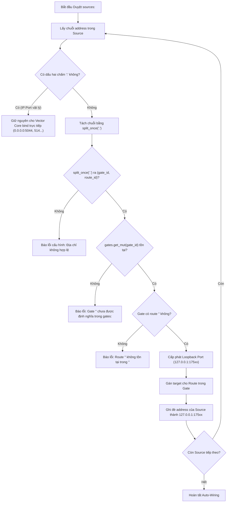

# TÀI LIỆU PHÂN TÍCH NGHIỆP VỤ & KIẾN TRÚC KỸ THUẬT (BA / BRD)
## ĐẶC TẢ TÍNH NĂNG: MULTI-GATE INGRESS ENGINE & NGỮ PHÁP TỐI GIẢN
### "Khai Báo Nhiều Gate Đa Cổng Song Song — Đấu Nối Nguồn Trực Tiếp Theo Cú Pháp `<gate_name>.<route_name>`"

---

> **Mã tài liệu**: `BA-MULTIGATE-INGRESS-2026.4`  
> **Phiên bản kiến trúc mục tiêu**: `v2.5.0`  
> **Trạng thái**: ĐÃ DUYỆT ĐẶC TẢ — CHUẨN BỊ TRIỂN KHAI (SPECIFICATION APPROVED)  
> **Ngày lập**: 26/10/2026  
> **Dựa trên chỉ đạo trực tiếp**: User Specification Directive (`2026-10-26`)  

---

## I. TỔNG QUAN YÊU CẦU NGHIỆP VỤ (EXECUTIVE SUMMARY)

### 1.1. Bối cảnh & Vấn đề tồn tại
Trong các phiên bản trước (`v2.4.0` – `v2.4.3`), `vector-gate` hoạt động theo mô hình **Single-Gate Singleton**:
- Toàn bộ khối cấu hình chỉ có duy nhất một đối tượng `gates:` lắng nghe trên một cổng duy nhất (mặc định `0.0.0.0:5000`).
- Cú pháp đấu nối vào `sources:` phụ thuộc vào tiền tố dài dòng: `address: "gates.<route_name>"`.
- Fallback terminal cố định là `gates.other`.

Khi triển khai thực tế tại các trung tâm dữ liệu hoặc hạ tầng đa phân vùng mạng (Multi-Zone / Multi-Tenant):
- Phân vùng **DMZ** yêu cầu một cổng riêng (ví dụ `0.0.0.0:5045`) chuyên nhận Nginx HTTP JSON và Beats external.
- Phân vùng **Internal LAN** yêu cầu một cổng riêng (ví dụ `0.0.0.0:5046`) chuyên nhận Windows Winlogbeat và Linux Auditd.
- Phân vùng **IoT / Trạm xa** yêu cầu một cổng riêng (ví dụ `0.0.0.0:5000`) với chữ ký gói tin nhị phân đặc thù.
- Mỗi phân vùng cần có **vùng đệm sniffing độc lập** và **kênh Fallback Unmatched (`other`) riêng biệt**, không được để log rác của phân vùng này tràn vào kênh của phân vùng khác.

### 1.2. Các nguyên tắc thiết kế bắt buộc (Guiding Principles)
Theo chỉ thị dứt khoát từ người dùng:
1. **Chỉ hỗ trợ cách viết ngắn gọn**: Cú pháp địa chỉ trong `sources:` bắt buộc là:
   $$\text{address: } \text{"<gate\_name>.<route\_name>"}$$
2. **Tuyệt đối không phân cấp thừa (No absolute namespace)**:
   - Loại bỏ hoàn toàn tiền tố `gates.`. Không dùng `gates.dmz_gate.nginx_route`.
3. **Không mở rộng tư duy "tự bơm dữ liệu" (No Zero-Address / No Producer Injection)**:
   - Duy trì nghiêm ngặt chuẩn cấu hình khai báo của Vector Core: `sources` là consumer, chủ động khai báo `address: "<gate_name>.<route_name>"`. Gate không can thiệp ngầm vào schema của Source.
4. **Chuẩn hóa Fallback Terminal**:
   - Fallback terminal của từng Gate bắt buộc phải có tên là:
     $$\mathbf{<gate\_name>.other}$$
   - Xóa bỏ hoàn toàn định dạng `gates.other` cũ.

---

## II. ĐẶC TẢ CẤU HÌNH MẪU CHUẨN (DECLARATIVE SPECIFICATION)

### 2.1. Cấu hình khối `gates:` (Đa cổng lắng nghe độc lập)
Thay vì một object đơn, `gates:` trở thành một **IndexMap** chứa danh sách các Gate độc lập:

```yaml
# ==============================================================================
# PHASE 0: MULTI-GATE INGRESS MULTIPLEXERS (v2.5.0)
# ==============================================================================
gates:
  # Gate 1: Chuyên trách Phân vùng DMZ (Web, Nginx, Public Ingress)
  dmz_gate:
    address: "0.0.0.0:5045"
    options:
      zero_copy: true
      reuse_port: true
      tcp_nodelay: true
      sniff_window_bytes: 512
      pipe_buffer: 64
    routes:
      nginx_route:
        type: "http_server"
      beats_route:
        type: "logstash"
      other:
        type: "socket"                 # Terminal fallback riêng của dmz_gate

  # Gate 2: Chuyên trách Phân vùng Nội bộ LAN (Enterprise Windows & Linux)
  lan_gate:
    address: "0.0.0.0:5046"
    options:
      zero_copy: true
      reuse_port: true
      tcp_nodelay: true
      sniff_window_bytes: 512
      pipe_buffer: 128
    routes:
      winlog_route:
        type: "logstash"
      auditd_route:
        type: "logstash"
      other:
        type: "socket"                 # Terminal fallback riêng của lan_gate

  # Gate 3: Cổng Đa Giao Thức Đa Năng IoT / WAN (Type: Any)
  iot_gate:
    address: "0.0.0.0:5000"
    options:
      zero_copy: true
      reuse_port: true
      inspect_timeout_ms: 200
    routes:
      custom_sensor:
        type: "any"
        magic_base64: "3q2+7w=="        # 0xDEADBEEF
      syslog_route:
        type: "syslog"
      other:
        type: "socket"                 # Terminal fallback riêng của iot_gate
```

---

### 2.2. Cấu hình khối `sources:` (Đấu nối ngắn gọn `<gate_name>.<route_name>`)

```yaml
# ==============================================================================
# PHASE 1: VECTOR SOURCES (ĐẤU NỐI TRỰC TIẾP QUA TÊN GATE NGẮN GỌN)
# ==============================================================================
sources:
  # --- 1. Nhận luồng từ dmz_gate (Cổng 5045) ---
  in_dmz_nginx:
    type: http_server
    address: "dmz_gate.nginx_route"     # <gate_name>.<route_name>
    decoding:
      codec: json

  in_dmz_beats:
    type: logstash
    address: "dmz_gate.beats_route"

  other_dmz_unmatched:
    type: socket
    mode: tcp
    address: "dmz_gate.other"           # Fallback terminal riêng của dmz_gate

  # --- 2. Nhận luồng từ lan_gate (Cổng 5046) ---
  in_lan_winlog:
    type: logstash
    address: "lan_gate.winlog_route"
    receive_buffer_bytes: 4194304

  in_lan_auditd:
    type: logstash
    address: "lan_gate.auditd_route"

  other_lan_unmatched:
    type: socket
    mode: tcp
    address: "lan_gate.other"           # Fallback terminal riêng của lan_gate

  # --- 3. Nhận luồng từ iot_gate (Cổng 5000) ---
  in_iot_sensor:
    type: socket
    mode: tcp
    address: "iot_gate.custom_sensor"

  in_iot_syslog:
    type: syslog
    mode: tcp
    address: "iot_gate.syslog_route"

  other_iot_unmatched:
    type: socket
    mode: tcp
    address: "iot_gate.other"           # Fallback terminal riêng của iot_gate

  # --- 4. Cổng Truyền Thống Độc Lập Không Qua Gate (Vector Core Direct) ---
  in_legacy_syslog_udp:
    type: syslog
    mode: udp
    address: "0.0.0.0:514"             # Không có dấu chấm namespace -> Vector Core bind thẳng
```

---

## III. KIỂM CHỨNG & THIẾT KẾ KỸ THUẬT RUST (TECHNICAL DESIGN)

### 3.1. Cấu trúc dữ liệu trong `vector-gate/src/config.rs`

Mô hình cấu hình gốc chuyển đổi:

```rust
// TỪ: Single Gate Singleton
pub struct UnifiedVectorConfig {
    #[serde(rename = "gate", alias = "gates")]
    pub gate: Option<GateConfig>,
    ...
}

// SANG: Multi-Gate Map
#[derive(Debug, Clone, Serialize, Deserialize)]
pub struct UnifiedVectorConfig {
    #[serde(default)]
    pub gates: IndexMap<String, GateConfig>,

    #[serde(flatten)]
    pub vector_topology: serde_yaml::Value,
}
```

Mỗi `GateConfig` đại diện cho 1 Ingress Listener độc lập:
```rust
#[derive(Debug, Clone, Serialize, Deserialize)]
pub struct GateConfig {
    #[serde(default = "default_true")]
    pub enabled: bool,

    #[serde(default = "default_bind_addr")]
    pub address: SocketAddr,

    #[serde(default)]
    pub options: GateOptions,

    #[serde(default)]
    pub routes: Option<RoutesConfig>,
}
```

### 3.2. Thuật toán Tự Động Đấu Nối (Auto-Wiring Algorithm)

Quy trình chuẩn hóa trong `auto_wire_routes(&mut self)`:



#### Quy tắc xử lý Fallback `[tên gate].other`:
Trong mỗi Gate, nếu kỹ sư không khai báo route `other` tường minh, hệ thống sẽ **tự động chèn route `other` mặc định** cho Gate đó.
Khi một source khai báo `address: "<gate_name>.other"`, nó sẽ tự động bắt cặp với route `other` của chính `<gate_name>`.

---

### 3.3. Khởi tạo Đa Luồng Độc Lập trong `vector-gate/src/main.rs`

Tại hàm `start_gate_engine`, thay vì chỉ bind 1 socket, hệ thống duyệt qua danh sách các Gate đã kích hoạt:

```rust
for (gate_name, gate_cfg) in active_gates {
    let runtime_cfg = Arc::new(RuntimeConfig::from_gate_config(&gate_name, &gate_cfg));
    let stats = Arc::new(Stats::for_gate(&gate_name));
    
    // Khởi tạo pool SO_REUSEPORT riêng biệt trên cổng của từng Gate
    start_single_gate_workers(
        gate_name.clone(),
        runtime_cfg,
        stats,
        shutdown_rx.clone(),
    );
}
```

**Lợi ích kiến trúc:**
1. **Cô lập tải (Load Isolation)**: Tải bùng nổ (burst spike) trên `lan_gate` (5046) không làm chiếm dụng socket queue của `dmz_gate` (5045).
2. **Cấu hình độc lập (Independent Tuning)**: Cổng DMZ có thể đặt `sniff_window_bytes: 1024`, trong khi cổng LAN chỉ cần `512`.
3. **Thống kê chuyên biệt (Segmented Metrics)**: Metrics hiển thị chi tiết EPS và kết nối riêng cho từng cổng `dmz_gate`, `lan_gate`, `iot_gate`.

---

## IV. MA TRẬN TÁC ĐỘNG & TƯƠNG THÍCH (IMPACT ANALYSIS)

| Hạng mục | Bản cũ (`v2.4.3`) | Bản mới (`v2.5.0`) | Ghi chú & Đánh giá |
| :--- | :--- | :--- | :--- |
| **Khai báo Gate** | `gates: { enabled: true, address: "0.0.0.0:5000", ... }` | `gates: { <gate_1>: { address: "..." }, <gate_2>: { ... } }` | Chuyển từ Singleton sang Map đa cổng |
| **Cú pháp gọi Source** | `address: "gates.<route>"` | `address: "<gate_name>.<route_name>"` | **Ngắn gọn, bỏ hoàn toàn tiền tố `gates.`** |
| **Fallback Terminal** | `address: "gates.other"` | `address: "<gate_name>.other"` | **Cô lập fallback theo từng Gate** |
| **Cổng Direct Vector** | `address: "0.0.0.0:514"` | `address: "0.0.0.0:514"` | **Giữ nguyên 100% không ảnh hưởng** |
| **VRL Auto-Remap** | `type: auto_remap, dir: "..."` | `type: auto_remap, dir: "..."` | **Tương thích 100%** |
| **Zero-Copy Splice** | Hoạt động trên 1 port | Hoạt động song song trên N ports | Tận dụng đa nhân CPU với SO_REUSEPORT |

---

## V. KẾ HOẠCH TRIỂN KHAI CHI TIẾT (IMPLEMENTATION PHASES)

### Giai đoạn 1: Refactor Cấu trúc Dữ liệu & Auto-wiring (`config.rs`)
- Cập nhật struct `UnifiedVectorConfig` hỗ trợ `gates: IndexMap<String, GateConfig>`.
- Hiện đại hóa hàm `auto_wire_routes` với thuật toán bóc tách `split_once('.')`.
- Kiểm tra hợp lệ: Báo lỗi nếu thiếu `<gate_name>.other` hoặc tham chiếu sai Gate.
- Đảm bảo hàm `sanitized_vector_yaml` dọn dẹp sạch sẽ toàn bộ khối `gates:` trước khi chuyển giao sang Vector Core.

### Giai đoạn 2: Nâng cấp Runtime Multi-Listener (`main.rs`)
- Mở rộng `start_gate_engine` để khởi chạy worker loops song song cho từng Gate.
- Bổ sung tên Gate vào log hiển thị khi khởi động và báo cáo định kỳ:
  `📊 [Vector Gate Stats - dmz_gate] Total: 12,450 | Beats: 8,000 | HTTP: 4,450 ...`
  `📊 [Vector Gate Stats - lan_gate] Total: 45,100 | Winlog: 30,000 | Auditd: 15,100 ...`

### Giai đoạn 3: Cập nhật Cấu hình & Tài liệu Mẫu
- Cập nhật file cấu hình chính [deploy/config/vector.yaml](file:///home/manager/vectormod/deploy/config/vector.yaml).
- Cập nhật tài liệu hướng dẫn kỹ thuật [docs/MASTER_SPECIFICATION.md](file:///home/manager/vectormod/docs/MASTER_SPECIFICATION.md).

### Giai đoạn 4: Bộ Test Chuyên Sâu (Multi-Gate Verification Suites)
- Tạo kịch bản kiểm thử đa cổng [test/suites/test_multi_gate.py](file:///home/manager/vectormod/test/suites/test_multi_gate.py):
  1. Gửi đồng thời traffic Beats vào `dmz_gate:5045` và `lan_gate:5046`.
  2. Kiểm tra log ra đúng các source `in_dmz_beats` và `in_lan_winlog`.
  3. Gửi payload không xác định vào từng Gate để chứng minh traffic rơi chính xác vào `<gate_name>.other` tương ứng.
- Chạy toàn bộ 7 Test Suites hiện tại đảm bảo không hồi quy lỗi (Zero Regression).
