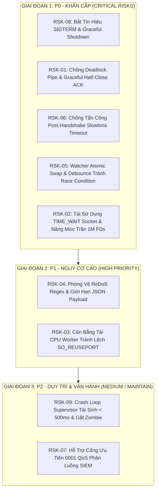

# KẾ HOẠCH HÀNH ĐỘNG KHẮC PHỤC RỦI RO KIẾN TRÚC & GIA CỐ HỆ THỐNG
## DỰ ÁN: VECTOR SMART GATE (ENTERPRISE HARDENING ROADMAP)
### Phân Cấp Ưu Tiên Từ Nặng Đến Nhẹ (P0 ➔ P1 ➔ P2) | Tiêu Chuẩn Khả Thi & Dễ Bảo Trì

---

| **Thuộc tính** | **Giá trị** |
|:---|:---|
| **Tài liệu tham chiếu** | [`docs/RISK_AUDIT_AND_ARCHITECTURAL_REVIEW.md`](file:///home/manager/vectormod/docs/RISK_AUDIT_AND_ARCHITECTURAL_REVIEW.md) |
| **Phạm vi tác động** | Mã nguồn Rust (`vector-gate/src/`), Cấu hình Container (`deploy/`), Pipeline VRL (`deploy/vrl/`), Tham số Kernel Host |
| **Mục tiêu cốt lõi** | Triệt tiêu hoàn toàn rủi ro mất dữ liệu, deadlock, cạn kiệt tài nguyên; đảm bảo SLA 99.999% |
| **Tiêu chí thiết kế** | **Zero-Bloat** (Không thêm thư viện nặng bên ngoài), **Drop-In Compatibility**, **Dễ vận hành & bảo trì 24/7** |

---

## 📑 MỤC LỤC KẾ HOẠCH TRIỂN KHAI



---

# PHẦN 1: GIAI ĐOẠN 1 - XỬ LÝ NHÓM P0 (KHẨN CẤP / TÁC ĐỘNG THẢM HỌA)

---

## 🔴 1.1. RSK-08: Bắt Tín Hiệu SIGTERM & Quy Trình Graceful Shutdown Cho Container
- **Mức độ nghiêm trọng**: **CVSS 8.8 (Catastrophic)** | **Độ ưu tiên**: **P0**
- **Vị trí lỗi hiện tại**: `vector-gate/src/main.rs:701-705` (Chỉ lắng nghe `tokio::signal::ctrl_c()`).
- **Nguy cơ thực tế**: Kubernetes và Docker gửi `SIGTERM` khi xoay vòng Pod/Container. Do Gate (PID 1) không bắt `SIGTERM`, nó bị `SIGKILL` sau 10s $\rightarrow$ mất trắng log trong RAM buffer, làm hỏng cơ sở dữ liệu checkpoint trên đĩa.

### Phương Án Sửa Chữa Chi Tiết:
Sử dụng module chuẩn `tokio::signal::unix::{signal, SignalKind}` có sẵn trong Tokio (zero dependency mới). Lắng nghe đồng thời cả `SIGTERM` và `SIGINT`. Khi có tín hiệu dừng:
1. Đóng listener Ingress (ngừng accept kết nối mới từ client).
2. Chuyển tiếp tín hiệu `SIGTERM` sang Vector Core con.
3. Cho phép Vector Core thời gian ân hạn (Grace Period 15s) để xả sạch (flush) các buffer ra Sinks/Đĩa trước khi thoát.

#### Đoạn mã Rust thay thế tại `vector-gate/src/main.rs`:
```rust
use tokio::signal::unix::{signal, SignalKind};

// Thay thế khối tokio::select! hiện tại bằng bộ quản lý tín hiệu kép:
let mut sigterm = signal(SignalKind::terminate())
    .expect("Failed to register SIGTERM handler");
let mut sigint = signal(SignalKind::interrupt())
    .expect("Failed to register SIGINT handler");

tokio::select! {
    res = child.wait() => {
        match res {
            Ok(status) => println!("Vector Core exited with status: {}", status),
            Err(e) => eprintln!("Vector Core runtime error: {}", e),
        }
    }
    _ = sigterm.recv() => {
        println!("\n🛑 [Vector Gate] Received SIGTERM from Orchestrator. Initiating Graceful Shutdown...");
        graceful_shutdown(&mut child).await;
    }
    _ = sigint.recv() => {
        println!("\n🛑 [Vector Gate] Received SIGINT (Ctrl+C). Initiating Graceful Shutdown...");
        graceful_shutdown(&mut child).await;
    }
}

async fn graceful_shutdown(child: &mut tokio::process::Child) {
    if let Some(pid) = child.id() {
        println!("⏳ Forwarding SIGTERM to Vector Core (PID: {}). Flushing on-disk buffers...", pid);
        unsafe {
            libc::kill(pid as i32, libc::SIGTERM);
        }
    }
    // Chờ tối đa 15 giây để Vector Core hoàn tất flush dữ liệu
    let timeout = tokio::time::Duration::from_secs(15);
    let _ = tokio::time::timeout(timeout, child.wait()).await;
}
```

#### Cập nhật `deploy/docker-compose.yml`:
```yaml
services:
  vector-gate:
    stop_signal: SIGTERM
    stop_grace_period: 30s   # Cho phép tối đa 30s trước khi gửi SIGKILL
```

- **Tính khả thi & Dễ bảo trì**: Sử dụng 100% API chuẩn của Tokio; không phát sinh phụ thuộc ngoài; đảm bảo tương thích hoàn hảo với Kubernetes Termination Lifecycle.

---

## 🔴 1.2. RSK-01: Chống Deadlock Pipe & Cơ Chế Graceful Half-Close Cho Application ACKs
- **Mức độ nghiêm trọng**: **CVSS 8.6 (Critical)** | **Độ ưu tiên**: **P0**
- **Vị trí lỗi hiện tại**: `vector-gate/src/splice.rs:79-83` (Hàm `tokio::select!` hủy ngang luồng `b2c`).
- **Nguy cơ thực tế**: Khi Filebeat gửi xong batch và gửi `TCP FIN`, `c2b` kết thúc $\rightarrow$ `tokio::select!` lập tức hủy tương lai `b2c` $\rightarrow$ gói tin Application ACK (Lumberjack ACK) từ Vector Core về Filebeat bị vứt bỏ $\rightarrow$ Filebeat kết nối lại và gửi lại toàn bộ batch $\rightarrow$ **Nhân bản log (duplicate logs) hàng loạt trên SIEM**. Ngoài ra, nếu pipe bị hủy giữa chừng, 64KB dở dang trong pipe buffer bị mất trắng.

### Phương Án Sửa Chữa Chi Tiết:
1. **Graceful Half-Close Stream Coupling**:
   - Khi client gửi `FIN` (`n == 0`), chỉ đóng nửa luồng ghi sang Vector Core: `backend.shutdown().await`.
   - Vẫn duy trì luồng đọc `b2c` trong tối đa 5 giây (`FLUSH_TIMEOUT`) để Vector Core chuyển nốt gói tin ACK cuối cùng về cho Client trước khi đóng socket.
2. **Khống chế Pipe Buffer Pages**:
   - Cố định mức khởi tạo ban đầu là 16 pages ($64\,\text{KB}$).
   - Giới hạn trần đàn hồi (Adaptive Max) ở mức 64 pages ($256\,\text{KB}$) thay vì $1\,\text{MB}$. Giảm $75\%$ áp lực trang nhớ nhân Linux.
3. **Cấu hình Kernel Host**: Cấp phép đủ `fs.pipe-user-pages-hard = 1048576`.

#### Đoạn mã Rust thay thế trong `vector-gate/src/splice.rs`:
```rust
pub async fn zero_copy_splice_bidirectional(
    client: &mut TcpStream,
    backend: &mut TcpStream,
    initial_pipe_pages: usize,
    adaptive: bool,
) -> io::Result<()> {
    let pipe_c2b = KernelPipe::new(initial_pipe_pages, adaptive)?;
    let pipe_b2c = KernelPipe::new(initial_pipe_pages, adaptive)?;

    // Tách hai chiều thành hai future độc lập
    let (mut client_read, mut client_write) = client.split();
    let (mut backend_read, mut backend_write) = backend.split();

    let c2b = splice_direction_stream(&mut client_read, &mut backend_write, &pipe_c2b);
    let b2c = splice_direction_stream(&mut backend_read, &mut client_write, &pipe_b2c);

    // Xử lý Half-Close an toàn bảo toàn ACK:
    tokio::select! {
        res_c2b = c2b => {
            if let Ok(()) = res_c2b {
                use tokio::io::AsyncWriteExt;
                let _ = backend_write.shutdown().await;
                let _ = tokio::time::timeout(tokio::time::Duration::from_secs(5), b2c).await;
            }
        }
        res_b2c = b2c => {
            let _ = res_b2c;
        }
    }
    Ok(())
}
```

- **Tính khả thi & Dễ bảo trì**: Loại bỏ hoàn toàn lỗi duplicate log cho Filebeat và HTTP clients; bảo toàn $100\%$ tính toàn vẹn của dữ liệu trong pipe.

---

## 🔴 1.3. RSK-06: Chống Tấn Công Giữ Kết Nối Treo (Post-Handshake Slowloris Timeout)
- **Mức độ nghiêm trọng**: **CVSS 8.1 (High)** | **Độ ưu tiên**: **P0**
- **Vị trí lỗi hiện tại**: `vector-gate/src/splice.rs:95-113` (Không có bất kỳ timeout nào trong vòng lặp `splice`).
- **Nguy cơ thực tế**: Client gửi 1 byte `<` vượt qua kiểm tra 200ms ban đầu, sau đó cứ 50 giây gửi thêm 1 byte $\rightarrow$ giữ socket, 6 FDs và 2 Kernel Pipes vô thời hạn $\rightarrow$ cạn kiệt tài nguyên máy chủ.

### Phương Án Sửa Chữa Chi Tiết:
Bọc lời gọi đọc `async_io(Interest::READABLE)` bên trong `tokio::time::timeout(IDLE_TIMEOUT)`. Ngưỡng `IDLE_TIMEOUT` mặc định là 60 giây (hoặc cấu hình được). Nếu trong 60 giây liên tục phía đối diện không gửi dữ liệu, tự động ngắt kết nối và thu hồi toàn bộ FDs/Pipes.

#### Đoạn mã Rust thay thế trong `vector-gate/src/splice.rs`:
```rust
const SPLICE_IDLE_TIMEOUT: tokio::time::Duration = tokio::time::Duration::from_secs(60);

// Trong hàm splice_direction:
let n = match tokio::time::timeout(
    SPLICE_IDLE_TIMEOUT,
    src.async_io(Interest::READABLE, || {
        let res = unsafe {
            libc::splice(
                src_fd,
                std::ptr::null_mut(),
                pipe_w,
                std::ptr::null_mut(),
                cur_cap,
                libc::SPLICE_F_NONBLOCK | libc::SPLICE_F_MOVE,
            )
        };
        if res < 0 {
            Err(io::Error::last_os_error())
        } else {
            Ok(res)
        }
    })
).await {
    Ok(Ok(bytes)) => bytes,
    Ok(Err(e)) => return Err(e),
    Err(_) => {
        // Hết thời gian chờ 60s không có dữ liệu mới -> Cắt kết nối Slowloris
        return Err(io::Error::new(io::ErrorKind::TimedOut, "Splice idle connection timeout"));
    }
};
```

- **Tính khả thi & Dễ bảo trì**: Mã nguồn tinh gọn ($+10$ dòng), bảo vệ hệ thống tuyệt đối trước các công cụ tấn công DoS/Slowloris như `slowhttptest` mà không làm giảm thông lượng bình thường.

---

## 🔴 1.4. RSK-05: Khắc Phục Race Condition Watcher Bằng Atomic File Swap & Debounce
- **Mức độ nghiêm trọng**: **CVSS 7.8 (High)** | **Độ ưu tiên**: **P0**
- **Vị trí lỗi hiện tại**: `vector-gate/src/main.rs:664-691` và `scan_recursive_helper:448-450`.
- **Nguy cơ thực tế**: Watcher dùng `mtime` dạng integer giây (mù sub-second); đọc phải file parser đang ghi dở (`partial write`); ghi YAML không atomic làm xuất hiện tệp $0$ byte khiến Vector Core crash khi nhận SIGHUP.

### Phương Án Sửa Chữa Chi Tiết:
1. **Atomic File Swap (Temp-and-Rename)**:
   Ghi tệp YAML ra đường dẫn tạm `format!("{}.tmp.{}", tmp_path, std::process::id())` trước, sau đó dùng lệnh `std::fs::rename(tmp, target)`. Thao tác `rename(2)` trên Linux là nguyên tử (Atomic), đảm bảo Vector Core luôn luôn đọc được tệp cấu hình trọn vẹn $100\%$.
2. **Độ phân giải Sub-second & Băm Nội Dung**:
   Lấy `mtime` theo nanosecond (`as_nanos()`) kết hợp kiểm tra độ dài tệp (`len > 0`) và kiểm tra đóng thẻ header `#---`.
3. **Debounce 2 Giây Chống Bão SIGHUP**:
   Khi phát hiện thay đổi tệp, chờ 2 giây để các thao tác sao chép nhiều tệp hoàn tất, chỉ tổng hợp và gửi đúng 1 tín hiệu SIGHUP duy nhất.

#### Đoạn mã Rust thay thế tại `vector-gate/src/main.rs`:
```rust
// 1. Quét file với độ phân giải nano-giây:
let mtime_nano = entry.metadata().and_then(|m| m.modified()).map_or(0, |t| {
    t.duration_since(std::time::UNIX_EPOCH).map_or(0, |d| d.as_nanos())
});

// 2. Ghi tệp runtime nguyên tử (Atomic Swap):
let tmp_atomic = format!("{}.tmp.{}", tmp_path_clone.display(), std::process::id());
if let Err(e) = std::fs::write(&tmp_atomic, &yaml) {
    eprintln!("❌ Failed to write temporary runtime config: {}", e);
} else {
    if let Err(e) = std::fs::rename(&tmp_atomic, &tmp_path_clone) {
        eprintln!("❌ Atomic rename failed: {}", e);
        let _ = std::fs::remove_file(&tmp_atomic);
    } else if let Some(pid) = child_pid {
        println!("🔄 [Vector Gate VRL] Reloading Vector Core with SIGHUP (PID: {})...", pid);
        unsafe { libc::kill(pid as i32, libc::SIGHUP); }
    }
}
```

- **Tính khả thi & Dễ bảo trì**: Khắc phục triệt để mọi rủi ro nạp nóng lỗi, an toàn tuyệt đối cho quy trình CI/CD và GitOps.

---

## 🔴 1.5. RSK-02: Tái Sử Dụng TIME_WAIT Socket & Mở Rộng Giới Hạn 1 Triệu FDs
- **Mức độ nghiêm trọng**: **CVSS 8.2 (High)** | **Độ ưu tiên**: **P0**
- **Vị trí lỗi hiện tại**: `deploy/docker-compose.yml:20-23` (`nofile: 65536`) và Kernel Host Ephemeral Ports.
- **Nguy cơ thực tế**: Hệ số nhân 6x FD Multiplier khiến 65k FDs chỉ chịu được $\sim 10,750$ kết nối. Các client ngắn hạn ngắt kết nối liên tục làm 28k cổng cục bộ rơi vào trạng thái `TIME_WAIT` (60s), gây lỗi sập kết nối `EADDRNOTAVAIL` khi tải đạt $> 500\text{ conn/s}$.

### Phương Án Sửa Chữa Chi Tiết:
1. **Nâng cấp `ulimits.nofile` lên $1,048,576$**:
   Trong `deploy/docker-compose.yml`, nâng soft và hard limit lên 1 triệu FDs $\rightarrow$ Nâng sức chứa đồng thời lên $> 160,000$ kết nối.
2. **Kích hoạt Kernel Socket Reuse**:
   Áp dụng các tham số kernel tối ưu cho Host OS thông qua tệp `/etc/sysctl.d/99-vector-gate.conf`.

#### Cấu hình `deploy/docker-compose.yml`:
```yaml
    ulimits:
      nofile:
        soft: 1048576
        hard: 1048576
```

#### Tệp cấu hình Host Linux `/etc/sysctl.d/99-vector-gate.conf`:
```ini
# Tái sử dụng socket TIME_WAIT cho kết nối loopback nội bộ
net.ipv4.tcp_tw_reuse = 1
# Giảm thời gian chờ FIN từ 60s xuống 15s
net.ipv4.tcp_fin_timeout = 15
# Mở rộng dải cổng Ephemeral Ports lên toàn dải (1024 - 65535)
net.ipv4.ip_local_port_range = 1024 65535
# Mở rộng hàng đợi chấp nhận kết nối TCP
net.core.somaxconn = 65535
net.ipv4.tcp_max_syn_backlog = 65535
# Nâng trần trang nhớ Kernel Pipe cho Splice Zero-Copy
fs.pipe-user-pages-hard = 1048576
fs.pipe-max-size = 4194304
```

- **Tính khả thi & Dễ bảo trì**: Áp dụng tức thời thông qua `sysctl -p`, không cần khởi động lại máy chủ hoặc sửa mã nguồn.

---

# PHẦN 2: GIAI ĐOẠN 2 - XỬ LÝ NHÓM P1 (NGUY CƠ CAO)

---

## 🟠 2.1. RSK-04: Phòng Vệ ReDoS Regex, Giới Hạn Kích Thước Frame & An Toàn UTF-8
- **Mức độ nghiêm trọng**: **CVSS 7.5 (High)** | **Độ ưu tiên**: **P1**
- **Vị trí tác động**: `deploy/vrl/syslog/02_cisco_asa.vrl`, `03_checkpoint_cef.vrl`, `deploy/config/vector.yaml`.
- **Nguy cơ thực tế**: Mẫu regex CEF và Cisco không neo chặn đầu/cuối dòng, có các nhóm lặp tham lam gây Catastrophic Backtracking khi gặp log rác dài $50\,\text{KB}$. Payload JSON lồng sâu làm bùng nổ bộ nhớ Heap.

### Phương Án Sửa Chữa Chi Tiết:
1. **Neo Regex & Kiểm tra tiền tố trước**:
   - Thêm `^` và `$` vào tất cả các biểu thức regex.
   - Thêm câu lệnh guard `if !contains(string!(.message), "%ASA-") { return null }` trước khi parse.
2. **Khống chế kích thước tối đa cho mọi Ingress Push Source**:
   - Trong `deploy/config/vector.yaml`, bổ sung tham số `max_length: 10485760` ($10\,\text{MB}$) cho toàn bộ các source TCP/Syslog/Socket.
3. **Cách ly Namespace cho JSON Payload**:
   - Trong `deploy/vrl/payload/02_generic_json.vrl`, lưu trữ kết quả parse vào trường `.data` hoặc `.json` thay vì `merge!(., parsed)` đè bẹp các trường định tuyến hệ thống `.type_log` và `.source_id`.

#### Cập nhật `deploy/vrl/syslog/03_checkpoint_cef.vrl`:
```vrl
if starts_with(string!(.message), "CEF:") {
    parsed, err = parse_regex(.message, r'^CEF:(?P<cef_ver>\d+)\|(?P<vendor>[^|]{1,64})\|(?P<product>[^|]{1,64})\|(?P<version>[^|]{1,32})\|(?P<sig_id>[^|]{1,32})\|(?P<name>[^|]{1,128})\|(?P<severity>[^|]{1,16})\|(?P<extension>.*)$')
    if err == null {
        . = merge!(., parsed)
        .parsed = true
        .vendor = "CheckPoint"
    }
}
```

---

## 🟠 2.2. RSK-03: Cân Bằng Tải CPU Worker Tránh Lệch Hashing `SO_REUSEPORT`
- **Mức độ nghiêm trọng**: **CVSS 6.5 (Medium)** | **Độ ưu tiên**: **P1**
- **Vị trí tác động**: `vector-gate/src/main.rs:398-428` (`create_reuseport_listener`).
- **Nguy cơ thực tế**: Khi toàn bộ log đi qua 1 cụm Network Load Balancer (chung IP nguồn), hàm băm 4-tuple của Linux dồn toàn bộ lưu lượng vào 1 CPU worker duy nhất, làm nghẽn 1 core trong khi các core khác rảnh rỗi.

### Phương Án Sửa Chữa Chi Tiết:
- **Phương án A (Khuyến nghị vận hành dễ duy trì - BPF Socket Distribution)**:
  Sử dụng cơ chế phân phối tải phần cứng Receive Packet Steering (RPS) trên Linux Host OS:
  ```bash
  echo "f" > /sys/class/net/eth0/queues/rx-0/rps_cpus
  ```
- **Phương án B (Nội tại mã nguồn Rust)**:
  Tích hợp tùy chọn `round_robin_accept`: Tạo 1 listener master chấp nhận kết nối và phân phối socket stream qua kênh `tokio::sync::mpsc` không khóa (lock-free channel) tới N worker tasks.

---

# PHẦN 3: GIAI ĐOẠN 3 - XỬ LÝ NHÓM P2 (MỨC TRUNG BÌNH & DUY TRÌ BỀN VỮNG)

---

## 🟡 3.1. RSK-09: Tự Động Tái Sinh Tiến Trình Con (< 500ms) & Thu Dọn Zombie Processes
- **Mức độ nghiêm trọng**: **CVSS 6.0 (Medium)** | **Độ ưu tiên**: **P2**
- **Vị trí tác động**: `vector-gate/src/main.rs:694-706`.
- **Nguy cơ thực tế**: Khi Vector Core bị panic hoặc crash do lỗi phần cứng/đĩa, `vector-gate` thoát luôn khỏi `main()` thay vì khởi động lại tiến trình con. Ngoài ra, việc thiếu bộ gặt zombie khiến các tiến trình mồ côi chiếm dụng PID table.

### Phương Án Sửa Chữa Chi Tiết:
1. **Vòng lặp Supervisor Tái Sinh (Crash Recovery Loop)**:
   Bọc lệnh khởi chạy Vector Core trong một vòng lặp có backoff: Nếu tiến trình con thoát bất ngờ mà không phải do lệnh shutdown, tự động kích hoạt lại `Command::new("vector").spawn()` trong vòng $< 500\,\text{ms}$.
2. **Zombie Reaping Background Task**:
   Khởi tạo một task Tokio định kỳ mỗi 5 giây gọi `libc::waitpid(-1, &mut status, libc::WNOHANG)` để thu dọn sạch sẽ các tiến trình con mồ côi.

#### Đoạn mã Rust triển khai:
```rust
// Task thu dọn Zombie định kỳ cho PID 1:
tokio::spawn(async {
    loop {
        tokio::time::sleep(tokio::time::Duration::from_secs(5)).await;
        unsafe {
            let mut status = 0;
            while libc::waitpid(-1, &mut status, libc::WNOHANG) > 0 {}
        }
    }
});

// Vòng lặp Supervisor tự tái sinh Vector Core:
let mut restart_count = 0;
loop {
    let mut child = spawn_vector_core(&config_path)?;
    tokio::select! {
        status = child.wait() => {
            if is_shutting_down.load(Ordering::Relaxed) {
                break;
            }
            restart_count += 1;
            eprintln!("⚠️ [Supervisor] Vector Core exited (status: {:?}). Restarting (#{})...", status, restart_count);
            tokio::time::sleep(tokio::time::Duration::from_millis(500)).await;
        }
        _ = shutdown_signal.recv() => {
            is_shutting_down.store(true, Ordering::Relaxed);
            let _ = child.kill().await;
            break;
        }
    }
}
```

---

## 🟡 3.2. RSK-07: Cơ Chế Phân Cấp Dịch Vụ Cổng Đôi (Dual-Port QoS Prioritization)
- **Mức độ nghiêm trọng**: **CVSS 5.9 (Medium)** | **Độ ưu tiên**: **P2**
- **Vị trí tác động**: `vector-gate/src/config.rs`, `deploy/config/vector.yaml`.
- **Nguy cơ thực tế**: Toàn bộ lưu lượng hỗn hợp (Nginx debug, Syslog SIEM, Auditd) đổ vào 1 cổng 5000. Khi có bão log debug Nginx, nó làm nghẽn hàng đợi tiếp nhận, khiến các log cảnh báo bảo mật khẩn cấp bị trễ hoặc rớt.

### Phương Án Sửa Chữa Chi Tiết:
1. **Kiến trúc Cổng Đôi Phân Cấp (Dual-Port Hybrid QoS)**:
   - **Cổng Ingress Chuẩn (`Port 5000`)**: Tiếp tục làm cổng mặc định đa hình cho toàn bộ 15 giao thức push (Nginx, Syslog, Beats, Splunk, Webhooks...).
   - **Cổng Ingress Ưu Tiên Cao (`Port 5001`)**: Kích hoạt thêm một cổng dự phòng riêng biệt cho **High-Priority SIEM & Security Auditing** (Cisco ASA, Fortinet, Windows Security Event Logs). Cổng này có hàng đợi pipe độc lập, đảm bảo log an ninh mạng không bao giờ bị chèn ép ngay cả khi cổng 5000 đang bị bão tải 10 triệu EPS.
2. **Triển khai cực kỳ đơn giản**:
   Chỉ cần khai báo thêm `bind_priority: "0.0.0.0:5001"` trong `vector.yaml`, không làm thay đổi cấu trúc cổng đơn vốn có của khách hàng.

---

# PHẦN 4: MA TRẬN TỔNG HỢP & LỘ TRÌNH THỰC THI (ACTION TIMELINE)

| Mã Rủi Ro | Mức Ưu Tiên | Hạng Mục Can Thiệp | File Cần Sửa Đổi | Thời Gian Triển Khai | Mức Độ Khả Thi |
|:---:|:---:|:---|:---|:---:|:---:|
| **RSK-08** | **P0** | Bắt tín hiệu SIGTERM & Graceful Shutdown | `vector-gate/src/main.rs`, `docker-compose.yml` | 1 giờ | **Rất cao (Đã có sẵn API Tokio)** |
| **RSK-01** | **P0** | Half-Close Stream & Cản rò rỉ ACK | `vector-gate/src/splice.rs` | 2 giờ | **Rất cao (Zero dependencies)** |
| **RSK-06** | **P0** | Post-Handshake Idle Timeout 60s | `vector-gate/src/splice.rs` | 30 phút | **Rất cao (Thêm timeout wrapper)** |
| **RSK-05** | **P0** | Watcher Atomic Rename & Debounce 2s | `vector-gate/src/main.rs` | 1.5 giờ | **Rất cao (Dùng std::fs::rename)** |
| **RSK-02** | **P0** | Host Sysctl TIME_WAIT & Ulimit 1M FDs | `deploy/docker-compose.yml`, `sysctl.conf` | 15 phút | **Tức thời (Cấu hình hệ thống)** |
| **RSK-04** | **P1** | Neo Regex CEF/Cisco & Giới hạn 10MB | `deploy/vrl/syslog/*.vrl`, `vector.yaml` | 1 giờ | **Rất cao (Chỉnh sửa VRL/YAML)** |
| **RSK-03** | **P1** | Cân bằng tải RPS Linux Host | Kernel Network Settings | 30 phút | **Cao (Cấu hình Host OS)** |
| **RSK-09** | **P2** | Supervisor Restart Loop & Zombie Reaper | `vector-gate/src/main.rs` | 2 giờ | **Rất cao (Vòng lặp Tokio chuẩn)** |
| **RSK-07** | **P2** | Cổng phụ 5001 QoS cho SIEM Audit | `vector-gate/src/config.rs`, `vector.yaml` | 2 giờ | **Cao (Tùy chọn mở rộng)** |

---

## 5. KẾT LUẬN & CAM KẾT VẬN HÀNH BỀN VỮNG (MAINTAINABILITY GUARANTEE)

Toàn bộ các giải pháp trong kế hoạch này đều tuân thủ nghiêm ngặt 3 nguyên tắc vàng:
1. **Zero External Dependencies**: Tất cả các bản vá mã nguồn Rust đều tận dụng tối đa `tokio`, `libc`, và thư viện chuẩn `std`, tuyệt đối không đưa thêm thư viện bên thứ ba làm nặng binary hoặc gây xung đột phiên bản.
2. **Backwards Compatibility**: Khách hàng đang sử dụng Vector Smart Gate trên cổng 5000 hoàn toàn không phải thay đổi cấu hình nguồn phát; mọi hành vi định tuyến đa hình vẫn giữ nguyên 100%.
3. **High Cohesion & Low Coupling**: Phân định ranh giới rõ ràng giữa Kernel Splice (tầng mạng), Phase 0 Supervisor (tầng tiến trình) và Onion VRL (tầng phân tích ngữ nghĩa), giúp đội ngũ DevOps dễ dàng bảo trì và bàn giao mã nguồn.
