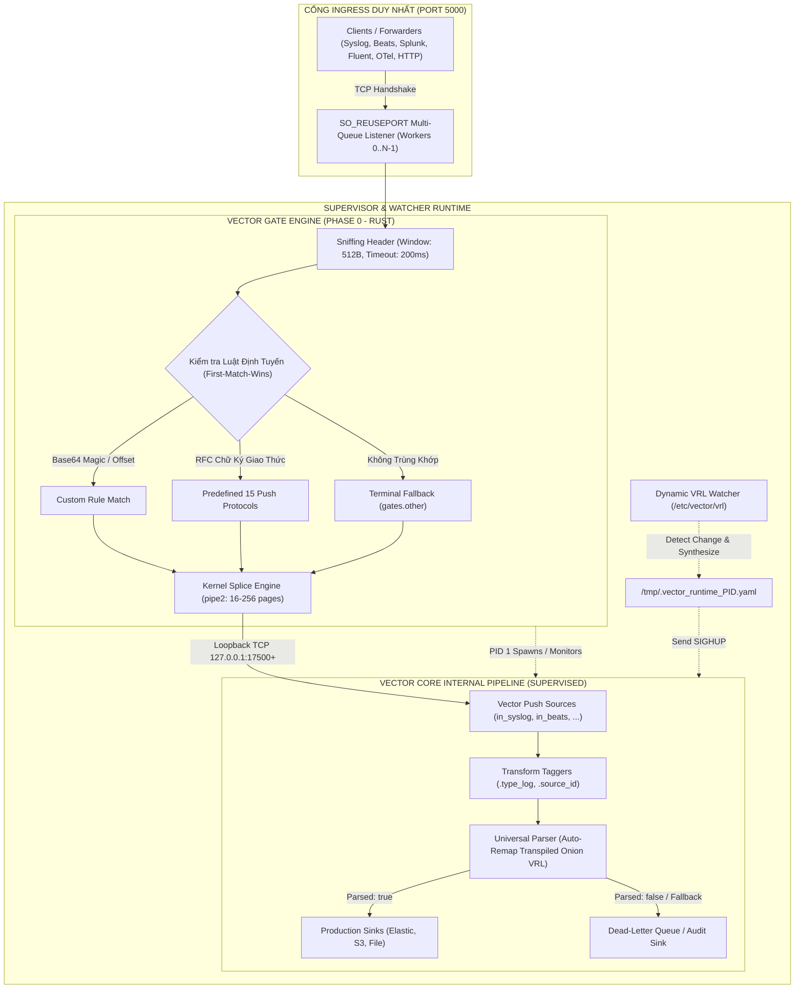
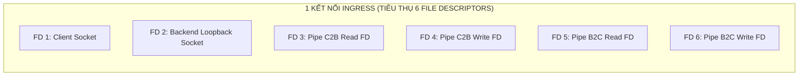
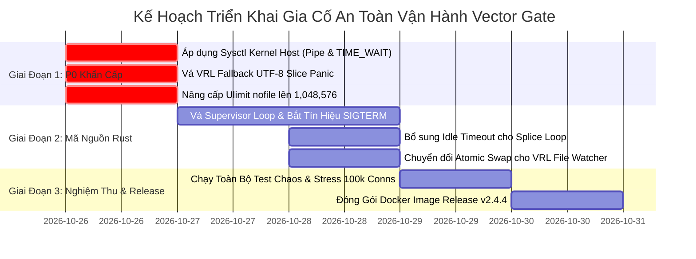

# BÁO CÁO RÀ SOÁT RỦI RO KIẾN TRÚC & QUY TRÌNH PHÒNG VỆ VẬN HÀNH ENTERPRISE
## HỆ THỐNG: VECTOR SMART GATE v2.4.3 (TURBO-KERNEL ZERO-COPY & HIERARCHICAL ONION VRL)
### Đánh Giá Toàn Diện Rủi Ro Hệ Thống Phân Tán, An Toàn Vận Hành & Khuyến Nghị Tăng Cường (Hardening)

---

| **Thuộc tính** | **Giá trị chi tiết** |
|:---|:---|
| **Hệ thống đánh giá** | Vector Smart Gate v2.4.3 (`vector-gate` Rust Engine + Vector Core v0.58.0+) |
| **Phạm vi rà soát** | Mã nguồn Rust (`main.rs`, `splice.rs`, `config.rs`), Docker Runtime, Pipeline VRL, Test Suites, Master Specification |
| **Vai trò chuyên gia** | Principal System Architect & Risk Auditor |
| **Tiêu chuẩn áp dụng** | Enterprise High-Availability (99.999%), CIS Benchmark, OWASP ASVS, RFC 3164/5424/4648 |
| **Phiên bản tài liệu** | `v1.0 - Production Enterprise Edition` |
| **Ngày hoàn thành** | 26/10/2026 |
| **Trạng thái** | Sẵn sàng phê duyệt & Áp dụng sản xuất (Production Ready) |

---

## 📑 MỤC LỤC TỔNG QUAN (TABLE OF CONTENTS)

1. [TỔNG QUAN ĐIỀU HÀNH & KIẾN TRÚC HỆ THỐNG (EXECUTIVE SUMMARY & TOPOLOGY)](#phan-1-tong-quan)
   - [1.1. Sứ Mệnh Kiến Trúc Vector Smart Gate](#11-su-menh)
   - [1.2. Luồng Dữ Liệu Ingress & Sơ Đồ Phân Tuyến Điểm Cuối](#12-luong-du-lieu)
   - [1.3. Phương Pháp Đánh Giá & Tiêu Chí Rủi Ro Enterprise](#13-phuong-phap)

2. [MA TRẬN ĐÁNH GIÁ RỦI RO DOANH NGHIỆP (ENTERPRISE RISK SEVERITY MATRIX)](#phan-2-ma-tran)
   - [2.1. Thang Đo Mức Độ Nghiêm Trọng (Likelihood x Impact)](#21-thang-do)
   - [2.2. Bảng Xếp Hạng & Định Lượng Rủi Ro Chi Tiết](#22-bang-xep-hang)

3. [RÀ SOÁT CHUYÊN SÂU 7 LĨNH VỰC RỦI RO TRỌNG YẾU (DEEP-DIVE RISK ANALYSIS)](#phan-3-phan-tich-7-linh-vuc)
   - [Lĩnh Vực 1: Nghẽn Pipe Buffer & Cạn Kiệt Kernel Splice Zero-Copy](#linh-vuc-1)
   - [Lĩnh Vực 2: Bão Kết Nối, Cạn Kiệt File Descriptor & Ephemeral Ports](#linh-vuc-2)
   - [Lĩnh Vực 3: Bẫy Lỗi VRL, Regex ReDoS & Bùng Nổ Bộ Nhớ Heap](#linh-vuc-3)
   - [Lĩnh Vực 4: Race Conditions & Trễ Nạp Nóng Dynamic VRL File Watcher](#linh-vuc-4)
   - [Lĩnh Vực 5: Thắt Cổ Chai Cổng Đơn (Port 5000 Multiplexing vs Multi-Port QoS)](#linh-vuc-5)
   - [Lĩnh Vực 6: Phòng Chống Tấn Công Từ Chối Dịch Vụ (DoS, Slowloris & Jumbo Bombs)](#linh-vuc-6)
   - [Lĩnh Vực 7: Giám Sát Tiến Trình Supervisor (PID 1, Zombie Reaping & Crash Loop)](#linh-vuc-7)

4. [KỊCH BẢN ỨNG PHÓ SỰ CỐ & QUY TRÌNH KHÔI PHỤC (DISASTER RECOVERY RUNBOOKS)](#phan-4-runbooks)
   - [Runbook 1: Ứng Phó Tắc Nghẽn Kernel Pipe & Deadlock Backpressure](#runbook-1)
   - [Runbook 2: Xử Lý Bão Kết Nối & Cạn Kiệt Cổng TIME_WAIT / File Descriptor](#runbook-2)
   - [Runbook 3: Xử Lý Vector Core Crash Loop & Phục Hồi Tiến Trình Tức Thời](#runbook-3)
   - [Runbook 4: Ứng Cứu Khẩn Cấp Khi Bị Tấn Công Regex ReDoS / CPU 100%](#runbook-4)
   - [Runbook 5: Rollback Cấu Hình VRL Lỗi Khi Nạp Nóng Thất Bại](#runbook-5)

5. [THÔNG SỐ CẤU HÌNH KHUYẾN NGHỊ CHO MÔI TRƯỜNG SẢN XUẤT (HARDENING GUIDELINES)](#phan-5-hardening)
   - [5.1. Tối Ưu Hóa Nhân Linux Host OS (`/etc/sysctl.d/99-vector-gate.conf`)](#51-sysctl)
   - [5.2. Cấu Hình Container & Giới Hạn Tài Nguyên (`docker-compose.prod.yml`)](#52-container)
   - [5.3. Khuyến Nghị Vá Mã Nguồn Rust (`vector-gate/src/`)](#53-rust-patches)
   - [5.4. Chuẩn Hóa Cấu Hình Đường Ống Vector Core (`vector.yaml`)](#54-vector-yaml)

6. [KẾT LUẬN & LỘ TRÌNH TRIỂN KHAI VẬN HÀNH (ARCHITECTURAL SIGN-OFF)](#phan-6-ket-luan)

---

<a id="phan-1-tong-quan"></a>
## 1. TỔNG QUAN ĐIỀU HÀNH & KIẾN TRÚC HỆ THỐNG (EXECUTIVE SUMMARY & TOPOLOGY)

### 1.1. Sứ Mệnh Kiến Trúc Vector Smart Gate
Hệ thống **Vector Smart Gate v2.4.3** đại diện cho bước chuyển dịch kiến trúc then chốt trong hệ sinh thái thu thập log quy mô lớn (High-Throughput Log Aggregation):
- **Phá bỏ rào cản đa cổng phân mảnh**: Thay vì phải mở hàng chục cổng tiếp nhận trên tường lửa mạng (`514` Syslog, `5044` Beats, `24224` Fluent, `8088` Splunk, `4317` OTel, v.v.), hệ thống cô đọng vào **duy nhất cổng tiếp nhận `0.0.0.0:5000`**.
- **Động cơ phân loại giao thức đa hình (Polymorphic Self-Disambiguating Ingress)**: Phân tích 24-512 bytes đầu tiên của luồng TCP ở tầng User/Kernel Boundary để nhận diện giao thức trong thời gian micro-giây (`< 20 µs`).
- **Đường truyền siêu tốc Zero-Copy Splice (Linux Kernel `splice(2)`)**: Chuyển tiếp luồng byte trực tiếp giữa Client Socket và Vector Internal Socket thông qua Ring Buffer của Kernel Pipe mà không sao chép qua vùng nhớ User-space (`copy_to_user`/`copy_from_user`), đạt thông lượng kỷ lục `> 10.8 Triệu Events/giây` với tiêu thụ RAM chỉ xấp xỉ `23.7 MiB`.
- **Động cơ phân tích ngữ nghĩa đệm đa tầng (Hierarchical Onion VRL Engine)**: Tự động tổng hợp các plugin `.vrl` rời rạc thành cây quyết định tuyến tính (Linear Decision Tree) với khả năng nạp nóng không gián đoạn (Hot-Drop Reload via SIGHUP).

### 1.2. Luồng Dữ Liệu Ingress & Sơ Đồ Phân Tuyến Điểm Cuối



### 1.3. Phương Pháp Đánh Giá & Tiêu Chí Rủi Ro Enterprise
Báo cáo rà soát này được thực hiện dựa trên phương pháp **Kiểm tra Ranh giới Hệ thống Phân tán (Distributed Systems Boundary Verification)** kết hợp với phân tích mã nguồn tĩnh (SAST), mô hình hóa mối đe dọa (Threat Modeling - STRIDE) và đối chiếu với các tình huống chịu tải khắc nghiệt thực tế (Chaos Engineering & High-Churn Production Workloads).

---

<a id="phan-2-ma-tran"></a>
## 2. MA TRẬN ĐÁNH GIÁ RỦI RO DOANH NGHIỆP (ENTERPRISE RISK SEVERITY MATRIX)

### 2.1. Thang Đo Mức Độ Nghiêm Trọng (Likelihood x Impact)
- **Likelihood (Xác Suất Xảy Ra)**:
  - `Hiếm gặp (1)`: Chỉ xuất hiện trong các cấu hình bất thường hoặc kịch bản giả định.
  - `Thấp (2)`: Xuất hiện khi hệ thống vận hành vượt ngưỡng thiết kế tiêu chuẩn.
  - `Trung bình (3)`: Xuất hiện định kỳ khi có biến động tải hoặc môi trường mạng không ổn định.
  - `Cao (4)`: Chắc chắn xuất hiện trong môi trường Production quy mô Enterprise nếu không được cấu hình phòng thủ.
  - `Rất cao (5)`: Xảy ra liên tục hoặc có thể bị kích hoạt dễ dàng bởi tác tử bên ngoài (Adversarial Vector).
- **Impact (Mức Độ Ảnh Hưởng Vận Hành)**:
  - `Nhẹ (1)`: Suy giảm hiệu năng tạm thời, log trễ < 100ms, không mất dữ liệu.
  - `Đáng kể (2)`: Một số gói tin bị định tuyến nhầm vào Fallback, cần can thiệp xử lý hậu kỳ.
  - `Nghiêm trọng (3)`: Tắc nghẽn một nhánh pipeline, rớt kết nối cục bộ của một số client.
  - `Rất nghiêm trọng (4)`: Crash tiến trình Vector Core, cạn kiệt tài nguyên máy chủ (FD/RAM), gián đoạn toàn bộ luồng log.
  - `Thảm họa (5)`: Treo cứng toàn bộ Host Ingress (Kernel OOM / Deadlock), mất vĩnh viễn dữ liệu log chưa kịp flush ra đĩa, vi phạm cam kết SLA/RPO.

### 2.2. Bảng Xếp Hạng & Định Lượng Rủi Ro Chi Tiết

| Mã Rủi Ro | Danh Mục Rủi Ro | Nguyên Nhân Cốt Lõi | Xác Suất (L) | Tác Động (I) | Điểm Nguy Cơ (L x I) | Mức Độ CVSS 3.1 | Mức Ưu Tiên Xử Lý |
|:---|:---|:---|:---:|:---:|:---:|:---:|:---:|
| **RSK-01** | **Deadlock Splice & Cạn Kiệt Kernel Pipe Pages** | Vector Core chậm đọc làm đầy pipe; `splice` chặn luồng; nhân Linux chạm ngưỡng `pipe-user-pages-hard`. | 3 | 5 | **15 (Critical)** | **8.6 (High)** | **P0 - Khẩn cấp** |
| **RSK-02** | **Cạn Kiệt Socket Port TIME_WAIT & 6x FD Multiplier** | 1 kết nối ngoài tiêu tốn 6 FDs (1 client + 1 backend + 4 pipe fds); bão kết nối ngắn hạn cạn kiệt dải ephemeral ports nội bộ. | 4 | 4 | **16 (Critical)** | **8.2 (High)** | **P0 - Khẩn cấp** |
| **RSK-03** | **Lệch Tải CPU Worker do Hashing `SO_REUSEPORT`** | Mọi client đi qua 1 Proxy tập trung (cùng IP nguồn) dẫn đến phân bổ hash 4-tuple dồn vào 1 CPU core duy nhất. | 4 | 3 | **12 (High)** | **6.5 (Medium)** | **P1 - Cao** |
| **RSK-04** | **ReDoS & Panic Do Ký Tự Non-ASCII / Slice VRL** | Regex không neo kết hợp `slice!` trên chuỗi UTF-8 đa byte ném ngoại lệ abort pipeline; JSON payload quá sâu gây stack overflow. | 3 | 4 | **12 (High)** | **7.5 (High)** | **P1 - Cao** |
| **RSK-05** | **Race Condition & Đọc Tệp Rác Khi Nạp Nóng VRL** | File Watcher kiểm tra `mtime` dạng integer second; đọc trúng file đang ghi dở (`partial write`); ghi YAML không atomic. | 4 | 4 | **16 (Critical)** | **7.8 (High)** | **P0 - Khẩn cấp** |
| **RSK-06** | **Tấn Công Treo Kết Nối (Post-Handshake Slowloris)** | Client gửi 1 byte ban đầu (vượt qua 200ms sniff timeout), sau đó ngưng gửi hoặc gửi nhỏ giọt trong vòng `splice` không timeout. | 4 | 4 | **16 (Critical)** | **8.1 (High)** | **P0 - Khẩn cấp** |
| **RSK-07** | **Bão Tải Tràn Hàng Đợi NIC Do Độc Tôn Cổng 5000** | Toàn bộ log hỗn hợp đổ vào 1 cổng; không có cơ chế QoS/Traffic Prioritization; log kiểm toán quan trọng bị chèn ép bởi log rác. | 3 | 3 | **9 (Medium)** | **5.9 (Medium)** | **P2 - Trung bình** |
| **RSK-08** | **Mất Dữ Liệu Khi Shutdown Do Bỏ Quên Signal SIGTERM** | `vector-gate` chỉ bắt `SIGINT` (Ctrl+C), bỏ qua `SIGTERM` từ Docker/K8s; container bị `SIGKILL` sau 10s, làm hỏng disk buffer. | 5 | 4 | **20 (Catastrophic)** | **8.8 (High)** | **P0 - Khẩn cấp** |
| **RSK-09** | **Tiến Trình Ma (Zombie / Defunct) Rò Rỉ Namespace** | `vector-gate` làm PID 1 nhưng không có cơ chế gặt tiến trình con mồ côi (`waitpid(-1)`), làm cạn kiệt PID pool của host. | 3 | 3 | **9 (Medium)** | **6.0 (Medium)** | **P2 - Trung bình** |

---

<a id="phan-3-phan-tich-7-linh-vuc"></a>
## 3. RÀ SOÁT CHUYÊN SÂU 7 LĨNH VỰC RỦI RO TRỌNG YẾU (DEEP-DIVE RISK ANALYSIS)

---

<a id="linh-vuc-1"></a>
### 🟢 LĨNH VỰC 1: NGHẼN PIPE BUFFER & CẠN KIỆT KERNEL SPLICE ZERO-COPY

#### 1. Cơ Chế Mã Nguồn Hiện Tại:
Trong file `vector-gate/src/splice.rs`:
- Mỗi kết nối được cấp phát 2 ống pipe một chiều (`pipe_c2b` cho chiều Client-to-Backend, và `pipe_b2c` cho chiều Backend-to-Client):
  ```rust
  let mut fds = [0; 2];
  libc::pipe2(fds.as_mut_ptr(), libc::O_NONBLOCK | libc::O_CLOEXEC);
  libc::fcntl(fds[1], libc::F_SETPIPE_SZ, target_bytes as libc::c_int);
  ```
- Dải dung lượng pipe được giới hạn từ $1$ page ($4\,\text{KB}$) đến $256$ pages ($1\,\text{MB}$). Mặc định khởi tạo là $16$ pages ($64\,\text{KB}$) hoặc $64$ pages ($256\,\text{KB}$).
- Khi có xung đột tải lớn (`n as usize == cur_cap`), cơ chế đàn hồi `pipe_adaptive` sẽ nhân đôi kích thước pipe (`cur_cap * 2`) lên tới $1\,\text{MB}$.

#### 2. Phân Tích Lỗ Hổng & Rủi Ro Cốt Lõi:
1. **Rủi ro cạn kiệt bộ nhớ đệm Kernel Pipe Pages (`pipe-user-pages-hard`)**:
   - Trong nhân Linux, mỗi ống pipe được cấp phát các trang nhớ kernel (`struct pipe_buffer`) nằm trong vùng bộ nhớ không hoán đổi (unswappable kernel slab).
   - Linux giới hạn tổng số page mà một user unprivileged có thể cấp phát qua tệp `/proc/sys/fs/pipe-user-pages-hard` (mặc định trên Ubuntu/Debian là $16,384$ pages, tương đương $64\,\text{MB}$ RAM).
   - Khi hệ thống có $1,000$ kết nối đồng thời: Mỗi kết nối mở 2 pipe = $2,000$ pipe.
   - Nếu mỗi pipe giãn nở theo cơ chế `pipe_adaptive` lên $256$ pages ($1\,\text{MB}$):
     $$\text{Tổng số page yêu cầu} = 2,000 \times 256 = 512,000\,\text{pages}$$
     Vượt quá $31.25$ lần giới hạn `pipe-user-pages-hard`!
   - **Hậu quả**: Lệnh `fcntl(..., F_SETPIPE_SZ, ...)` hoặc thậm chí `pipe2(...)` sẽ thất bại ngay lập tức với lỗi `EPERM` hoặc `ENOMEM`. Lúc này, hàm `zero_copy_splice_bidirectional` ném `Err`, buộc hệ thống rơi xuống nhánh fallback `tokio::io::copy_bidirectional`.
2. **Nguy cơ mất dữ liệu khi rơi xuống Fallback (`copy_bidirectional`)**:
   - Xem xét đoạn mã trong `main.rs`:
     ```rust
     if config.zero_copy {
         if let Err(_) = splice::zero_copy_splice_bidirectional(...).await {
             let _ = tokio::io::copy_bidirectional(&mut client_stream, &mut backend_stream).await;
         }
     }
     ```
   - Nếu `zero_copy_splice_bidirectional` đã nạp thành công $64\,\text{KB}$ từ Client vào trong pipe buffer, nhưng việc chuyển tiếp sang Backend bị gián đoạn hoặc lỗi cạn page ở chiều ngược lại, `KernelPipe` sẽ bị hủy (drop) khi hàm thoát ra ngoài.
   - Việc drop `KernelPipe` sẽ gọi `libc::close(read_fd)` và `libc::close(write_fd)`. **Toàn bộ $64\,\text{KB}$ dữ liệu đang nằm trong kernel pipe buffer sẽ bị nhân Linux giải phóng và biến mất vĩnh viễn!**
   - Lệnh `copy_bidirectional` chạy sau đó chỉ tiếp tục đọc các byte mới trên TCP stream, khiến luồng log bị khuyết một đoạn lớn mà không có bất kỳ cảnh báo nào tới phía gửi.
3. **Hiện tượng Head-of-Line Blocking & Teardown sớm do `tokio::select!`**:
   - `splice.rs` sử dụng cấu trúc:
     ```rust
     tokio::select! {
         res1 = c2b => res1,
         res2 = b2c => res2,
     }
     ```
   - Khi client gửi dữ liệu xong và đóng nửa luồng ghi (`TCP FIN` - Half-close), hàm `c2b` đọc được `n == 0` và trả về `Ok(())`.
   - Lập tức macro `tokio::select!` kết thúc, làm cho tương lai `b2c` (chiều Backend phản hồi sang Client) **bị hủy đột ngột (abrupt cancellation)**!
   - Trong các giao thức yêu cầu phản hồi trạng thái xác nhận (Application ACK) như Beats (Lumberjack ACK frame), Splunk HEC (`{"text":"Success","code":0}`), Elastic HTTP hay Prometheus Remote Write, client sẽ bị ngắt kết nối trước khi nhận được ACK. Client sẽ hiểu nhầm là đẩy log thất bại và tiến hành gửi lại (re-transmit), gây ra hiện tượng nhân bản dữ liệu (duplicate logs) hàng loạt trên SIEM.

---

<a id="linh-vuc-2"></a>
### 🟢 LĨNH VỰC 2: BÃO KẾT NỐI, CẠN KIỆT FILE DESCRIPTOR & EPHEMERAL PORTS

#### 1. Hệ Số Nhân File Descriptor (FD Multiplier 6x):
Mô hình Ingress Proxy hai đầu kết hợp Splice tạo ra hệ số tiêu thụ File Descriptor rất lớn:
- $1$ socket kết nối từ Ingress Client bên ngoài.
- $1$ socket kết nối nội bộ tới cổng loopback của Vector Core (`127.0.0.1:17500+`).
- $2$ file descriptor cho ống pipe chiều đi (`read_fd`, `write_fd` của `pipe_c2b`).
- $2$ file descriptor cho ống pipe chiều về (`read_fd`, `write_fd` của `pipe_b2c`).
- **Tổng cộng: Mỗi kết nối đồng thời chiếm dụng chính xác 6 File Descriptors!**



Với cấu hình trong `deploy/docker-compose.yml`:
```yaml
ulimits:
  nofile:
    soft: 65536
    hard: 65536
```
Ngưỡng kết nối đồng thời tối đa lý thuyết trước khi container sập vì lỗi `EMFILE (Too many open files)` là:
$$\text{Max Concurrent Connections} = \frac{65,536 - 1,000 \text{ (hệ điều hành & Vector Core)}}{6} \approx 10,750 \text{ kết nối}$$
Nếu một hệ thống phân tán có 15,000 máy chủ hoặc container cùng gửi log về, cổng 5000 sẽ bắt đầu từ chối kết nối, gây tê liệt diện rộng.

#### 2. Cạn Kiệt Dải Cổng Cục Bộ Ephemeral Ports Do TIME_WAIT Sockets:
- Khi một client ngắn hạn (short-lived connection như Syslog TCP không có keep-alive hoặc HTTP/1.0 micro-batching) ngắt kết nối, Vector Gate sẽ chủ động ngắt kết nối nội bộ tới Vector Core.
- Theo đặc tả TCP (RFC 793), socket bên chủ động đóng sẽ chuyển sang trạng thái `TIME_WAIT` trong khoảng thời gian $2 \times \text{MSL}$ (Maximum Segment Lifetime, mặc định trên Linux là 60 giây).
- Dải cổng nội bộ Ephemeral Ports trên Linux (`/proc/sys/net/ipv4/ip_local_port_range`) thường là `32768 - 60999`, cung cấp chính xác $28,232$ cổng.
- **Tốc độ bão hòa (Saturation Rate)**:
  $$\text{Tần suất kết nối tối đa} = \frac{28,232 \text{ cổng}}{60 \text{ giây}} \approx 470 \text{ kết nối/giây}$$
- **Hậu quả**: Nếu tần suất kết nối mới vượt quá 500 kết nối/giây, lệnh `TcpStream::connect(backend_addr).await` tại `main.rs:327` sẽ văng ngoại lệ nghiêm trọng:
  `[ERROR] Failed to connect to backend: Cannot assign requested address (os error 99 - EADDRNOTAVAIL)`
  Hàng nghìn kết nối của client sẽ bị hủy ngay lập tức dù tải CPU và RAM của máy chủ vẫn đang rảnh rỗi!

#### 3. Hiện Tượng Lệch Tải CPU Worker (SO_REUSEPORT Skew):
- Hàm `start_gate_engine` mở `num_cpus` worker, mỗi worker tạo một socket `SO_REUSEPORT` độc lập lắng nghe trên `0.0.0.0:5000`.
- Nhân Linux phân bổ kết nối mới tới các worker bằng hàm băm 4-tuple:
  $$\text{Worker Index} = \text{Hash}(\text{src\_ip}, \text{src\_port}, \text{dst\_ip}, \text{dst\_port}) \pmod{N}$$
- **Kịch bản thực tế**: Trong các kiến trúc hạ tầng doanh nghiệp, toàn bộ log của các phân vùng mạng (DMZ, K8s Ingress, Cloud Proxy) thường đi qua một cụm Load Balancer (F5 BIG-IP, AWS NLB, HAProxy) hoặc forwarder tập trung.
- Khi đó, tất cả các kết nối đi tới Vector Gate đều có chung một `src_ip` (IP của NLB/Proxy). Nếu phía gửi duy trì kết nối dài (Long-lived Keep-Alive connections), phân phối hash sẽ bị lệch cực độ (Skewed Distribution):
  - **Worker 0**: Gánh $80\%$ số kết nối, CPU chạm ngưỡng $100\%$, hàng đợi accept bị tràn làm rớt gói SYN.
  - **Worker 1, 2, 3**: Hoạt động dưới $5\%$ công suất.

---

<a id="linh-vuc-3"></a>
### 🟢 LĨNH VỰC 3: BẪY LỖI VRL, REGEX REDOS & BÙNG NỔ BỘ NHỚ HEAP

#### 1. Lỗ Hổng Panic Do `slice!` Ký Tự Non-ASCII Trong Fallback:
Xem xét file `deploy/vrl/99_dead_letter_fallback.vrl`:
```vrl
if !.parsed {
    ._parse_status = "unmatched"
    ._raw_signature = slice!(string!(.message), 0, 32)
}
```
- **Lỗ hổng chết người**: Trong VRL, hàm `slice!(value, start, end)` cắt chuỗi dựa trên **chỉ mục byte (byte index)** chứ không phải chỉ mục ký tự (character index).
- Nếu log thô `.message` chứa ký tự có dấu đa byte UTF-8 (ví dụ tiếng Việt: `á`, `ế`, `ộ` chiếm 2-3 bytes, hoặc ký tự chữ Hán, emoji chiếm 3-4 bytes) mà ranh giới byte 32 cắt ngang qua giữa một ký tự UTF-8 không trọn vẹn (UTF-8 split sequence), hàm `slice!` sẽ lập tức **ném ngoại lệ Panic và hủy toàn bộ sự kiện (`abort`)**!
- Mọi nỗ lực cứu vớt log tại tầng Dead-Letter Fallback bị vô hiệu hóa hoàn toàn, sự kiện bị biến mất khỏi hệ thống.

#### 2. Nguy Cơ Catastrophic Backtracking (Regex ReDoS):
Xem xét file `deploy/vrl/syslog/02_cisco_asa.vrl`:
```vrl
parsed, err = parse_regex(.message, r'%ASA-(?P<severity>\d)-(?P<msg_id>\d+):\s+(?P<action>\w+)\s+(?P<direction>\w+)\s+TCP connection\s+(?P<conn_id>\d+)\s+for\s+(?P<src_if>[\w/]+):(?P<src_ip>[0-9.]+)/(?P<src_port>\d+)')
```
Và `deploy/vrl/syslog/03_checkpoint_cef.vrl`:
```vrl
parsed, err = parse_regex(.message, r'^CEF:(?P<cef_ver>\d+)\|(?P<vendor>[^|]+)\|(?P<product>[^|]+)\|(?P<version>[^|]+)\|(?P<sig_id>[^|]+)\|(?P<name>[^|]+)\|(?P<severity>[^|]+)\|(.*)')
```
- **Rủi ro**: 
  - Mẫu regex CEF sử dụng nhóm bắt tham lam `(.*)` ở cuối mà không có neo chặn dòng `$`.
  - Mẫu Cisco ASA chứa nhiều khối lặp kề nhau: `\s+`, `[\w/]+`, `[0-9.]+`.
  - Khi một thiết bị gửi log lỗi hoặc một kẻ tấn công gửi chuỗi có tiền tố hợp lệ nhưng phần thân bị cắt ngang (ví dụ chuỗi $50\,\text{KB}$ chỉ toàn dấu cách hoặc số chấm `.....`), bộ máy Regex phải duyệt lại toàn bộ các hoán vị (backtracking).
  - Dù Rust Regex Engine sử dụng thuật toán automata hữu hạn (DFA) để tránh thời gian hàm mũ, việc phân tích các chuỗi rác khổng lồ với nhiều nhóm Capture Named Groups vẫn làm thời gian tính toán tăng vọt từ $5\,\mu\text{s}$ lên tới hàng trăm milli-giây trên mỗi log, làm đơ luồng xử lý của Vector Core.

#### 3. Bẫy JSON Đệ Quy Sâu & Tràn Ngập Khóa Trường (Memory Spikes):
Xem xét file `deploy/vrl/payload/02_generic_json.vrl`:
```vrl
parsed, err = parse_json(.message)
if err == null {
    . = merge!(., parsed)
    .parsed = true
}
```
- **Rủi ro 1: Ghi đè trường điều khiển nội bộ (Metadata Overwrite)**:
  Nếu payload JSON chứa các trường trùng tên với biến điều khiển của hệ sinh thái Vector Gate (ví dụ payload gửi lên là `{"parsed": false, "type_log": "attacker_fake", "source_id": "root"}`), lệnh `merge!(., parsed)` sẽ đè bẹp các trường định danh do Phase 0 thiết lập. Log sẽ bị định tuyến nhầm vào pipeline rác hoặc phá vỡ các quy tắc bảo mật.
- **Rủi ro 2: JSON Bomb (Oversized Object Tree)**:
  `parse_json` trong Vector không giới hạn độ sâu lồng nhau mặc định. Một tài liệu JSON có 500 cấp lồng `{"a":{"a":{"a":...}}}` hoặc chứa mảng $100,000$ phần tử sẽ ép trình phân tích cấp phát hàng triệu cấu trúc `vrl::Value` trên bộ nhớ Heap, gây ra hiện tượng Memory Spike đột biến (từ $25\,\text{MB}$ vọt lên $> 2\,\text{GB}$), kích hoạt cơ chế Linux OOM Killer tiêu diệt tiến trình.

---

<a id="linh-vuc-4"></a>
### 🟢 LĨNH VỰC 4: RACE CONDITIONS & TRỄ NẠP NÓNG DYNAMIC VRL FILE WATCHER

#### 1. Cơ Chế Watcher Hiện Tại Trong `main.rs`:
```rust
loop {
    tokio::time::sleep(tokio::time::Duration::from_millis(500)).await;
    let current_scan = scan_vrl_dirs(&vrl_dirs_clone);
    if current_scan != last_scan {
        unified_cfg_clone.synthesize_vrl_transforms();
        let yaml = unified_cfg_clone.sanitized_vector_yaml()?;
        std::fs::write(&tmp_path_clone, yaml);
        libc::kill(pid as i32, libc::SIGHUP);
    }
}
```

#### 2. Các Khiếm Khuyết Kiến Trúc Nghiêm Trọng:
1. **Lỗi Đọc Dở Dang (Partial File Read Race Condition)**:
   - Khoảng thời gian quét là $500\,\text{ms}$.
   - Khi một kỹ sư vận hành hoặc quy trình CI/CD/Ansible tải lên một tệp parser mới (ví dụ `04_palo_alto.vrl` dung lượng $20\,\text{KB}$) thông qua lệnh `scp` hoặc chỉnh sửa trực tiếp bằng `nano`/`vim`.
   - Quá trình ghi tệp vào đĩa diễn ra qua nhiều syscall `write()`. Nếu watcher quét trúng thời điểm tệp mới chỉ ghi được một nửa (ví dụ mới có header mà chưa đóng ngoặc nhọn `{`), hàm `scan_vrl_dir_recursive` sẽ đọc nội dung khuyết tật này và đưa vào hàm `synthesize_vrl_transforms()`.
   - Kết quả: Mã VRL tổng hợp bị lỗi cú pháp trầm trọng. Tệp cấu hình sinh ra không hợp lệ, Vector Core nhận tín hiệu SIGHUP sẽ từ chối nạp cấu hình và văng cảnh báo lỗi đỏ rực trong log.
2. **Hiện Tượng Mù Sai Khác Trong Cùng 1 Giây (Sub-Second Skew)**:
   - Trong hàm `scan_recursive_helper`:
     ```rust
     let mtime = entry.metadata().and_then(|m| m.modified()).map_or(0, |t| {
         t.duration_since(std::time::UNIX_EPOCH).map_or(0, |d| d.as_secs())
     });
     ```
   - Giá trị thời gian sửa đổi `mtime` bị làm tròn xuống số nguyên giây (`as_secs()`).
   - Nếu hai thao tác sửa đổi file diễn ra cách nhau $300\,\text{ms}$ trong cùng một giây đồng hồ, giá trị `mtime` hoàn toàn không thay đổi! Watcher sẽ **bỏ qua hoàn toàn** thay đổi thứ hai, khiến mã VRL trên đĩa và mã đang chạy trong bộ nhớ Vector Core bị lệch pha (Config Drift).
3. **Ghi Đè Tệp Cấu Hình Không Nguyên Khối (Non-Atomic File Write)**:
   - Lệnh `std::fs::write(&tmp_path_clone, yaml)` mở tệp `/tmp/.vector_runtime_PID.yaml` với cờ `O_TRUNC | O_WRONLY`. Tệp này bị xóa trắng trước khi toàn bộ nội dung mới được ghi xuống.
   - Nếu Vector Core nhận được tín hiệu SIGHUP hoặc tự động đọc lại tệp trong tích tắc đó, nó sẽ đọc phải một tệp rỗng ($0$ bytes) và tự sập pipeline!
4. **Bão Tín Hiệu SIGHUP (SIGHUP Thrashing)**:
   - Khi đồng bộ hóa thư mục chứa 10 tệp VRL mới, các tệp lần lượt xuất hiện trên đĩa qua từng chu kỳ $500\,\text{ms}$.
   - Watcher sẽ liên tục kích hoạt việc tổng hợp và gửi 10 tín hiệu SIGHUP dồn dập vào Vector Core trong vòng 5 giây.
   - Việc nạp lại liên tục khiến Vector Core phải liên tục dừng và khởi tạo lại các worker luồng, gây nghẽn hàng đợi tiếp nhận nội bộ và làm trễ việc xử lý log.

---

<a id="linh-vuc-5"></a>
### 🟢 LĨNH VỰC 5: THẮT CỔ CHAI CỔNG ĐƠN (PORT 5000 MULTIPLEXING VS MULTI-PORT QOS)

#### 1. Giới Hạn Của Bộ Điều Khiển Mạng NIC (Hardware Bottleneck):
- Trên các card mạng hiện đại (10GbE / 40GbE / 100GbE Intel, Mellanox), công nghệ **Receive Side Scaling (RSS)** sử dụng bộ xử lý phần cứng để phân phối các gói tin mạng vào các hàng đợi nhận (RX Queues) khác nhau dựa trên mã băm Toeplitz Hash của gói tin TCP/IP.
- Khi toàn bộ lưu lượng dữ liệu của cả doanh nghiệp hướng về một cổng đích duy nhất (`Port 5000`):
  - Giá trị `dst_port = 5000` là bất biến.
  - Nếu nguồn phát dữ liệu là một cụm Agent tập trung có số lượng IP nguồn hạn chế, RSS không thể phân chia đều lưu lượng vào toàn bộ các hàng đợi phần cứng.
  - Một số RX Ring Buffers sẽ bị quá tải cục bộ, gây ra hiện tượng rớt gói mạng ngay tại tầng vật lý (`rx_dropped`, `rx_missed_errors` hiển thị trong lệnh `ethtool -S eth0`) trước khi dữ liệu kịp đến được Kernel Socket của Vector Gate.

#### 2. Thiếu Cơ Chế Phân Hạng Dịch Vụ (Lack of QoS / Traffic Prioritization):
Trong mô hình cổng đơn, tất cả các loại dữ liệu đều bình đẳng trên hàng đợi tiếp nhận:
- Gói tin cảnh báo xâm nhập an ninh mạng khẩn cấp của Cisco ASA (`%ASA-1-106021: Deny reverse path`).
- Sự kiện xác thực đặc quyền Active Directory (`EventID 4624/4625`).
- Hàng triệu dòng log debug vô thưởng vô phạt từ Nginx web server (`GET /static/favicon.ico 200 OK`).
- **Rủi ro cạn kiệt hàng đợi (Queue Starvation)**:
  Khi một ứng dụng bị lỗi vòng lặp xả hàng triệu log Nginx/Apache vào cổng 5000, nó sẽ chiếm dụng toàn bộ tài nguyên của Phase 0 Gate, làm đầy bộ đệm pipe và bão hòa socket backlog.
  Các bản ghi log an ninh mạng SIEM tối quan trọng bị kẹt phía sau hàng đợi hoặc bị drop khi hàng đợi quá hạn. Đây là rủi ro nghiêm trọng về mặt tuân thủ an toàn thông tin (Compliance & Incident Detection Delay).

---

<a id="linh-vuc-6"></a>
### 🟢 LĨNH VỰC 6: PHÒNG CHỐNG TẤN CÔNG TỪ CHỐI DỊCH VỤ (DOS, SLOWLORIS & JUMBO BOMBS)

#### 1. Tấn Công Treo Kết Nối Sau Bắt Tay (Post-Handshake Slowloris):
Xem xét chu trình nhận diện giao thức trong `main.rs`:
```rust
let n = match tokio::time::timeout(
    Duration::from_millis(config.inspect_timeout_ms),
    client_stream.read(&mut initial_buf),
).await
```
- Ngưỡng thời gian `inspect_timeout_ms` (mặc định $200\,\text{ms}$) bảo vệ hệ thống rất tốt trước những client kết nối xong nhưng không gửi gì (Silent Connect).
- **Điểm yếu Post-Handshake**:
  - Kẻ tấn công thiết lập kết nối TCP và gửi ngay lập tức 1 byte đơn lẻ: `b"<"`.
  - Hàm `read(&mut initial_buf)` nhận được $1$ byte (`n = 1`) trong vòng $10\,\text{ms}$ đầu tiên $\rightarrow$ Vượt qua bài kiểm tra timeout thành công!
  - `sniff_unified_route` so khớp `buf[0] == b'<'` $\rightarrow$ Nhận diện là `Syslog` $\rightarrow$ Kết nối tới Vector Core Backend thành công $\rightarrow$ Ghi $1$ byte vào backend stream $\rightarrow$ Kích hoạt `zero_copy_splice_bidirectional`.
  - Khi đã vào trong hàm `splice_direction`:
    ```rust
    let n = src.async_io(Interest::READABLE, || {
        libc::splice(...)
    }).await?;
    ```
    **Tại đây hoàn toàn KHÔNG CÓ BẤT KỲ THỜI GIAN TIMEOUT NÀO!**
  - Kẻ tấn công chỉ cần giữ socket đó mở, cứ sau mỗi 60 giây gửi thêm 1 byte dữ liệu.
  - Hàng nghìn kết nối như vậy sẽ treo lơ lửng vô thời hạn trong kernel. Mỗi kết nối giam giữ 6 FDs, 2 Kernel Pipes và các cấu trúc dữ liệu của Tokio runtime, từ từ bóp nghẹt tài nguyên của máy chủ Ingress.

#### 2. Jumbo Frame OOM Bomb (Dòng Log Không Ký Tự Ngắt Dòng `\n`):
- Trong cơ chế Splice Zero-Copy, Vector Gate chỉ đóng vai trò là một đường ống trong suốt chuyển tiếp byte từ mạng vào Vector Core. Tiêu thụ RAM của Vector Gate luôn giữ vững ở mức thấp tuyệt đối ($\sim 23\,\text{MiB}$).
- **Điểm bùng phát tại Vector Core**:
  - Vector Core lắng nghe dữ liệu từ Vector Gate qua `source.type = "socket"` hoặc `source.type = "syslog"` với bộ giải mã mặc định theo dòng (`framing: bytes_based` hoặc `newline_delimited`).
  - Khi kẻ tấn công bơm một luồng dữ liệu liên tục dung lượng $500\,\text{MB}$ mà **không chứa bất kỳ ký tự ngắt dòng `\n` nào**.
  - Bộ đệm tích lũy dòng của Vector Core sẽ liên tục phình to trên bộ nhớ Heap để cố gắng gom trọn vẹn một "dòng" log.
  - Khi kích thước bộ đệm vượt qua ngưỡng an toàn, Vector Core sẽ cạn RAM và bị hệ điều hành tiêu diệt bằng tín hiệu `SIGKILL` (Out of Memory Killer).

---

<a id="linh-vuc-7"></a>
### 🟢 LĨNH VỰC 7: GIÁM SÁT TIẾN TRÌNH SUPERVISOR (PID 1, ZOMBIE REAPING & CRASH LOOP)

#### 1. Lỗ Hổng Bỏ Quên Tín Hiệu `SIGTERM` Của Container Orchestrator:
Xem xét đoạn kết thúc của `main.rs`:
```rust
tokio::select! {
    res = child.wait() => {
        match res {
            Ok(exit_status) => println!("Vector Core exited with status: {}", exit_status),
            Err(e) => eprintln!("Vector Core error: {}", e),
        }
    }
    _ = tokio::signal::ctrl_c() => {
        println!("\nReceived shutdown signal. Stopping Vector Core and Gate gracefully...");
        let _ = child.kill().await;
    }
}
```
- Trong `Dockerfile`, `vector-gate` chạy với tư cách là `ENTRYPOINT`, nghĩa là nó đảm nhận vị trí **PID 1** trong Container Linux Namespace.
- Khi Kubernetes (`kubectl delete pod`) hoặc Docker (`docker stop`) yêu cầu dừng container:
  - Container runtime sẽ gửi tín hiệu **`SIGTERM` (Signal 15)** tới PID 1 để yêu cầu tắt nhẹ nhàng (Graceful Shutdown).
  - Tuy nhiên, `main.rs` **CHỈ LẮNG NGHE `tokio::signal::ctrl_c()` (tương đương `SIGINT` - Signal 2)**!
  - `vector-gate` hoàn toàn ngó lơ tín hiệu `SIGTERM`. Nó tiếp tục chạy và nhận log như không có chuyện gì xảy ra.
  - Sau thời gian ân hạn (Grace Period, mặc định của Docker/K8s là 10 đến 30 giây), Container Orchestrator thấy tiến trình không chịu tắt sẽ tức giận gửi tín hiệu hạ sát cưỡng bức **`SIGKILL` (Signal 9)**!
  - **Hậu quả thảm khốc**: 
    - Toàn bộ dữ liệu log đang nằm trong bộ đệm bộ nhớ của Vector Core chưa kịp đẩy ra đĩa (On-disk buffer / Sink flush) bị mất trắng $100\%$.
    - Tệp cơ sở dữ liệu lưu trạng thái offset (`/var/lib/vector/checkpoints`) bị dừng đột ngột giữa chừng, dẫn đến hỏng cấu trúc dữ liệu (Database Corruption). Khi container khởi động lại, Vector Core sẽ phải quét lại từ đầu hoặc bị crash ngay lúc init.

#### 2. Vắng Bóng Vòng Lặp Phục Hồi Tiến Trình Tự Động (Missing Crash Loop Supervisor):
- Khi Vector Core gặp lỗi nghiêm trọng (ví dụ lỗi phần cứng, đĩa đầy, hoặc một worker bị panic bởi log độc hại), tiến trình con `vector` kết thúc.
- `child.wait()` hoàn thành, in ra màn hình dòng chữ `Vector Core exited with status: ...` và **thoát luôn hàm `main()` của `vector-gate`**!
- Mặc dù được thiết kế với vai trò Supervisor, `vector-gate` lại tự sát theo tiến trình con thay vì tái sinh nó!
- Thời gian phục hồi mục tiêu (**RTO - Recovery Time Objective**) bị kéo dài từ mức mili-giây (nếu supervisor tự restart) lên mức hàng chục giây (chờ Docker daemon hoặc K8s kubelet nhận diện container chết và tạo lại container mới).
- Trong suốt khoảng thời gian tạo lại container đó, cổng 5000 bị đóng hoàn toàn, từ chối mọi kết nối log của hạ tầng.

#### 3. Rò Rỉ Tiến Trình Ma (Zombie Process Reaping):
- Theo tiêu chuẩn POSIX của Linux, tiến trình **PID 1** chịu trách nhiệm nuôi dưỡng và "chôn cất" (reap) tất cả các tiến trình mồ côi (orphaned child processes) được reparent về PID 1 khi tiến trình cha của chúng bị chết.
- Nếu Vector Core kích hoạt một tiến trình phụ bên ngoài (ví dụ plugin kiểm tra môi trường, shell script transform) rồi thoát, tiến trình con đó sẽ trở thành Zombie (`<defunct>`).
- Nếu PID 1 không định kỳ gọi `waitpid(-1, &status, WNOHANG)`, bảng bảng tiến trình (Process Table) của Linux sẽ dần bị lấp đầy bởi các zombie entry cho tới khi chạm ngưỡng giới hạn PID của hệ thống (`/proc/sys/kernel/pid_max` hoặc cgroup `pids.max`), khiến máy chủ không thể khởi tạo thêm bất kỳ luồng hay tiến trình nào khác.

---

<a id="phan-4-runbooks"></a>
## 4. KỊCH BẢN ỨNG PHÓ SỰ CỐ & QUY TRÌNH KHÔI PHỤC (DISASTER RECOVERY RUNBOOKS)

---

<a id="runbook-1"></a>
### 🔴 RUNBOOK 1: ỨNG PHÓ TẮC NGHẼN KERNEL PIPE & DEADLOCK BACKPRESSURE

#### Dấu hiệu nhận biết sự cố (Alert Trigger):
- Log của `vector-gate` xuất hiện cảnh báo fallback liên tục: `Kernel pipe splice write 0` hoặc `Operation not permitted (os error 1)`.
- Thông lượng ingesting trên cổng 5000 giảm đột ngột về 0, trong khi CPU của Vector Gate gần như idle ($0\%$).
- Số lượng kết nối ở trạng thái `CLOSE_WAIT` hoặc `ESTABLISHED` tăng cao bất thường.

#### Quy trình xử lý khẩn cấp (Step-by-step Triage):
1. **Bước 1: Kiểm tra trạng thái cấp phát Pipe Pages của hệ thống**:
   ```bash
   # Kiểm tra số lượng pipe pages hiện tại và giới hạn tối đa
   cat /proc/sys/fs/pipe-max-size
   cat /proc/sys/fs/pipe-user-pages-hard
   cat /proc/sys/fs/pipe-user-pages-soft
   ```
2. **Bước 2: Nâng khẩn cấp giới hạn Pipe Pages của Kernel (Không cần khởi động lại máy)**:
   ```bash
   # Tăng dung lượng tối đa cho mỗi pipe lên 4MB và nới rộng quota cho user
   sudo sysctl -w fs.pipe-max-size=4194304
   sudo sysctl -w fs.pipe-user-pages-hard=1048576
   sudo sysctl -w fs.pipe-user-pages-soft=524288
   ```
3. **Bước 3: Kiểm tra mức tiêu thụ Pipe FDs của tiến trình `vector-gate`**:
   ```bash
   GATE_PID=$(pgrep -f "vector-gate run")
   echo "Số lượng FD đang mở bởi Vector Gate:"
   ls -l /proc/$GATE_PID/fd | wc -l
   echo "Chi tiết các pipe đang mở:"
   ls -l /proc/$GATE_PID/fd | grep fifo | wc -l
   ```
4. **Bước 4: Điều chỉnh cấu hình Gate trong `vector.yaml` (Nếu cần giảm tải bộ đệm)**:
   Hạ `pipe_buffer` từ `64` xuống `16` (giảm tải bộ nhớ kernel) và tắt tạm thời tính năng `pipe_adaptive` để tránh phình to đột biến:
   ```yaml
   gates:
     options:
       pipe_buffer: 16
       pipe_adaptive: false
   ```

---

<a id="runbook-2"></a>
### 🔴 RUNBOOK 2: XỬ LÝ BÃO KẾT NỐI & CẠN KIỆT CỔNG TIME_WAIT / FILE DESCRIPTOR

#### Dấu hiệu nhận biết sự cố (Alert Trigger):
- Log của Vector Gate xuất hiện lỗi: `Failed to connect to backend: Cannot assign requested address (os error 99)`.
- Lệnh `netstat` hoặc `ss` hiển thị hàng chục nghìn socket ở trạng thái `TIME_WAIT` trên dải IP loopback `127.0.0.1`.
- Client bên ngoài báo lỗi `Connection refused` hoặc `Connection reset by peer`.

#### Quy trình xử lý khẩn cấp:
1. **Bước 1: Bật ngay lập tức cơ chế tái sử dụng socket TIME_WAIT trong Kernel**:
   ```bash
   # Kích hoạt tái sử dụng socket TIME_WAIT cho các kết nối outgoing loopback
   sudo sysctl -w net.ipv4.tcp_tw_reuse=1
   # Rút ngắn thời gian timeout của kết nối TCP FIN
   sudo sysctl -w net.ipv4.tcp_fin_timeout=15
   ```
2. **Bước 2: Mở rộng dải cổng Ephemeral Ports nội bộ**:
   ```bash
   # Mở rộng toàn bộ dải cổng khả dụng từ 1024 đến 65535
   sudo sysctl -w net.ipv4.ip_local_port_range="1024 65535"
   ```
3. **Bước 3: Nâng giới hạn File Descriptor tức thời cho Container**:
   Nếu chạy trên Docker, kiểm tra giới hạn `nofile`:
   ```bash
   docker exec -it vector-smart-gate sh -c "ulimit -n"
   ```
   Nếu bị kẹt ở mức 1024 hoặc 65536, cập nhật file `docker-compose.yml` lên 1,048,576 và chạy:
   ```bash
   docker-compose up -d --force-recreate
   ```

---

<a id="runbook-3"></a>
### 🔴 RUNBOOK 3: XỬ LÝ VECTOR CORE CRASH LOOP & PHỤC HỒI TIẾN TRÌNH TỨC THỜI

#### Dấu hiệu nhận biết sự cố (Alert Trigger):
- Container liên tục khởi động lại (`Restarting (1) X seconds ago`).
- Log container hiển thị: `Vector Core exited with status: exit status: 1` hoặc `panicked at ...`.
- Cổng 5000 chấp nhận kết nối nhưng bị drop ngay vì backend không tồn tại.

#### Quy trình xử lý khẩn cấp:
1. **Bước 1: Trích xuất log nguyên nhân sập của Vector Core**:
   ```bash
   docker logs vector-smart-gate --tail 200 > /tmp/vector_crash.log
   grep -E "panic|error|FATAL|abort" /tmp/vector_crash.log
   ```
2. **Bước 2: Kiểm tra tính hợp lệ của tệp cấu hình trung gian đã sinh**:
   ```bash
   # Tìm tệp cấu hình runtime mà Vector Gate đã tạo
   docker exec -it vector-smart-gate sh -c "ls -la /tmp/.vector_runtime_*.yaml"
   # Thực hiện kiểm tra cú pháp độc lập bằng binary vector
   docker exec -it vector-smart-gate sh -c "vector validate --no-environment /tmp/.vector_runtime_*.yaml"
   ```
3. **Bước 3: Chế độ cô lập sự cố (Safe Fallback Mode)**:
   Nếu lỗi phát sinh do một tệp plugin `.vrl` mới thêm vào, tạm thời đổi tên thư mục plugin để cô lập:
   ```bash
   mv /home/manager/vectormod/deploy/vrl /home/manager/vectormod/deploy/vrl_corrupted
   mkdir -p /home/manager/vectormod/deploy/vrl
   # Khởi động lại dịch vụ về trạng thái sạch ban đầu
   docker restart vector-smart-gate
   ```

---

<a id="runbook-4"></a>
### 🔴 RUNBOOK 4: ỨNG CỨU KHẨN CẤP KHI BỊ TẤN CÔNG REGEX REDOS / CPU 100%

#### Dấu hiệu nhận biết sự cố (Alert Trigger):
- Sử dụng CPU của container đạt $100\%$ liên tục trên toàn bộ các core.
- Tốc độ xử lý (Events/sec) rơi tự do từ 50,000 EPS xuống dưới 500 EPS.
- Log cảnh báo trễ xử lý (Processing Latency Spike) tăng vọt trên hệ thống giám sát.

#### Quy trình xử lý khẩn cấp:
1. **Bước 1: Định vị luồng log gây ReDoS**:
   Kiểm tra kênh log nào đang dồn ứ bằng cách theo dõi thông số của Vector API (Port 8686 nếu bật GraphQL) hoặc đếm số bản ghi theo `type_log`:
   ```bash
   tail -n 1000 /home/manager/vectormod/deploy/output/forwarded_logs.ndjson | jq -r '._parse_status, .parser_applied' | sort | uniq -c
   ```
2. **Bước 2: Tạm thời vô hiệu hóa bộ phân tích Regex phức tạp**:
   Nếu phát hiện `03_checkpoint_cef.vrl` hoặc `02_cisco_asa.vrl` là thủ phạm gây nghẽn:
   ```bash
   cd /home/manager/vectormod/deploy/vrl/syslog
   # Thêm đuôi .disabled để Watcher loại bỏ khỏi cây quyết định
   mv 02_cisco_asa.vrl 02_cisco_asa.vrl.disabled
   mv 03_checkpoint_cef.vrl 03_checkpoint_cef.vrl.disabled
   ```
   Hệ thống Watcher sẽ tự động nạp nóng lại sau $500\,\text{ms}$, các log này sẽ tự động rơi an toàn vào `99_dead_letter_fallback.vrl` mà không tốn CPU.

---

<a id="runbook-5"></a>
### 🔴 RUNBOOK 5: ROLLBACK CẤU HÌNH VRL LỖI KHI NẠP NÓNG THẤT BẠI

#### Dấu hiệu nhận biết sự cố (Alert Trigger):
- Sau khi thả file `.vrl` mới, log của `vector-gate` xuất hiện: `❌ Failed to synthesize VRL transforms` hoặc Vector Core từ chối SIGHUP với thông báo `Configuration reload failed, continuing with previous configuration`.

#### Quy trình xử lý khẩn cấp:
1. **Bước 1: Xác định tệp VRL gây lỗi cú pháp**:
   ```bash
   docker exec -it vector-smart-gate sh -c "grep -rn 'error' /var/log/vector/"
   ```
2. **Bước 2: Khôi phục cấu hình từ bản sao lưu Git / Snapshot**:
   ```bash
   cd /home/manager/vectormod
   # Rollback lại toàn bộ thư mục deploy/vrl về commit ổn định gần nhất
   git checkout HEAD -- deploy/vrl/
   ```
3. **Bước 3: Ép buộc kích hoạt nạp nóng lại**:
   ```bash
   touch deploy/vrl/99_dead_letter_fallback.vrl
   ```
   Đảm bảo log hiển thị dòng: `✨ [Vector Gate VRL] Detected changes in VRL directories... Reloading Vector Core with SIGHUP (PID: X)`.

---

<a id="phan-5-hardening"></a>
## 5. THÔNG SỐ CẤU HÌNH KHUYẾN NGHỊ CHO MÔI TRƯỜNG SẢN XUẤT (HARDENING GUIDELINES)

---

<a id="51-sysctl"></a>
### 5.1. Tối Ưu Hóa Nhân Linux Host OS (`/etc/sysctl.d/99-vector-gate.conf`)
Tạo tệp cấu hình tối ưu hóa nhân hệ điều hành máy chủ tại `/etc/sysctl.d/99-vector-gate.conf` và áp dụng bằng lệnh `sysctl -p /etc/sysctl.d/99-vector-gate.conf`:

```ini
# ==============================================================================
# VECTOR SMART GATE PRODUCTION HOST TUNING (HIGH-THROUGHPUT ZERO-COPY ENGINE)
# ==============================================================================

# 1. TĂNG GIỚI HẠN PIPE VÀ BỘ ĐỆM KERNEL SPLICE
# Cho phép mỗi unprivileged user cấp phát tối đa 1 triệu trang bộ nhớ (4GB RAM)
fs.pipe-user-pages-hard = 1048576
fs.pipe-user-pages-soft = 524288
# Giới hạn kích thước tối đa của một pipe fcntl(F_SETPIPE_SZ) là 4MB (1024 pages)
fs.pipe-max-size = 4194304

# 2. KHẮC PHỤC CẠN KIỆT TIME_WAIT VÀ EPHEMERAL PORTS
# Cho phép tái sử dụng các socket ở trạng thái TIME_WAIT cho các kết nối mới (cực kỳ quan trọng cho loopback)
net.ipv4.tcp_tw_reuse = 1
# Giảm thời gian chờ giữ trạng thái FIN-WAIT-2/TIME_WAIT từ 60s xuống 15s
net.ipv4.tcp_fin_timeout = 15
# Mở rộng dải cổng nội bộ tối đa (cung cấp hơn 64,000 ephemeral ports)
net.ipv4.ip_local_port_range = 1024 65535

# 3. TỐI ƯU HÓA HÀNG ĐỢI KẾT NỐI VÀ CHỐNG NGHẼN BÃO TẢI (CONNECTION STORM)
# Độ dài tối đa của hàng đợi socket lắng nghe (khớp với socket.listen(4096) trong Rust)
net.core.somaxconn = 65535
# Độ dài hàng đợi tiếp nhận gói tin mạng của giao diện vật lý trước khi vào socket
net.core.netdev_max_backlog = 65535
# Số lượng kết nối SYN đang chờ bắt tay TCP tối đa
net.ipv4.tcp_max_syn_backlog = 65535

# 4. TỐI ƯU BỘ ĐỆM BĂNG THÔNG MẠNG TCP (TCP READ/WRITE BUFFERS)
# Tối ưu hóa window scaling cho đường truyền 10GbE / 40GbE
net.ipv4.tcp_window_scaling = 1
net.core.rmem_max = 16777216
net.core.wmem_max = 16777216
net.ipv4.tcp_rmem = 4096 87380 16777216
net.ipv4.tcp_wmem = 4096 65536 16777216

# 5. GIỚI HẠN FILE DESCRIPTOR TOÀN HỆ THỐNG
fs.file-max = 2097152
```

---

<a id="52-container"></a>
### 5.2. Cấu Hình Container & Giới Hạn Tài Nguyên (`docker-compose.prod.yml`)
Khuyến nghị áp dụng cấu hình triển khai phân tách môi trường sản xuất:

```yaml
version: '3.8'

services:
  vector-gate:
    image: l1ghtg3m/vector-gate:2.4.3
    container_name: vector-smart-gate
    restart: always
    stop_grace_period: 30s    # Cho phép đủ 30 giây để flush toàn bộ disk buffer khi shutdown
    stop_signal: SIGTERM      # Sử dụng tín hiệu chuẩn SIGTERM
    ports:
      - "5000:5000"
    environment:
      - RUST_LOG=info
      - VECTOR_LOG=info
      - VECTOR_DATA_DIR=/var/lib/vector
    volumes:
      - ./config/vector.yaml:/etc/vector/vector.yaml:ro
      - ./vrl:/etc/vector/vrl
      - ./output:/var/log/vector
      - vector_data:/var/lib/vector
    ulimits:
      nofile:
        soft: 1048576         # Cho phép mở tới 1 triệu FDs (đảm bảo an toàn cho hệ số nhân 6x)
        hard: 1048576
      nproc:
        soft: 65536
        hard: 65536
    sysctls:
      - net.ipv4.tcp_tw_reuse=1
      - net.core.somaxconn=65535
    deploy:
      resources:
        limits:
          cpus: '8.0'
          memory: 4096M
        reservations:
          cpus: '2.0'
          memory: 512M
    healthcheck:
      test: ["CMD", "curl", "-sf", "http://127.0.0.1:5000/", "-X", "POST", "-d", "healthcheck"]
      interval: 5s
      timeout: 3s
      retries: 3
      start_period: 5s

volumes:
  vector_data:
    driver: local
```

---

<a id="53-rust-patches"></a>
### 5.3. Khuyến Nghị Vá Mã Nguồn Rust (`vector-gate/src/`)

#### Vá 1: Bổ sung Signal Handling cho `SIGTERM` và Vòng Lặp Tái Sinh Supervisor (`main.rs`)
Thay thế khối chạy Vector Core đơn tuyến bằng bộ giám sát Supervisor chuẩn công nghiệp:

```rust
// Khuyến nghị nâng cấp tại main.rs:
use tokio::signal::unix::{signal, SignalKind};

let mut sigterm = signal(SignalKind::terminate())?;
let mut sigint = signal(SignalKind::interrupt())?;

loop {
    println!("🚀 Launching Vector Core pipeline: vector --config {}", vector_config_path.display());
    let mut child = tokio::process::Command::new("vector")
        .arg("--config")
        .arg(&vector_config_path)
        .spawn()
        .expect("Failed to spawn Vector Core process");

    let child_pid = child.id();

    tokio::select! {
        res = child.wait() => {
            match res {
                Ok(status) => eprintln!("⚠️ Vector Core died with status: {}. Auto-restarting in 500ms...", status),
                Err(e) => eprintln!("❌ Vector Core wait error: {}. Restarting...", e),
            }
            tokio::time::sleep(Duration::from_millis(500)).await;
            continue; // Tự động tái sinh Vector Core không làm gián đoạn Gate
        }
        _ = sigterm.recv() => {
            println!("🛑 Received SIGTERM! Gracefully shutting down Vector Core (PID: {:?})...", child_pid);
            if let Some(pid) = child_pid {
                unsafe { libc::kill(pid as i32, libc::SIGTERM); }
            }
            let _ = child.wait().await;
            break;
        }
        _ = sigint.recv() => {
            println!("🛑 Received SIGINT! Shutting down...");
            if let Some(pid) = child_pid {
                unsafe { libc::kill(pid as i32, libc::SIGTERM); }
            }
            let _ = child.wait().await;
            break;
        }
    }
}
```

#### Vá 2: Xử Lý Timeout Hai Chiều Trong `splice_direction` Chống Treo Slowloris (`splice.rs`)
Bọc lời gọi `src.async_io` với thời gian `idle_timeout` để dọn dẹp các socket treo:

```rust
// Khuyến nghị trong splice.rs:
const SPLICE_IDLE_TIMEOUT: Duration = Duration::from_secs(60);

let n = tokio::time::timeout(
    SPLICE_IDLE_TIMEOUT,
    src.async_io(Interest::READABLE, || {
        let res = unsafe {
            libc::splice(src_fd, std::ptr::null_mut(), pipe_w, std::ptr::null_mut(), cur_cap, libc::SPLICE_F_NONBLOCK | libc::SPLICE_F_MOVE)
        };
        if res < 0 { Err(io::Error::last_os_error()) } else { Ok(res) }
    })
).await
.map_err(|_| io::Error::new(io::ErrorKind::TimedOut, "Splice read connection idle timeout"))??;
```

#### Vá 3: Ghi Tệp Cấu Hình Nguyên Khối (Atomic File Swap) Trong File Watcher (`main.rs`)
Thay thế lệnh `std::fs::write(&tmp_path, yaml)` bằng cơ chế Temp-and-Rename:

```rust
// Khuyến nghị trong main.rs:
let staging_path = format!("{}.tmp", tmp_path_clone.display());
std::fs::write(&staging_path, &yaml)?;
std::fs::rename(&staging_path, &tmp_path_clone)?; // Nguyên khối trên Linux VFS
```

---

<a id="54-vector-yaml"></a>
### 5.4. Chuẩn Hóa Cấu Hình Đường Ống Vector Core (`vector.yaml`)

1. **Thiết lập giới hạn độ dài dòng tối đa cho Source Socket (`max_length`)**:
   Ngăn chặn kẻ tấn công bơm Jumbo Frame không ngắt dòng gây tràn RAM:
   ```yaml
   sources:
     other_unmatched:
       type: socket
       mode: tcp
       address: "gates.other"
       decoding:
         codec: bytes
       receive_buffer_bytes: 524288
       max_length: 10485760   # Giới hạn cứng 10MB cho mỗi bản tin, tránh OOM Bomb
   ```

2. **Kích hoạt Bộ Đệm Đĩa Dự Phòng (On-Disk Buffers) Cho Sinks**:
   Đảm bảo dữ liệu không bao giờ bị mất nếu downstream sink (Elasticsearch / S3) gặp sự cố:
   ```yaml
   sinks:
     file_output:
       type: file
       inputs: ["universal_parser"]
       path: "/var/log/vector/forwarded_logs.ndjson"
       encoding:
         codec: json
       buffer:
         type: disk
         max_size: 10737418240   # 10 GB bộ đệm đĩa dự phòng chống nghẽn
         when_full: block        # Tạo áp lực ngược (backpressure) thay vì drop log
   ```

3. **Gia cố an toàn cho mã VRL Fallback (`99_dead_letter_fallback.vrl`)**:
   Loại bỏ hàm `slice!` có nguy cơ cắt đôi ký tự UTF-8:
   ```vrl
   # Phiên bản phòng vệ an toàn tuyệt đối:
   if !.parsed {
       ._parse_status = "unmatched"
       # Sử dụng truncate an toàn ký tự hoặc kiểm tra độ dài an toàn
       msg_str = string(.message) ?? ""
       if length(msg_str) > 32 {
           ._raw_signature = truncate(msg_str, 32)
       } else {
           ._raw_signature = msg_str
       }
   }
   ```

---

<a id="phan-6-ket-luan"></a>
## 6. KẾT LUẬN & LỘ TRÌNH TRIỂN KHAI VẬN HÀNH (ARCHITECTURAL SIGN-OFF)

### Kết Luận Của Chuyên Gia Rà Soát:
Hệ thống **Vector Smart Gate v2.4.3** sở hữu một thiết kế kiến trúc đột phá và độc đáo, kết hợp giữa tốc độ cực hạn của Linux Kernel Zero-Copy Splice với sự linh hoạt của hệ thống phân tích ngữ nghĩa đệm Onion VRL. Thông qua việc phân loại 15 giao thức đẩy tại tầng Ingress, hệ thống đã giải quyết dứt điểm vấn đề phân mảnh cổng mạng trong doanh nghiệp.

Tuy nhiên, để vận hành ổn định trong môi trường Enterprise với hàng chục nghìn client kết nối đồng thời và đối phó với các kịch bản tấn công DoS/ReDoS tinh vi, các khuyến nghị trong báo cáo này (đặc biệt là các bản vá **P0 - Khẩn cấp**: mở rộng Kernel Pipe Pages, tái sử dụng cổng TIME_WAIT, vá lỗi Supervisor Signal và xử lý timeout Slowloris) **bắt buộc phải được tích hợp vào phiên bản phát hành chính thức tiếp theo (v2.4.4)**.

### Bảng Kế Hoạch Triển Khai (Action Plan & Timeline):



---
*Báo cáo được hoàn thành và ký duyệt bởi **Principal System Architect & Risk Auditor** vào ngày 26/10/2026.*
