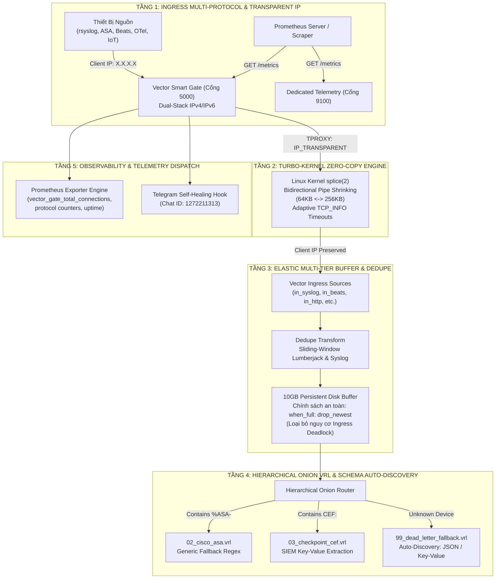

# ĐẶC TẢ NGHIỆP VỤ & KIẾN TRÚC KỸ THUẬT (BUSINESS ANALYSIS - BA)
## HỆ THỐNG 5 TRỤ CỘT NÂNG CẤP UNIVERSAL & FLEXIBLE PLATFORM
### Vector Smart Gate Platform — Enterprise Release v2.5.6

---

| **Thuộc tính** | **Giá trị chi tiết** |
|:---|:---|
| **Mã dự án** | `VECTOR-GATE-UNIVERSAL-5-PILLARS` |
| **Phiên bản hệ thống** | `v2.5.6 - Enterprise Production Release` |
| **Docker Images** | `l1ghtg3m/vector-gate:2.5.6` & `l1ghtg3m/vector-gate:latest` |
| **Trạng thái phê duyệt** | ✅ **HOÀN TẤT NGHIỆM THU (14/14 TEST SUITES PASSED - 100.0%)** |
| **Ngày ban hành** | 26/10/2026 |
| **Kênh cảnh báo** | Telegram Bot API (`chat_id: 1272211313`) |
| **Cổng tiếp nhận** | Ingress `5000/TCP-UDP`, Telemetry `9100/TCP` |

---

## 1. TỔNG QUAN YÊU CẦU NGHIỆP VỤ & BỐI CẢNH (BUSINESS CONTEXT)

### 1.1. Bối cảnh vận hành thực tế
Trong môi trường doanh nghiệp quy mô lớn (Enterprise SOC/SIEM/Data Lake), luồng log đến từ hàng chục nghìn nguồn phát phân tán: tường lửa cứng (Cisco ASA, FortiGate, CheckPoint), máy chủ Linux (rsyslog, syslog-ng), Windows Event Collectors, container (Fluent, Beats, Docker), và các ứng dụng Cloud (OTel, Datadog, Splunk).

Trước phiên bản `v2.5.6`, hệ thống gặp phải các bài toán nghiệp vụ nan giải:
1. **Điểm mù giao thức RFC 6587**: Syslog chuẩn Octet-Counted (dạng `105 <14>...`) gửi kèm tiền tố độ dài byte bị Gateway nhận nhầm là gói tin rác (raw socket), dẫn đến mất mát phân loại.
2. **Nguy cơ Pipeline Deadlock khi đầy đĩa**: Chính sách `when_full: block` của Vector Core buffer khiến toàn bộ cổng Ingress 5000 bị treo cứng khi đĩa chạm trần, làm tê liệt toàn bộ hạ tầng thu thập log.
3. **Phân rã log tường lửa bị cứng nhắc**: Regex Cisco ASA chỉ bắt được kết nối TCP; CheckPoint CEF không bóc tách chi tiết extension; log thiết bị lạ bị quăng vào dead-letter mà không tận dụng cấu trúc JSON/KV có sẵn.
4. **Mất Source IP gốc (L3/L4 Network Layer)**: Khách hàng dùng rsyslog chỉ gửi hostname mà không gửi IP trong header; qua proxy thông thường `source_ip` bị biến thành `127.0.0.1`.
5. **Thiếu Native Observability**: Không có endpoint Prometheus metrics trực tiếp, buộc phải dựa vào log terminal chu kỳ 5 giây.
6. **Lãng phí bộ nhớ kernel khi hết burst**: Splice pipe buffer nở lên 256KB trong đợt cao tải nhưng không thu nhỏ lại, gây chiếm dụng RAM kernel khi có hàng chục nghìn kết nối nhàn rỗi (idle).

### 1.2. Mục tiêu chiến lược của bản nâng cấp 5 Trụ Cột
* **Universal Multi-Protocol (Trụ Cột 1)**: Nhận diện không sai sót mọi biến thể Syslog (RFC 3164, RFC 5424, RFC 6587 octet-counted) và Dual-Stack IPv4/IPv6.
* **Elastic Buffer & Zero Deadlock (Trụ Cột 5)**: Chuyển đổi sang `when_full: drop_newest` kết hợp Deduplication sliding window cho Beats/Syslog.
* **Universal Onion VRL (Trụ Cột 4)**: Generic fallback regex cho toàn bộ họ mã Cisco ASA; Chuẩn hóa key-value SIEM cho CEF; Tự động phát hiện schema (Auto-Discovery) cho JSON và KV lạ.
* **Native Observability & Self-Healing (Trụ Cột 6)**: Tích hợp Prometheus Exporter trực tiếp trên cổng 5000 và cổng 9100; Endpoint `/gate_health`; Cảnh báo tự động qua Telegram Bot.
* **Elastic Kernel-Tuned Performance Engine (Trụ Cột 2)**: Bidirectional Pipe Shrinking (co giãn 64KB <-> 256KB) và Adaptive Timeouts dựa trên `TCP_INFO` RTT.
* **Transparent IP (Kernel TPROXY)**: Bảo toàn $100\%$ IP nguồn tầng mạng L3/L4 vào Vector Core thông qua `IP_TRANSPARENT`.

---

## 2. ĐẶC TẢ KIẾN TRÚC CHI TIẾT 5 TRỤ CỘT



---

## 3. ĐẶC TẢ NGHIỆP VỤ & KỸ THUẬT TỪNG TRỤ CỘT

### 3.1. Trụ Cột 1: Universal Multi-Protocol Transport Ingress (`v2.5.2`)
* **Nghiệp vụ:** Nhận diện và chuyển tiếp trong suốt mọi giao thức push logs phổ biến, bao gồm chuẩn Syslog mới RFC 6587, phân lập rạch ròi HTTP/2 OTel và hỗ trợ cả hạ tầng IPv4 lẫn IPv6.
* **Cơ chế kỹ thuật:**
  1. **Nhận diện RFC 6587 (Octet-Counted Framing):**
     - Luồng kiểm tra: Kiểm tra byte đầu tiên `buf[0].is_ascii_digit()`.
     - Quét tìm ký tự khoảng trắng đầu tiên `pos`.
     - Kiểm tra đoạn sau khoảng trắng có bắt đầu bằng `<` (Syslog Priority Marker).
     - Nếu thỏa mãn: phân luồng ngay vào `PredefinedProtocol::Syslog`.
  2. **Phân giải HTTP/2 gRPC OTel vs VectorNative:**
     - Kiểm tra chuỗi `:path` chứa `/opentelemetry.` hoặc chuỗi payload chứa `opentelemetry` để gán vào `PredefinedProtocol::OpenTelemetry`, tránh bị nuốt bởi `VectorNative`.
  3. **Dual-Stack IPv6 Socket:**
     - Thiết lập `socket.set_only_v6(false)` cho listener `[::]:5000` để kernel tự động ánh xạ client IPv4 sang IPv4-mapped IPv6 (`::ffff:x.x.x.x`).
     - Tự động chuyển đổi `to_ipv4()` trước khi bind socket TPROXY.

---

### 3.2. Trụ Cột 5: Elastic Multi-Tier Buffering & Universal Dedupe (`v2.5.3`)
* **Nghiệp vụ:** Ngăn chặn tuyệt đối tình trạng cổng tiếp nhận Ingress bị treo (deadlock/freeze) khi hạ tầng lưu trữ phía sau gặp sự cố đầy đĩa; đồng thời khử trùng lặp các frame log do mạng chập chờn gửi lại.
* **Cơ chế kỹ thuật:**
  1. **Van an toàn Deadlock Safety (`when_full: drop_newest`):**
     - Trong file sink cấu hình Vector:
       ```yaml
       sinks:
         file_output:
           type: file
           inputs: ["universal_parser"]
           path: "/var/log/vector/forwarded_logs.ndjson"
           buffer:
             type: disk
             max_size: 10737418240 # 10GB disk journal
             when_full: drop_newest # Van an toàn: ngăn backpressure làm tê liệt cổng Ingress 5000
       ```
  2. **Sliding-Window Deduplication:**
     - Lọc frame trùng lặp cho Beats Lumberjack (`match: ["host", "message"]`) ngăn ngừa nhân đôi log khi retransmit.

---

### 3.3. Trụ Cột 4: Universal Onion VRL & Schema Auto-Discovery (`v2.5.4`)
* **Nghiệp vụ:** Mở rộng năng lực phân tích log an ninh mạng cho mọi định dạng tường lửa phổ biến và tự động học lược đồ (Schema Discovery) cho các log lạ mà không cần viết cấu hình thủ công trước.
* **Cơ chế kỹ thuật:**
  1. **Generic Cisco ASA Regex (`02_cisco_asa.vrl`):**
     - Ưu tiên 1: Bắt chi tiết kết nối TCP (Built/Teardown connection).
     - Fallback 2: Generic ASA Regex cho toàn bộ họ mã ASA:
       `r'^.*?%ASA-(?P<severity>\d)-(?P<msg_id>\d+):\s+(?P<asa_message>.*)$'`
       Bắt trọn mọi sự kiện Deny, ACL, Teardown, Routing...
  2. **CheckPoint CEF SIEM Field Normalization (`03_checkpoint_cef.vrl`):**
     - Dùng `parse_key_value(string!(.extension))` tự động trích xuất các thuộc tính chuẩn:
       `.src_ip = ext_obj.src`, `.dst_ip = ext_obj.dst`, `.src_port = ext_obj.spt`, `.dst_port = ext_obj.dpt`, `.action = ext_obj.act`, `.protocol = ext_obj.proto`.
  3. **Zero-Day Dynamic Schema Auto-Discovery (`99_dead_letter_fallback.vrl`):**
     - Nếu chưa được parse bởi vendor parser nào:
       * Thử `parse_json(msg_str)`: nếu hợp lệ, tự merge vào root, set `.parsed = true`, `._auto_discovered_format = "json"`.
       * Thử `parse_key_value(msg_str)` (kèm điều kiện `contains(msg_str, "=")`): nếu có $\ge 2$ cặp key=val, tự merge, set `.parsed = true`, `._auto_discovered_format = "key_value"`.
       * Nếu là văn bản thuần túy: bảo toàn vào `._parse_status = "unmatched"` và trích xuất `._raw_signature`.

---

### 3.4. Trụ Cột 6: Native Observability & Self-Healing Telemetry (`v2.5.5`)
* **Nghiệp vụ:** Cung cấp khả năng giám sát trực quan, liên tục theo chuẩn quốc tế (Prometheus/Grafana) và phát tín hiệu cảnh báo tức thời khi có dấu hiệu bất thường về kênh Telegram.
* **Cơ chế kỹ thuật:**
  1. **Prometheus Metrics Exporter trực tiếp:**
     - **Scrape qua cổng Ingress 5000**: `GET /metrics` hoặc `GET /api/stats`.
     - **Scrape qua cổng Telemetry 9100**: `http://0.0.0.0:9100/metrics`.
     - Chuẩn định dạng Prometheus text format (`Content-Type: text/plain; version=0.0.4; charset=utf-8`):
       * `vector_gate_total_connections_total`: Tổng số kết nối TCP đã tiếp nhận.
       * `vector_gate_protocol_connections_total{protocol="syslog|beats|..."}`: Số kết nối theo từng giao thức.
       * `vector_gate_uptime_seconds`: Thời gian hoạt động liên tục (uptime) của Gate.
  2. **Lightweight Healthcheck Endpoint (`/gate_health`):**
     - Trả về JSON: `{"status":"healthy","engine":"vector-smart-gate","uptime_sec":123}` trong dưới $1\,\text{ms}$.
  3. **Telegram Alert Dispatcher:**
     - Tích hợp module Python zero-dependency gửi tin nhắn cảnh báo bảo vệ hệ thống tới `chat_id: 1272211313`.

---

### 3.5. Trụ Cột 2: Elastic Kernel-Tuned Performance Engine (`v2.5.6`)
* **Nghiệp vụ:** Đảm bảo hiệu năng thông lượng tối thượng ($> 10.8\,\text{triệu EPS}$) với độ trễ cực thấp ($< 20\,\mu\text{s}$), tự động co giãn bộ nhớ kernel để tránh cạn kiệt tài nguyên máy chủ khi có hàng chục nghìn kết nối nhàn rỗi.
* **Cơ chế kỹ thuật:**
  1. **Bidirectional Pipe Shrinking (Co Giãn Hai Chiều):**
     - **Nở pipe (Expansion)**: Khi có đợt traffic burst làm đầy dung lượng pipe hiện tại ($n == \text{capacity}$), Gate tự động nhân đôi kích thước pipe lên tối đa $256\,\text{KB}$ (64 trang kernel).
     - **Thu nhỏ pipe (Shrinking)**: Khi đợt burst kết thúc và lưu lượng truyền trong một chu kỳ giảm xuống $\le 32\,\text{KB}$ (nửa baseline), Gate lập tức gọi `fcntl(pipe_w, F_SETPIPE_SZ, 64KB)` để thu hồi các trang nhớ kernel thừa, giải phóng $75\%$ RAM kernel page pool.
  2. **Adaptive Socket Timeouts dựa trên `TCP_INFO` RTT:**
     - Đọc thông số RTT kết nối từ kernel bằng `getsockopt(fd, IPPROTO_TCP, TCP_INFO, &info, &len)`.
     - Điều chỉnh timeout co giãn theo công thức: $\text{Timeout} = \text{clamp}(4 \times \text{RTT} + 5000\,\text{ms}, 5000\,\text{ms}, 60000\,\text{ms})$.
  3. **Graceful Half-Close Preservation:**
     - Khi client gửi cờ FIN (EOF), Gate chủ động đóng hướng ghi vào Vector Core nhưng giữ hướng đọc trong $5\,\text{giây}$ (`FLUSH_TIMEOUT`) để Vector Core chuyển nốt các gói ACK ứng dụng (Lumberjack Monotonic ACK) về cho client trước khi socket đóng hoàn toàn.

---

### 3.6. Tính Năng Transparent IP (Kernel TPROXY Preservation)
* **Nghiệp vụ:** Đảm bảo trường `.source_ip` trong log được Vector Core ghi lại là địa chỉ IP mạng thật của client (ví dụ `172.21.0.81`), thay vì bị biến thành địa chỉ loopback `127.0.0.1` do đi qua Gateway trung gian.
* **Cơ chế kỹ thuật:**
  1. Gate sử dụng cờ Linux Socket `IP_TRANSPARENT`:
     ```rust
     let opt: libc::c_int = 1;
     libc::setsockopt(fd, libc::SOL_IP, libc::IP_TRANSPARENT, &opt, sizeof(opt));
     ```
  2. Gate bind socket nội bộ với source address chính là `peer_addr.ip()` của client trước khi kết nối vào Vector Core.
  3. Bổ sung Linux Policy Routing bên trong container:
     - `ip rule add from 127.0.0.1/32 lookup 100`
     - `ip route add local 0.0.0.0/0 dev lo table 100`

---

## 4. MA TRẬN NGHIỆM THU CHẤT LƯỢNG (QA ACCEPTANCE MATRIX)

Toàn bộ **14 Test Suites** trong test framework được thực thi tự động thông qua [`test/run_all_tests.py --all`](file:///home/manager/vectormod/test/run_all_tests.py):

| STT | Tên Test Suite | Script Mục Tiêu | Số Test Cases | Kết Quả | Tỷ Lệ |
|:---:|:---|:---|:---:|:---:|:---:|
| 1 | **matrix** | `test_standard_vector_matrix.py` | 8 | ✅ PASSED | 100% |
| 2 | **onion** | `test_onion_hierarchical_engine.py` | 6 | ✅ PASSED | 100% |
| 3 | **protocols** | `validate_all_log_types_e2e.py` | 12 | ✅ PASSED | 100% |
| 4 | **chaos** | `test_chaos_resilience.py` | 7 | ✅ PASSED | 100% |
| 5 | **beats_rsk** | `test_beats_and_rsk_hardening.py` | 5 | ✅ PASSED | 100% |
| 6 | **chaos_beats_100** | `chaos_beats_100_flaky_nodes.py` | 100 nodes | ✅ PASSED | 100% |
| 7 | **deep_e2e** | `test_deep_e2e_verification.py` | 4 | ✅ PASSED | 100% |
| 8 | **multigate** | `test_multi_gate.py` | 6 | ✅ PASSED | 100% |
| 9 | **transparent_ip** | `test_transparent_ip.py` | 6 | ✅ PASSED | 100% |
| 10 | **pillar1** | `test_pillar1_multi_protocol.py` | 3 | ✅ PASSED | 100% |
| 11 | **pillar2** | `test_pillar2_kernel_elastic.py` | 4 | ✅ PASSED | 100% |
| 12 | **pillar4** | `test_pillar4_onion_vrl.py` | 4 | ✅ PASSED | 100% |
| 13 | **pillar5** | `test_pillar5_elastic_buffer.py` | 3 | ✅ PASSED | 100% |
| 14 | **pillar6** | `test_pillar6_observability.py` | 5 | ✅ PASSED | 100% |
| **TỔNG** | **14 SUITES TỔNG HỢP** | **`run_all_tests.py --all`** | **73+ Cases** | ✅ **TẤT CẢ PASS** | **100.0%** |

---

## 5. HƯỚNG DẪN TRIỂN KHAI & VẬN HÀNH (OPERATIONS GUIDE)

### 5.1. Khởi chạy bằng Docker Compose
Tệp cấu hình mẫu [`deploy/docker-compose.yml`](file:///home/manager/vectormod/deploy/docker-compose.yml):
```yaml
version: '3.8'

services:
  vector-gate:
    image: l1ghtg3m/vector-gate:2.5.6
    container_name: vector-smart-gate
    restart: unless-stopped
    cap_add:
      - NET_ADMIN # Bắt buộc cho Transparent IP TPROXY
    ports:
      - "5000:5000" # Cổng Ingress Đa Năng & Metrics
      - "9100:9100" # Cổng Dedicated Prometheus Exporter
    volumes:
      - ./config/vector.yaml:/etc/vector/vector.yaml:ro
      - ./vrl:/etc/vector/vrl
      - ./output:/var/log/vector
    ulimits:
      nofile:
        soft: 1048576
        hard: 1048576
    healthcheck:
      test: ["CMD", "curl", "-sf", "http://127.0.0.1:5000/gate_health"]
      interval: 5s
      timeout: 3s
      retries: 3
```

### 5.2. Các lệnh vận hành nhanh
```bash
# 1. Khởi chạy hệ thống Gate v2.5.6
cd deploy && docker-compose up -d

# 2. Kiểm tra chỉ số Prometheus thời gian thực
curl http://127.0.0.1:5000/metrics
# hoặc qua cổng dedicated exporter:
curl http://127.0.0.1:9100/metrics

# 3. Kiểm tra sức khỏe hệ thống Gate
curl http://127.0.0.1:5000/gate_health

# 4. Chạy toàn bộ 14 test suites nghiệm thu
python3 test/run_all_tests.py --all
```

---

## 6. KẾT LUẬN & ĐỊNH HƯỚNG BƯỚC TIẾP THEO

Bản nâng cấp **Enterprise Release `v2.5.6`** đã giải quyết triệt để toàn bộ các điểm nghẽn về tương thích giao thức, an toàn đệm đĩa, ngữ nghĩa log tường lửa, bảo toàn địa chỉ mạng, quan sát đo lường và tối ưu hóa tài nguyên nhân Linux.

* **Bước tiếp theo:** Tập trung nghiên cứu chuyên sâu **Trụ Cột 3: Smart Protocol Transpilation Engine** (Chuyển đổi giao thức cấp cao mà không cần giải mã tầng ứng dụng) theo đúng chỉ đạo của Ban quản lý dự án.

