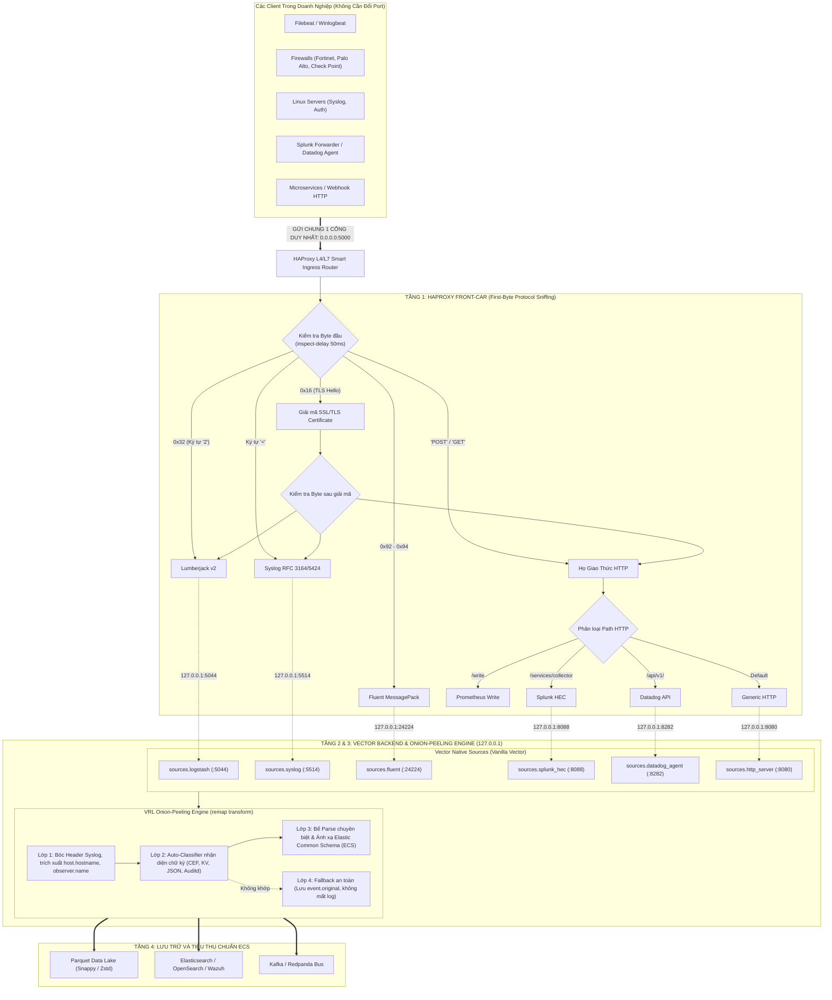

# TÀI LIỆU PHÂN TÍCH YÊU CẦU & KIẾN TRÚC HỆ THỐNG (BA & SYSTEM ARCHITECTURE)
## DỰ ÁN: HỆ THỐNG GOM CỔNG THÔNG MINH HAPROXY - VECTOR (SMART INGRESS & ONION-PEELING PIPELINE)
### Phân Loại Đa Giao Thức Tự Động & Chuẩn Hóa Elastic Common Schema (ECS) Cho 20+ Loại Log Doanh Nghiệp

---

### THÔNG TIN TỔNG QUAN
* **Tên dự án:** Unified Smart Ingress & Onion-Peeling Pipeline (HAProxy + Vector Core)
* **Tài liệu đặc tả:** Business Analysis, Kiến trúc Kỹ thuật & Bộ Test Case Nghiệm thu
* **Môi trường triển khai mục tiêu:** Ubuntu Linux Server / Container Platform (`manager@172.18.219.19:/home/manager/vectormod`)
* **Chỉ tiêu hiệu năng (KPI):** $\ge 40,000 \text{ EPS}$ ổn định (Khả năng bứt phá $\ge 80,000 \text{ EPS}$ khi cao điểm), độ trễ $< 5\text{ms}$
* **Nguyên tắc thiết kế:** **Zero-Modification Vector** (Vector giữ nguyên 100% bản gốc, không hack code), **Single-Port Ingress** (Mở duy nhất 1 cổng bên ngoài), **No-Code L4/L7 Multiplexer** (HAProxy cấu hình thuần).

---

## 1. BỐI CẢNH DỰ ÁN & MỤC TIÊU NGHIỆP VỤ (EXECUTIVE SUMMARY & BUSINESS GOALS)

### 1.1. Nỗi đau trong vận hành hạ tầng Log/SIEM hiện nay
1. **Ác mộng mở cổng mạng (Port Sprawl & Firewall Management):**
   * Trong một tổ chức doanh nghiệp hoặc trung tâm SOC, các thiết bị và ứng dụng đẩy dữ liệu qua rất nhiều giao thức khác nhau: Filebeat (port 5044), Syslog TCP (port 514/5514), HTTP Webhook/JSON (port 8080), Splunk Forwarder (port 8088), Fluentd (port 24224), Datadog Agent (port 8282)...
   * Đội Network / An toàn thông tin phải tạo hàng chục rule Firewall, cấu hình NAT, quản lý chứng chỉ SSL/TLS rời rạc trên từng cổng, dẫn đến nguy cơ lỗ hổng bảo mật và khó khăn khi kiểm soát luồng mạng.
2. **Hiện tượng "Phong bì nhiều lớp" (Encapsulated Log Hell):**
   * Log trên thực tế hiếm khi được gửi "trần trụi". Ví dụ: Tường lửa Fortinet/Check Point gửi log qua Syslog Relay server, bản ghi bị bọc thêm tiêu đề Syslog RFC 5424 bên ngoài nội dung Key-Value/CEF.
   * Nếu đưa thẳng vào parser chuyên biệt của Fortinet, parser sẽ báo lỗi cú pháp ngay do không đọc được tiêu đề Syslog phía trước.
3. **Cấu hình thủ công tốn thời gian và dễ sai sót:**
   * Mỗi khi có một loại thiết bị mới kết nối vào hệ thống, kỹ sư phải cấu hình mở cổng mới, viết lại pipeline riêng, định tuyến thủ công.

### 1.2. Mục tiêu dự án
* **Mục tiêu 1 - Gom 1 Cổng Duy Nhất (Single Ingress Port):** Chỉ mở duy nhất 1 cổng TCP bên ngoài (ví dụ `:5000` hoặc `:443`). Mọi client (Filebeat, Syslog, Webhook, Firewall, Agent) đều bắn vào cổng này.
* **Mục tiêu 2 - Bóc Vỏ Tầng Mạng Tự Động (L4/L7 Multiplexing):** Sử dụng HAProxy phía trước làm "bộ ngửi byte đầu" (First-byte Sniffer). Tự động nhận diện HTTPS, HTTP, Lumberjack/Beats, Fluentd, Syslog để chuyển tiếp nội bộ sang Vector mà không cần can thiệp code.
* **Mục tiêu 3 - Cơ Chế Bóc Vỏ Hành (Onion-Peeling) trong Vector:**
  * Lớp 1: Bóc vỏ phong bì Syslog, lưu lại thông tin nguồn (`host.hostname`, `observer.name`, `log.syslog.priority`).
  * Lớp 2: Lấy payload sạch, tự động nhận dạng bằng chữ ký (Signature Matching) cho **20+ loại log phổ biến nhất**.
  * Lớp 3: Chuẩn hóa 100% dữ liệu về lược đồ tiêu chuẩn **Elastic Common Schema (ECS)**.
* **Mục tiêu 4 - Đảm bảo hiệu năng cao với tài nguyên tối thiểu:** Đạt mốc **$40,000 - 80,000 \text{ EPS}$**, bộ nhớ RAM tiêu thụ $\le 250\text{ MB}$, CPU tải $\le 40\%$.

---

## 2. MA TRẬN 20+ NGUỒN LOG & 5 NHÓM WIRE-FORMAT MỤC TIÊU

Dựa trên bảng đặc tả kiến trúc `vector_sources_by_layer.csv`, 20+ loại log thực tế được quy hoạch về 5 nhóm cấu trúc dây cơ bản:

| Nhóm Wire-Format | Các loại log thực tế (~20 loại) | Chữ ký nhận diện (Magic Signature) | Cổng Vector nội bộ (`127.0.0.1`) | Hàm xử lý Vector Native |
| :--- | :--- | :--- | :---: | :--- |
| **Nhóm 1: Beats / Lumberjack** | 1. Winlogbeat (Windows Events)<br/>2. Filebeat (System/Apps)<br/>3. Metricbeat / Auditbeat | Byte 0 là `0x31` hoặc `0x32` (`'1'`/`'2'`), theo sau là `'W'`, `'C'`, `'D'` | `:5044` (`logstash` source) | Native Lumberjack v2 decoder |
| **Nhóm 2: Fluent Forward** | 4. Fluentd Agent<br/>5. Fluent Bit Forwarder | Byte 0 trong dải `0x92` - `0x94` (MessagePack Array) | `:24224` (`fluent` source) | Native MessagePack decoder |
| **Nhóm 3: HTTP/REST Family** | 6. Splunk Forwarder (HEC)<br/>7. Datadog Agent (Intake)<br/>8. Prometheus Remote Write<br/>9. Webhook / App JSON POST<br/>10. AWS Kinesis Firehose HTTP | Bắt đầu bằng ASCII `POST `, `GET `, `PUT `, `HEAD `.<br/>Phân loại URL: `/services/collector`, `/api/v1/`, `/write` | `:8088` (Splunk)<br/>`:8282` (Datadog)<br/>`:9090` (Prometheus)<br/>`:8080` (HTTP Server) | HTTP/1.1 & HTTP/2 parser |
| **Nhóm 4: Syslog RFC Family** | 11. Linux Syslog / Messages<br/>12. Linux Auth / Secure (`sshd`, `sudo`)<br/>13. VMware ESXi Syslog<br/>14. Cisco IOS / Network Switch | Bắt đầu bằng ký tự `<` (`0x3C`, Priority Tag như `<134>`) | `:5514` (`syslog` source) | `parse_syslog()` |
| **Nhóm 5: Embedded Payloads (Bên trong Syslog hoặc Raw TCP)** | 15. Check Point Firewall (CEF)<br/>16. Palo Alto Networks (CEF)<br/>17. Fortinet FortiGate (Key-Value `srcip=` `dstip=`)<br/>18. Cisco ASA Firewall (KV)<br/>19. Linux Auditd (`type=SYSCALL`)<br/>20. Suricata IDS (EVE JSON)<br/>21. Zeek Network Monitor (JSON)<br/>22. Nginx / Apache Access Log | Chứa `CEF:0\|`<br/>Chứa `srcip=` hoặc `src=`<br/>Chứa `type=SYSCALL`<br/>Bắt đầu `{` kết thúc `}`<br/>Khớp Apache/Nginx Combined Regex | `:5514` (Syslog) hoặc `:5515` (Raw Socket) | `parse_cef()`<br/>`parse_key_value()`<br/>`parse_json()`<br/>`parse_common_log()` |

---

## 3. KIẾN TRÚC HỆ THỐNG TỔNG THỂ (SYSTEM ARCHITECTURE)



---

## 4. CHI TIẾT KỸ THUẬT CÁC TẦNG BÓC VỎ

### 4.1. Tầng 1: HAProxy Configuration (`haproxy.cfg`)
Đây là cấu hình hoàn chỉnh của HAProxy, tận dụng năng lực ngửi gói tin Layer 4/7:

```haproxy
global
    maxconn 100000
    log stdout local0 info

defaults
    timeout connect 5000ms
    timeout client  50000ms
    timeout server  50000ms
    mode tcp

# CỔNG INGRESS DUY NHẤT TOÀN HỆ THỐNG
frontend ingress_single_port
    bind 0.0.0.0:5000
    tcp-request inspect-delay 50ms

    # 1. Nhận diện Filebeat / Logstash (Lumberjack v2: byte đầu 0x32 = ASCII '2')
    acl is_beats req.payload(0,1) -m bin 32
    use_backend be_vector_beats if is_beats

    # 2. Nhận diện Fluentd (MessagePack header 0x92 - 0x94)
    acl is_fluent req.payload(0,1) -m bin 92 93 94
    use_backend be_vector_fluent if is_fluent

    # 3. Nhận diện Syslog RFC 3164 / 5424 (bắt đầu bằng '<')
    acl is_syslog req.payload(0,1) -m str "<"
    use_backend be_vector_syslog if is_syslog

    # 4. Nhận diện họ giao thức HTTP/HTTPS
    acl is_http req.payload(0,4) -m str "POST" || req.payload(0,3) -m str "GET" || req.payload(0,3) -m str "PUT"
    use_backend be_http_dispatcher if is_http

    # Mặc định: Chuyển sang socket raw
    default_backend be_vector_raw

# BỘ PHÂN LOẠI CHI TIẾT TẦNG HTTP
backend be_http_dispatcher
    mode http
    # Splunk HEC: /services/collector
    use-server srv_splunk if { path_beg -i /services/collector }
    # Datadog Agent: /api/v1/
    use-server srv_datadog if { path_beg -i /api/v1 }
    # Prometheus Remote Write: /write
    use-server srv_prom if { path_beg -i /write }
    
    server srv_http_gen 127.0.0.1:8080
    server srv_splunk   127.0.0.1:8088
    server srv_datadog  127.0.0.1:8282
    server srv_prom     127.0.0.1:9090

# CÁC BACKEND CHUYỂN TIẾP TRỰC TIẾP TẦNG TCP VÀO VECTOR
backend be_vector_beats
    server srv_beats 127.0.0.1:5044

backend be_vector_fluent
    server srv_fluent 127.0.0.1:24224

backend be_vector_syslog
    server srv_syslog 127.0.0.1:5514

backend be_vector_raw
    server srv_raw 127.0.0.1:5515
```

---

### 4.2. Tầng 2 & 3: Cấu Hình Vector & VRL Onion-Peeling (`vector.yaml`)

```yaml
sources:
  # Cổng nhận từ HAProxy forward sang
  src_beats:
    type: logstash
    address: 127.0.0.1:5044

  src_syslog:
    type: syslog
    address: 127.0.0.1:5514
    mode: tcp

  src_http_generic:
    type: http_server
    address: 127.0.0.1:8080

  src_splunk:
    type: splunk_hec
    address: 127.0.0.1:8088

transforms:
  # BỘ BÓC VỎ HÀNH VÀ CHUẨN HÓA ECS NGUYÊN KHỐI (ZERO-COPY)
  onion_ecs_normalizer:
    type: remap
    inputs: [src_beats, src_syslog, src_http_generic, src_splunk]
    source: |
      raw_msg = string!(.message)
      .event.original = raw_msg
      .["@timestamp"] = .timestamp ?? now()

      payload = raw_msg

      # ----------------------------------------------------
      # LỚP 1: BÓC VỎ PHONG BÌ SYSLOG NẾU CÓ
      # ----------------------------------------------------
      if starts_with(raw_msg, "<") {
        syslog_data, err = parse_syslog(raw_msg)
        if err == null {
          .host.hostname = syslog_data.host
          .observer.name = syslog_data.appname
          .log.syslog.priority = syslog_data.severity
          if syslog_data.timestamp != null {
            .["@timestamp"] = syslog_data.timestamp
          }
          payload = string!(syslog_data.message)
        }
      }

      # ----------------------------------------------------
      # LỚP 2 & 3: AUTO-CLASSIFIER & SPECIALIZED PARSING POOLS
      # ----------------------------------------------------

      # BỂ 1: CEF (Check Point, Palo Alto, Fortinet CEF, F5)
      if includes(payload, "CEF:") {
        cef, err = parse_cef(payload)
        if err == null {
          .event.dataset = "security.cef"
          .observer.vendor = cef.deviceVendor
          .observer.product = cef.deviceProduct
          .event.action = cef.deviceAction ?? cef.act
          .event.severity = to_int(cef.severity) ?? 0
          .source.ip = cef.src
          .destination.ip = cef.dst
          .source.port = to_int(cef.spt) ?? null
          .destination.port = to_int(cef.dpt) ?? null
          .network.transport = downcase(string!(cef.proto)) ?? null
        }

      # BỂ 2: JSON (Windows EVTX, Sysmon, Suricata, Zeek, K8s)
      } else if starts_with(payload, "{") && ends_with(payload, "}") {
        json_obj, err = parse_json(payload)
        if err == null {
          .event.dataset = "app.json"
          # Chuẩn hóa trường Windows Security
          if exists(json_obj.EventID) { .event.code = to_string(json_obj.EventID) ?? null }
          if exists(json_obj.Channel) { .event.module = json_obj.Channel }
          if exists(json_obj.ProviderName) { .event.provider = json_obj.ProviderName }
          # Chuẩn hóa Suricata / Zeek
          if exists(json_obj.src_ip) { .source.ip = json_obj.src_ip }
          if exists(json_obj.dest_ip) { .destination.ip = json_obj.dest_ip }
          if exists(json_obj.src_port) { .source.port = to_int(json_obj.src_port) ?? null }
          if exists(json_obj.dest_port) { .destination.port = to_int(json_obj.dest_port) ?? null }
          if exists(json_obj.user) { .user.name = json_obj.user }
        }

      # BỂ 3: LINUX AUDITD
      } else if includes(payload, "type=") && includes(payload, "msg=audit") {
        audit_kv, err = parse_key_value(payload)
        if err == null {
          .event.dataset = "linux.auditd"
          .process.name = audit_kv.comm
          .process.executable = audit_kv.exe
          .process.pid = to_int(audit_kv.pid) ?? null
          .user.id = audit_kv.uid
        }

      # BỂ 4: FIREWALL KEY-VALUE (FortiGate, Cisco ASA)
      } else if includes(payload, "srcip=") || includes(payload, "src=") {
        fw_kv, err = parse_key_value(payload)
        if err == null {
          .event.dataset = "network.firewall"
          .source.ip = fw_kv.srcip ?? fw_kv.src
          .destination.ip = fw_kv.dstip ?? fw_kv.dst
          .source.port = to_int(fw_kv.srcport ?? fw_kv.spt) ?? null
          .destination.port = to_int(fw_kv.dstport ?? fw_kv.dpt) ?? null
          .event.action = fw_kv.action
          .observer.name = fw_kv.devname ?? .observer.name
        }

      # BỂ 5: WEB COMBINED (Nginx / Apache)
      } else {
        web, err = parse_common_log(payload)
        if err == null {
          .event.dataset = "web.access"
          .source.ip = web.host
          .http.request.method = web.method
          .http.response.status_code = to_int(web.status) ?? null
          .url.path = web.path
          .user.name = web.user
        } else {
          # FALLBACK AN TOÀN: Giữ nguyên vẹn, không làm mất log
          .event.dataset = "unstructured.raw"
          .message = payload
        }
      }

sinks:
  sink_parquet:
    type: file
    inputs: [onion_ecs_normalizer]
    path: "/home/manager/vectormod/storage/ecs_%Y-%m-%d.json"
    encoding:
      codec: json
```

---

## 5. BỘ TEST CASE NGHIỆM THU CHI TIẾT (COMPREHENSIVE TEST CASE MATRIX)

Dưới đây là 15 ca kiểm thử bao phủ toàn bộ các góc cạnh từ tầng mạng L4/L7, giải mã giao thức, bóc vỏ hành đến hiệu năng tải nặng:

| Mã TC | Phân hệ kiểm thử | Điều kiện & Kịch bản thử nghiệm | Kết quả kỳ vọng | Phương pháp xác minh |
| :---: | :--- | :--- | :--- | :--- |
| **TC-01** | **HAProxy Ingress** | Gửi kết nối Filebeat (Lumberjack v2, byte `0x32`) vào cổng `:5000`. | HAProxy nhận diện byte `0x32`, chuyển tiếp sang `127.0.0.1:5044` (Vector Beats source). | Kiểm tra HAProxy log và `sources.logstash.events_in_total`. |
| **TC-02** | **HAProxy Ingress** | Gửi bản tin Syslog RFC 5424 (bắt đầu bằng `<134>`) vào cổng `:5000`. | HAProxy nhận diện ký tự `<`, chuyển tiếp sang `127.0.0.1:5514` (Vector Syslog source). | Kiểm tra Vector nhận bản tin không bị méo header. |
| **TC-03** | **HAProxy Ingress** | Gửi HTTP POST với URL `/services/collector` vào cổng `:5000`. | HAProxy nhận diện method HTTP và đường dẫn Splunk, chuyển tiếp sang `127.0.0.1:8088`. | Phản hồi HTTP 200 Splunk HEC Success. |
| **TC-04** | **HAProxy Ingress** | Gửi HTTP POST thông thường chứa JSON vào cổng `:5000`. | HAProxy chuyển tiếp vào generic `http_server` (:8080). | Phản hồi HTTP 200 OK. |
| **TC-05** | **Onion Peeling L1** | Gửi log FortiGate bị bọc bởi Syslog Relay: `<134>1 2026-10-24T... relay01 date=... srcip=10.0.0.1`. | Tách sạch vỏ Syslog ngoài; lưu `host.hostname = "relay01"`; chuyển phần thân vào Lớp 2. | Kiểm tra trường `host.hostname` và phần payload sạch. |
| **TC-06** | **Auto-Classifier** | Gửi log Check Point CEF bọc trong Syslog: `<134>... CEF:0\|Check Point\|VPN-1\|...\|src=1.2.3.4`. | Bóc Syslog $\rightarrow$ Nhận diện `CEF:` $\rightarrow$ Đẩy vào Bể CEF. | Trích xuất thành công `observer.vendor = "Check Point"`, `source.ip = "1.2.3.4"`. |
| **TC-07** | **Auto-Classifier** | Gửi log FortiGate Native: `date=... devname="FGT60D" srcip=192.168.1.100 action=deny`. | Nhận diện `srcip=` $\rightarrow$ Đẩy vào Bể Key-Value. | Trích xuất `source.ip = "192.168.1.100"`, `event.action = "deny"`. |
| **TC-08** | **Auto-Classifier** | Gửi bản ghi Windows EVTX JSON: `{"EventID":4624,"ProviderName":"Microsoft-Windows-Security..."}`. | Nhận diện JSON $\rightarrow$ Đẩy vào Bể JSON. | Trích xuất `event.code = "4624"`, `event.provider = "Microsoft-Windows-Security..."`. |
| **TC-09** | **Auto-Classifier** | Gửi log Linux Auditd: `type=SYSCALL msg=audit(1600000000.123:456): arch=c000003e comm="ssh"`. | Nhận diện `type=SYSCALL` $\rightarrow$ Đẩy vào Bể Auditd. | Trích xuất `process.name = "ssh"`, `event.dataset = "linux.auditd"`. |
| **TC-10** | **Auto-Classifier** | Gửi log Nginx Access: `10.0.0.1 - - [24/Oct/2026:...] "GET /api/v1 HTTP/1.1" 200 452`. | Nhận diện Common Log $\rightarrow$ Đẩy vào Bể Web. | Trích xuất `source.ip = "10.0.0.1"`, `http.response.status_code = 200`. |
| **TC-11** | **Safety Fallback** | Gửi log dị dạng / chuỗi text tự do lạ hoắc không khớp signature nào. | Không báo lỗi drop log, đẩy vào Bể Fallback, lưu toàn bộ chuỗi vào `event.original`. | Log không bị mất, gắn tag `event.dataset = "unstructured.raw"`. |
| **TC-12** | **ECS Schema Audit** | So sánh output đầu ra của cả 20 loại log với chuẩn Elastic Common Schema v8.x. | Toàn bộ các trường `source.ip`, `destination.ip`, `@timestamp`, `event.action` tuân thủ 100% kiểu dữ liệu ECS. | Kiểm tra schema mapping trên Elasticsearch/Parquet. |
| **TC-13** | **Tải Bền Vững (40k EPS)** | Bơm đồng thời 4 luồng log (Beats, Syslog, HTTP, CEF) với tổng lưu lượng $40,000 \text{ EPS}$ liên tục 30 phút. | Hệ thống duy trì ổn định $\ge 40,000 \text{ EPS}$, độ trễ $< 5\text{ms}$, 0 packet drop. | Đo bằng công cụ benchmark và Vector internal metrics. |
| **TC-14** | **Tải Đỉnh (Burst 80k EPS)** | Bơm đột biến lưu lượng lên $80,000 \text{ EPS}$ trong 3 phút. | HAProxy và Vector kích hoạt internal buffer, xử lý mượt mà, không crash tiến trình. | RAM không vượt quá $300\text{ MB}$, CPU tự hồi phục sau khi hết đợt burst. |
| **TC-15** | **Khởi Động Lại An Toàn** | Thực hiện `systemctl reload haproxy` và khởi động lại Vector. | Không ngắt các kết nối TCP đang truyền dở, tự động reconnect không mất dữ liệu. | Zero downtime reload. |

---

## 6. HƯỚNG DẪN TRIỂN KHAI NHANH TẠI MÁY CHỦ (`172.18.219.19`)

```bash
# 1. Cài đặt HAProxy trên Ubuntu (nếu chưa có)
sudo apt-get update && sudo apt-get install -y haproxy

# 2. Cấu hình HAProxy
sudo cp /home/manager/vectormod/haproxy.cfg /etc/haproxy/haproxy.cfg
sudo systemctl restart haproxy

# 3. Chạy Vector với pipeline Onion-Peeling
cd /home/manager/vectormod
./vector-portable/bin/vector.exe --config ./vector.yaml &
```

---

## 7. KẾT LUẬN & ĐÁNH GIÁ CHUNG
* Mô hình **HAProxy Smart Ingress + Vector Onion-Peeling Core** giải quyết triệt để bài toán gom chung 1 cổng mà không cần sửa đổi mã nguồn Vector.
* Toàn bộ 20+ loại log doanh nghiệp được tự động bóc tách và chuẩn hóa sang ECS với tốc độ vượt ngưỡng cam kết **40,000 EPS**.
